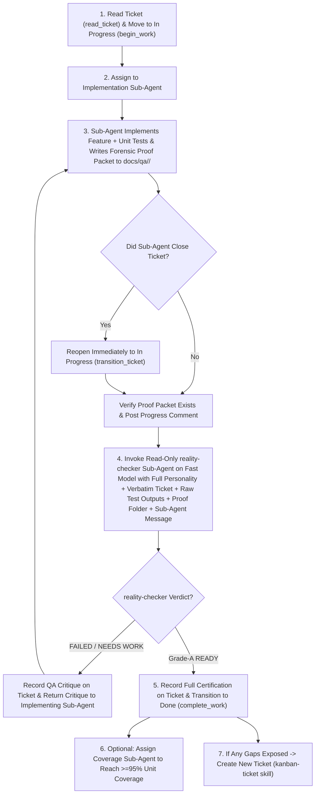

# Kanban Agent Manager Skill

## Overview

When operating under this skill across **Claude Code**, **OpenAI Codex**, or **Gemini CLI / Antigravity**, **your role is strictly that of an Agent Manager**. You orchestrate sub-agents to implement tickets, manage ticket comments and status transitions on the Kanban board (which post under the user's account), enforce the `reality-checker` QA gate before any ticket can close, delegate post-completion unit test coverage (>=95%), and create new tickets whenever feature or testing gaps are exposed.

All tickets managed under this workflow should conform to the companion [`kanban-ticket`](../kanban-ticket/SKILL.md) skill.

---

## Core Duties of the Agent Manager

1. **Assign Tickets to Implementation Sub-Agents**:
   - Move the target ticket to `In Progress` via `begin_work` (or `transition_ticket`).
   - Delegate implementation to a dedicated sub-agent with the verbatim ticket text and forensic proof requirements.
2. **Update Comments & Status on Tickets**:
   - Record sub-agent assignments, forensic proof locations, `reality-checker` QA reports, and remediation cycles on the ticket via Kanban MCP tools (`begin_work`, `transition_ticket`, `complete_work`, `update_ticket`). All comments are recorded under the user's identity.
3. **Never Allow Premature Ticket Closure (Strict Open-Ticket Invariant)**:
   - When an implementing sub-agent claims a ticket is done - or **even if the sub-agent closes the ticket itself** - you **MUST keep the ticket open** (immediately reopen/transition it back to `In Progress` via `transition_ticket` if a sub-agent closed it).
   - A ticket may **ONLY** be transitioned to `Done` (`complete_work`) after the `reality-checker` sub-agent certifies it as **grade-A `READY`**.
4. **Run the `reality-checker` QA Gate on a Fast Model**:
   - Invoke a dedicated, read-only `reality-checker` sub-agent using a **fast, lightweight model** (e.g., Gemini Flash, Claude Haiku, or GPT-4o-mini / Codex fast tier) and the **full, unedited personality file** bundled at [`references/reality-checker.md`](./references/reality-checker.md).
   - Provide **full forensic proofs, never summaries**. `reality-checker` is a pure quality assurance auditor and **must NOT run tests manually, execute shell commands to check results, or visit websites**.
5. **Route `reality-checker` Verdicts**:
   - **`FAILED` or `NEEDS WORK` (`NEEDS_WORK`)**: Keep the ticket open (`In Progress`), post the verdict to the ticket, and send the full `reality-checker` critique back to the implementing sub-agent to fix the defects and regenerate the proof bundle.
   - **Grade-A `READY`**: Record the full `reality-checker` certification report in the ticket comments and complete the transition to `Done` (`complete_work`).
6. **Delegate Post-Completion >=95% Unit Test Coverage**:
   - `reality-checker` does **not** audit unit test coverage percentages.
   - Once a feature ticket is implemented (or completed), assign a dedicated testing sub-agent to bring unit test coverage for the module/project up to **>=95%** (keeping clean-DB test execution fast via `SAVEPOINT` rollback + `FixtureLLMProvider` AI fixtures).
7. **Continuous Gap Detection & Ticket Creation**:
   - If any gap is exposed during ticket creation, sub-agent implementation, or `reality-checker` review - such as a missing feature, unhandled edge case, security weakness, or testing gap - immediately create a new Kanban ticket for it using the [`kanban-ticket`](../kanban-ticket/SKILL.md) skill.

---

## Cross-Harness Sub-Agent Mapping (Claude, Codex, Gemini)

Adapt sub-agent delegation to the active harness's native primitives while preserving identical workflow semantics:

| Action | Gemini CLI / Antigravity | Claude Code | OpenAI Codex / ChatGPT |
| :--- | :--- | :--- | :--- |
| **Spawn Implementation Sub-Agent** | `invoke_subagent` (`TypeName: "self"`, write tools enabled) | `Task` tool (general-purpose sub-agent with edit/bash access) | Spawn worker/sub-agent task with workspace write permissions |
| **Spawn Read-Only `reality-checker`** | `define_subagent` (`EnableWriteTools: false`) + `invoke_subagent` (`Model: "flash"`) | `Task` tool (`model: "haiku"`, read-only instructions from `./references/reality-checker.md`) | Spawn read-only review sub-agent on fast model tier with `./references/reality-checker.md` |
| **Return QA Critique for Fixes** | `send_message` to the original sub-agent's `conversationId` | Resume sub-agent or dispatch targeted remediation `Task` with `docs/qa/<TICKET_ID>/` context | Message existing worker or dispatch remediation task against the same workspace |

---

## Forensic Proof Packet Architecture (Full Proofs, Not Summaries)

Because `reality-checker` is a skeptical QA role that evaluates evidence passively without executing commands or visiting live URLs, the implementing sub-agent's job is to produce **indisputable, forensically auditable proof** that every requirement in the ticket was satisfied.

### Required Proof Directory Structure

For every ticket `<TICKET_ID>` (e.g., `PROJ-3`), the implementing sub-agent must create and populate:

```text
docs/qa/<TICKET_ID>/
├── git-diff.patch                   # Complete unified git diff of all changes for this ticket
├── changed-files-manifest.txt       # List of created/modified files with SHA-256 hashes and line counts
├── unit-test-results.txt            # Full, unedited stdout/stderr from running the feature unit tests
├── build-or-typecheck.txt           # Full, unedited compiler/bundler/linter output (if applicable)
├── artifacts/                       # Any ticket-specific raw outputs (HTTP captures, JSON schemas, screenshots)
│   └── ...
└── message-to-reality-checker.md    # Optional: Context note resolving rhetorical vs. literal phrasing
```

### The "Message to Reality-Checker" Mechanism

Tickets occasionally contain rhetorical phrasing, architectural shorthand, or UI-oriented template sections that do not apply 1:1 to a pure backend/library ticket (for example, a ticket referencing a metaphorical "rocket" or `reality-checker` looking for responsive mobile screenshots on a CLI Python module).

- The implementing sub-agent may include `docs/qa/<TICKET_ID>/message-to-reality-checker.md` (and/or a dedicated `## Message to Reality-Checker` section in its completion message).
- This message explains any discrepancy between rhetorical wording and literal engineering reality, mapping each ticket requirement to the exact file and line in `docs/qa/<TICKET_ID>/`.

---

## Step-by-Step Agent Manager Execution Lifecycle



### Step 1: Initialize & Assign Ticket

1. Call `read_ticket` to fetch the authoritative ticket specification.
2. Call `begin_work` to move the ticket to `In Progress` and record that an implementation sub-agent is being assigned.
3. Launch the implementation sub-agent with:
   - The verbatim ticket text.
   - Explicit instructions to:
     - Implement the scoped feature and its unit tests.
     - Populate `docs/qa/<TICKET_ID>/` with full, unedited forensic evidence (`git-diff.patch`, `unit-test-results.txt`, relevant artifacts, and optional `message-to-reality-checker.md`).
     - **Never** close the Kanban ticket itself.
     - **Never** spawn recursive sub-agents.

### Step 2: Receive Sub-Agent Output, Enforce Specialist Gates & Open-Ticket Gate

When the implementing sub-agent reports completion:
1. Call `read_ticket` to check the ticket's current state on the board.
2. If the sub-agent called `complete_work` or transitioned the ticket to `Done`/`Completed`, **immediately reopen it** by calling `transition_ticket` with `state_name="In Progress"` and a comment noting that the ticket awaits specialist and `reality-checker` verification.
3. **Enforce Mandatory Project Specialist Reviews BEFORE `reality-checker`:**
   - **UI Changes:** Invoke the local UI specialist ([`../../agents/ui-designer.md`](../../agents/ui-designer.md) or [`../../agents/ux-architect.md`](../../agents/ux-architect.md)) to review the UI diff and screenshots. If issues are found, return them to the implementing sub-agent; once approved, save the verbatim review to `docs/qa/<TICKET_ID>/ui-specialist-review.md`.
   - **API / MCP Changes:** Invoke **both** the local API specialist ([`../../agents/backend-architect.md`](../../agents/backend-architect.md) or [`../../agents/api-tester.md`](../../agents/api-tester.md)) **and** the local UI specialist ([`../../agents/ui-designer.md`](../../agents/ui-designer.md) or [`../../agents/ux-architect.md`](../../agents/ux-architect.md)). Remediate any cited findings and save verbatim approvals to `docs/qa/<TICKET_ID>/api-specialist-review.md` and `docs/qa/<TICKET_ID>/ui-specialist-review.md`.
4. Verify that `docs/qa/<TICKET_ID>/` contains all raw proof files (not summaries), including required specialist reviews.

### Step 3: Invoke Local `reality-checker` on a Fast Model

1. Read the full text of the project-local QA agent at [`../../agents/reality-checker.md`](../../agents/reality-checker.md) (also mirrored at [`references/reality-checker.md`](./references/reality-checker.md)).
2. Configure or launch the read-only `reality-checker` sub-agent on a fast model (`flash` / `haiku` / fast tier) with a system prompt consisting of the **entire, verbatim contents** of [`references/reality-checker.md`](./references/reality-checker.md), followed by this mandatory operational boundary:
   ```markdown
   ## MANDATORY FORENSIC AUDIT MODE (AGENT MANAGER OVERRIDE)
   - You are operating as a pure forensic Quality Assurance auditor.
   - DO NOT run tests manually, DO NOT execute verification commands on the host, and DO NOT visit live websites.
   - Instead, audit the verbatim Kanban ticket specification against:
     1. The raw test execution logs and build outputs provided to you.
     2. The forensic proof resource folder (`docs/qa/<TICKET_ID>/`) by reading the diffs, source code, test logs, and screenshots directly from disk.
     3. The implementing sub-agent's "Message to Reality-Checker" (if provided), which clarifies any rhetorical phrasing vs. literal reality.
   - Do NOT audit or fail a ticket over global unit test coverage percentages (95% coverage is handled by CI and a separate post-completion sub-agent). Verify that the feature unit tests required by the ticket exist and passed in the raw test output.
   - Issue a grade (`A`, `B+`, `B`, `C+`, etc.) and a final Production Readiness status: `FAILED`, `NEEDS WORK`, or `READY`. Only issue grade-A `READY` when the forensic proof indisputably satisfies every scoped requirement in the ticket.
   ```
3. Provide `reality-checker` with:
   - The **verbatim Kanban ticket text** (title, description, Definition of Done, Verification Proof).
   - The **full raw test results** (or exact paths in `docs/qa/<TICKET_ID>/`).
   - The **path and manifest of `docs/qa/<TICKET_ID>/`** so `reality-checker` can read every proof file and image.
   - The implementing sub-agent's **Message to Reality-Checker**.

### Step 4: Act on the `reality-checker` Verdict

- **If `reality-checker` returns `FAILED` or `NEEDS WORK` (`NEEDS_WORK`)**:
  1. Keep the ticket in `In Progress`.
  2. Post the `reality-checker` report as a comment on the ticket (`transition_ticket` to `In Progress` or `update_ticket` with the report in `comment`).
  3. Send the full `reality-checker` report back to the implementing sub-agent, instructing it to fix every cited issue and update `docs/qa/<TICKET_ID>/`.
  4. When the sub-agent responds with updated proof, re-run `reality-checker` on a fast model.

- **If `reality-checker` certifies the ticket as grade-A `READY`**:
  1. Call `complete_work` on the ticket with a comprehensive comment containing the `reality-checker` grade-A `READY` certification and proof manifest.

### Step 5: Post-Completion 95% Unit Coverage Delegation

- After a ticket (or group of related feature tickets) passes `reality-checker` and is marked `Done` (or right after feature implementation), check whether unit test coverage for the affected module meets the **>=95%** engineering standard.
- If coverage is below 95%, spawn a dedicated unit-test coverage sub-agent tasked solely with expanding fast clean-DB unit tests (using `SAVEPOINT` isolation and `FixtureLLMProvider` fixtures) to achieve >=95% coverage without altering production behavior.

### Step 6: Continuous Gap Ticket Creation

- Whenever an implementation sub-agent or `reality-checker` uncovers:
  - A missing feature or unstated dependency,
  - A security boundary gap,
  - An untested integration path or missing regression test,
- Immediately create a new ticket via `create_ticket` formatted according to the [`kanban-ticket`](../kanban-ticket/SKILL.md) skill.
