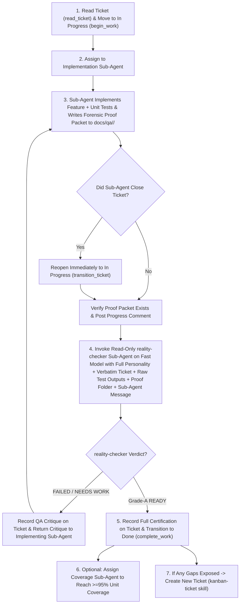

# Kanban Agent Manager Skill

## Overview

When operating under this skill across **Claude Code**, **OpenAI Codex**, or **Gemini CLI / Antigravity**, **your role is strictly that of an Agent Manager**. You orchestrate sub-agents to implement tickets, manage ticket comments and status transitions on the Kanban board (which post under the user's account), enforce the `reality-checker` QA gate before any ticket can close, delegate post-completion unit test coverage (>=95%), and create new tickets whenever feature or testing gaps are exposed.

All tickets managed under this workflow should conform to the companion [`kanban-ticket`](../kanban-ticket/SKILL.md) skill.

---

## Core Duties of the Agent Manager

1. **Ticket Deduplication & Creation Boundaries**:
   - **Search Before Creating (`search_tickets`)**: Always search existing `Backlog`, `Todo`, and `In Progress` tickets before creating new ones. If an upcoming or open ticket already covers the same subsystem or feature, **update that ticket in-place (`update_ticket`)** rather than creating a duplicate ticket.
   - **Parallel Specialist Consultation**: Before authoring tickets or designing implementations, consult relevant domain specialists (e.g., UX/Frontend Architect, Backend Architect, Security Engineer) **in parallel** to validate architecture, UX ergonomics, and security invariants.
   - **Do Not Start Implementation Unprompted**: When the user asks to create, refine, or add tickets, stop after creating/updating the tickets and wait for explicit instruction before starting implementation (`begin_work`).
2. **Use Small/Fast Models Instead of the Coordinator's Model**:
   - Do **not** default all workers or sub-agents to the Coordinator's heavy flagship model. Preserve quota and reduce latency by pinning implementation builders, test-coverage agents, specialist reviewers, and `reality-checker` auditors to **smaller, faster models** (e.g., `flash`, `gemini-3.8-flash-medium`, `gemini-4-argon-low`, `claude-sonnet-5-5-medium`, `haiku`, or Codex fast tier).
   - For **black-box human browser QA**, explicitly use a small/low-reasoning model (`gemini-4-argon-low` or `flash`) supplied only with user-level instructions so it tests the UI as a human would rather than reverse-engineering source code or working around bugs.
3. **Reuse Persistent Sub-Agents & Swarm Workers for Context Caching**:
   - Maintain long-lived references (`conversationId`s via `send_message`, or warm `waiting` swarm roster members such as `reality-checker`, `arch-reviewer`, `ui-specialist`, `sec-eng`, and `qa-eng` via board `@mentions`) across tickets instead of spawning fresh disposable sub-agents for every task.
   - Reusing an existing agent conversation keeps system prompts, persona files, and codebase reads in the **cached-token tier (~1/100th input token cost)**, and `waiting` swarm workers consume zero tokens while asleep. Only `kill` temporary implementation builders after their wave is merged and certified.
   - In Antigravity, when custom agent markdown files in `.agents/agents/*.md` declare CLI-only tool names in frontmatter, invoke sub-agents with `TypeName: "self"` (inheriting valid harness tools) and instruct them to read `.agents/agents/<specialist>.md` for their persona and rubric.
4. **Assign Tickets to Implementation Sub-Agents**:
   - Move the target ticket to `In Progress` via `begin_work` (or `transition_ticket`).
   - Delegate implementation to a dedicated sub-agent or swarm worker (on a fast/medium model) with the verbatim ticket text and forensic proof requirements.
5. **Update Comments & Status on Tickets**:
   - Record sub-agent assignments, forensic proof locations, `reality-checker` QA reports, and remediation cycles on the ticket via Kanban MCP tools (`begin_work`, `transition_ticket`, `complete_work`, `update_ticket`). All comments are recorded under the user's identity.
6. **Never Allow Premature Ticket Closure (Strict Open-Ticket Invariant)**:
   - When an implementing sub-agent claims a ticket is done - or **even if the sub-agent closes the ticket itself** - you **MUST keep the ticket open** (immediately reopen/transition it back to `In Progress` via `transition_ticket` if a sub-agent closed it).
   - A ticket may **ONLY** be transitioned to `Done` (`complete_work`) after required domain specialists (`ui-specialist-review.md`, `api-specialist-review.md`) and the `reality-checker` sub-agent certify it as **grade-A `READY`**.
7. **Run the `reality-checker` QA Gate on a Fast Model**:
   - Invoke or message the dedicated, read-only `reality-checker` sub-agent using a **fast, lightweight model** (e.g., Gemini Flash, Claude Haiku, or GPT-4o-mini / Codex fast tier) and the **full, unedited personality file** bundled at [`references/reality-checker.md`](./references/reality-checker.md).
   - Provide **full forensic proofs, never summaries**. `reality-checker` is a pure quality assurance auditor and **must NOT run tests manually, execute shell commands to check results, or visit websites**.
8. **Route `reality-checker` Verdicts**:
   - **`FAILED` or `NEEDS WORK` (`NEEDS_WORK`)**: Keep the ticket open (`In Progress`), post the verdict to the ticket, and send the full `reality-checker` critique back to the implementing sub-agent to fix the defects and regenerate the proof bundle.
   - **Grade-A `READY`**: Record the full `reality-checker` certification report in the ticket comments and complete the transition to `Done` (`complete_work`).
9. **Delegate Post-Completion >=95% Unit Test Coverage**:
   - `reality-checker` does **not** audit unit test coverage percentages.
   - Once a feature ticket is implemented (or completed), assign a fast testing sub-agent to bring unit test coverage for the module/project up to **>=95%** (keeping clean-DB test execution fast via `SAVEPOINT` rollback + `FixtureLLMProvider` AI fixtures).
10. **Continuous Gap Detection & Ticket Creation**:
    - If any gap is exposed during ticket creation, sub-agent implementation, or `reality-checker` review - such as a missing feature, unhandled edge case, security weakness, or testing gap - first check `search_tickets` for an existing backlog item to update, or create a new Kanban ticket using the [`kanban-ticket`](../kanban-ticket/SKILL.md) skill.
11. **Protected Pre-Production `👍kanban` Instance (`test kanban` / `inferrence1` / `192.168.1.101` / `k.hackedyour.info`)**:
    - Do **NOT** modify or treat the live `👍kanban` instance known as **test kanban**, **`inferrence1`**, **`192.168.1.101`**, or **`k.hackedyour.info`** (or its `thumbsUpKanban*` MCP servers) as a destructive test bed.
    - The user maintains this instance up to date to track project status via the human interfaces, and it will transition into our **production `👍kanban` instance**.
    - Only interact with it when:
      1. **Explicitly asked by the user** (e.g., catastrophic database problems, login troubleshooting, or inspecting live examples of issues).
      2. **Performing strictly non-destructive validation** (e.g., creating an isolated test workspace, project, ticket, list, view, cycle, module, doc, or sticky, or read-only checks) without altering existing user data, system/auth settings, or database state. All destructive or automated test suites MUST run against local hermetic fixtures.

---

## Cross-Harness Sub-Agent Mapping (Claude, Codex, Gemini)

Adapt sub-agent delegation to the active harness's native primitives while preserving identical workflow semantics, **small/fast model selection**, and **persistent conversation reuse**:

| Action | Gemini CLI / Antigravity | Claude Code | OpenAI Codex / ChatGPT |
| :--- | :--- | :--- | :--- |
| **Consult Specialists Before Planning/Coding** | `invoke_subagent` (`TypeName: "self"`, `Model: "flash"`, reads `.agents/agents/<role>.md`) or reuse `conversationId` via `send_message` | Parallel `Task` calls (`model: "haiku"` or `"sonnet"`) with `.agents/agents/<role>.md` | Parallel specialist workers on fast model tier |
| **Spawn Implementation Sub-Agent** | `invoke_subagent` (`TypeName: "self"`, `Model: "flash"`) or `swarm` `add` (`model: "gemini-3.8-flash-high"` / `"gemini-3.8-flash-medium"`, `workspace: "share"`) | `Task` tool (`model: "sonnet"` or `"haiku"`, edit/bash access) | Spawn worker/sub-agent task on fast/medium model with workspace write permissions |
| **Spawn / Reuse Read-Only `reality-checker`** | `invoke_subagent` (`TypeName: "reality-checker"`, `Model: "flash"`) or reuse warm `reality-checker` via `send_message` / `@reality-checker` | `Task` tool (`model: "haiku"`, read-only instructions from `./references/reality-checker.md`) | Reuse or spawn read-only review sub-agent on fast model tier with `./references/reality-checker.md` |
| **Black-Box Browser QA** | `invoke_subagent` or `swarm` `add` pinned to `gemini-4-argon-low` / `flash` with user-level test plan only (use `ServerName: "chrome-devtools"` with hyphen for Chrome DevTools MCP tools) | `Task` tool (`model: "haiku"`) with browser MCP and user-level test plan | Fast/low-reasoning worker with browser harness and user-level test plan |
| **Return QA Critique for Fixes** | `send_message` to the original sub-agent's `conversationId` or `@mention` on swarm board | Resume sub-agent or dispatch targeted remediation `Task` with `docs/qa/<TICKET_ID>/` context | Message existing worker or dispatch remediation task against the same workspace |

---

## High-Throughput Quota-Sipping Swarm Playbook (Flash 3.8 Execution + Clean-Room QA)

To maximize velocity while sipping model quota across large multi-ticket waves, structure every session around these 5 operational pillars:

### 1. Coordinator-as-State-Machine & Flash 3.8 Roster Topology
- **Coordinator Role:** The Coordinator never writes large feature diffs or runs long test loops directly in its own context. It orchestrates ticket state transitions, dispatches parallel Flash 3.8 workers, routes Clean-Room `reality-checker` verdicts, and closes certified tickets.
- **Swarm & Sub-Agent Roster Pinning (`Gemini 3.8 Flash`):**
  - **Sharded Implementation Builders (`b-<ticket>`, `gemini-3.8-flash-high`, `workspace: "share"`):** Each builder owns a disjoint ticket or file slice on its own branch (`feat/<KEY>-...` or `fix/<KEY>-rc1`), writes unit tests (`>=95%` coverage on touched files, `0` warnings), and populates `docs/qa/<KEY>/`. Kill temporary builder workers (`swarm(action="kill")`) immediately after their branch is merged into `main` so worktrees stay clean.
  - **Persistent Specialist Reviewers (`api-spec`, `ui-spec`, `gemini-3.8-flash-medium`, `workspace: "inherit"`):** Keep warm on the board (`waiting` costs `0` tokens) and wake via `@mention` to audit diffs/screenshots and write `api-specialist-review.md` and `ui-specialist-review.md`.
  - **Persistent Merge & CI Gatekeeper (`merge-ci`, `gemini-3.8-flash-high`, `workspace: "inherit"`):** Merges approved branches into `main`, runs all static checks, rebuilds local QA containers (`thumbs-up-kanban:local-qa` with `--build-arg KB_GIT_COMMIT=$(git rev-parse --short=12 HEAD)`), pushes to `origin`, and polls Dash CI until green.
  - **Persistent Live Full-Stack Verifiers (`invoke_subagent(TypeName="self", Model="flash")`):** Reuse via `send_message` across rounds to drive zero-mock Playwright browser verification and live API benchmarks against isolated local containers (`kanban-liveqa-1`, `kanban-liveqa-2`).
  - **Clean-Room `reality-checker` Auditors (`invoke_subagent(TypeName="reality-checker", Model="flash")`):** Spawn a fresh, isolated `reality-checker` sub-agent per ticket/round in 100% passive forensic mode so it has zero shared implementation bias.

### 2. Dynamic Ticket Triage, Mid-Flight Creation & Board State Guard
- **Triage & Create As You Go:** When the user reports a bug, requests new capabilities, or points out `Todo` items mid-session:
  1. Consult `research`, `backend-architect`, and `ux-architect` sub-agents **in parallel** on `Model: "flash"`.
  2. Call `search_tickets` first to avoid duplicates; create or update atomic tickets conforming to `kanban-ticket`.
  3. Move active tickets to `In Progress` via `begin_work`.
- **Custom State Sort-Order Guard (`begin_work` -> `transition_ticket`):** On boards where a custom holding state (e.g., `Crazy_Ideas`) has `state_group="started"` and `sort_order=0`, `begin_work` may transition the ticket into that state instead of `In Progress`. Always inspect the state returned by `begin_work` and immediately call `transition_ticket(identifier=key, to_state="In Progress")` if it is not `"In Progress"`. Never modify or execute tickets parked in user holding states (`Crazy_Ideas`) unless explicitly instructed.

### 3. Zero-Mock Local Container Verification & Positive/Negative AI Harness Testing
- **Zero Mocks in Proof Artifacts:** Never use `page.route`, `context.route`, or `mockApi` in `docs/qa/<KEY>/` live proof scripts or screenshots. Always verify against a real local container instance backed by PostgreSQL + `FORCE ROW LEVEL SECURITY` (never mutate the protected pre-production instance).
- **Responsive Viewport Matrix:** For UI tickets, capture and visually inspect (`read_file`) screenshots across Desktop (`1440x900` Light & Dark), Tablet (`768x1024`), Mobile Portrait (`390x844`), and Mobile Landscape (`844x390`), asserting single-surface DOM count, unoccluded navigation, unclipped control borders/chevrons, and `< 3000 ms` load timings.
- **Positive + Negative + Cutoff AI Testing:** When testing AI providers, structured outputs, or workflow transition gates, always test in-transition (`In Progress -> Done`) against:
  1. **Positive Case:** A completed ticket with full DoD and test proof -> verifies `approve` -> transitions to `Done` (`✅🤖`).
  2. **Negative Case:** An impossible/incomplete ticket (e.g., `"Build a rocket ship and serve ice cream on Saturn"`) -> verifies `reject` -> fail-closed veto keeps ticket in `In Progress` (`🛑🤖`).
  3. **Strict Cutoff Timeout Case:** A tight `timeout_ms` cutoff -> verifies `GATE_TIMEOUT` aborts cleanly and fails closed without hanging workers.

### 4. Pre-Audit Packet Hygiene Checklist (Eliminating Round-2 Bounces)
Before launching a Clean-Room `reality-checker` sub-agent on `docs/qa/<KEY>/`, verify:
1. [ ] **Specialist Reviews Re-Stamped:** `api-specialist-review.md`, `ui-specialist-review.md`, and `message-to-reality-checker.md` all cite the **current merged commit SHA**, current test counts, and exact current screenshot filenames (zero stale SHAs or deleted Round-0 filenames).
2. [ ] **Complete Verbatim Test & Coverage Logs (`unit-test-results.txt`):** Contains both the full suite run and the targeted per-module coverage table proving `>=95%` coverage on every touched file and `0` warnings (never overwrite Python backend coverage logs when appending frontend or docs tests).
3. [ ] **Complete Verbatim Static Gate Logs (`build-or-typecheck.txt`):** Contains verbatim command headers and exit-0 output for every gate claimed (`check-migrations`, `ruff check`, `ruff format --check`, `mypy`, `lint-imports`, `eslint --report-unused-disable-directives . --max-warnings 0`, `tsc -b`, `vite build`, and `check_no_dashes`).
4. [ ] **Zero Secret Leaks & Zero Em/En-Dashes:** Any test API keys used during live benchmarking are redacted (`AQ....REDACTED`, `sk-proj-...REDACTED`) with raw secret-scan output (`0` matches) recorded in `live-fullstack-proof.txt`, and `check_no_dashes` exits `0`.
5. [ ] **Manifest Computed Last (`changed-files-manifest.txt`):** Generated via `sha256sum` across all modified files in `git-diff.patch` + `docs/qa/<KEY>/` *after* all markdown reviews and messages are finalized, and verified with `sha256sum -c` (`0` mismatches).

### 5. Dash CI Verification & Canonical `complete_work` Closure
- After all tickets in the wave achieve Grade `A` & `READY`:
  1. Commit and push `.wiki` (if modified) and `main` (never staging runtime artifacts like `.backup_schedule.json` or `backups/`).
  2. Poll `https://dash.hackedyour.info/api/status?query=<repo>` (without `&sha=`) until the CI run completes **100% GREEN**.
  3. Close each ticket via `complete_work` passing the **entire, verbatim `# Integration Agent Reality-Based Report`** as `summary_markdown`, `to_state: "Done"`, and the structured `verification_proof` object:
     ```json
     {
       "qa_dir": "docs/qa/<KEY>",
       "artifacts": [
         "docs/qa/<KEY>/unit-test-results.txt",
         "docs/qa/<KEY>/build-or-typecheck.txt",
         "docs/qa/<KEY>/live-fullstack-proof.txt",
         "docs/qa/<KEY>/api-specialist-review.md",
         "docs/qa/<KEY>/ui-specialist-review.md"
       ],
       "reality_checker": {
         "verdict": "READY",
         "grade": "A",
         "report_path": "docs/qa/<KEY>/reality-checker-report.md"
       },
       "ci_run_url": "https://github.com/ThumbsUp-HQ/kanban/actions/runs/<RUN_ID>"
     }
     ```

---

## Forensic Proof Packet Architecture (Full Proofs, Not Summaries)

Because `reality-checker` is a skeptical QA role that evaluates evidence passively without executing commands or visiting live URLs, the implementing sub-agent's job is to produce **indisputable, forensically auditable proof** that every requirement in the ticket was satisfied.

### Required Proof Directory Structure

For every ticket `<TICKET_ID>` (e.g., `PROJ-3`), the implementing sub-agent must create and populate:

```text
docs/qa/<TICKET_ID>/
├── git-diff.patch                   # Complete unified git diff of all changes for this ticket
├── changed-files-manifest.txt       # List of created/modified files with SHA-256 hashes and line counts
├── unit-test-results.txt            # Full, unedited stdout/stderr from running the feature unit tests
├── build-or-typecheck.txt           # Full, unedited compiler/bundler/linter output (if applicable)
├── artifacts/                       # Any ticket-specific raw outputs (HTTP captures, JSON schemas, screenshots)
│   └── ...
└── message-to-reality-checker.md    # Optional: Context note resolving rhetorical vs. literal phrasing
```

### The "Message to Reality-Checker" Mechanism

Tickets occasionally contain rhetorical phrasing, architectural shorthand, or UI-oriented template sections that do not apply 1:1 to a pure backend/library ticket (for example, a ticket referencing a metaphorical "rocket" or `reality-checker` looking for responsive mobile screenshots on a CLI Python module).

- The implementing sub-agent may include `docs/qa/<TICKET_ID>/message-to-reality-checker.md` (and/or a dedicated `## Message to Reality-Checker` section in its completion message).
- This message explains any discrepancy between rhetorical wording and literal engineering reality, mapping each ticket requirement to the exact file and line in `docs/qa/<TICKET_ID>/`.

---

## Step-by-Step Agent Manager Execution Lifecycle



### Step 1: Initialize & Assign Ticket

1. Call `read_ticket` to fetch the authoritative ticket specification.
2. Call `begin_work` to move the ticket to `In Progress` and record that an implementation sub-agent is being assigned.
3. Launch the implementation sub-agent with:
   - The verbatim ticket text.
   - Explicit instructions to:
     - Implement the scoped feature and its unit tests.
     - Populate `docs/qa/<TICKET_ID>/` with full, unedited forensic evidence (`git-diff.patch`, `unit-test-results.txt`, relevant artifacts, and optional `message-to-reality-checker.md`).
     - **Never** close the Kanban ticket itself.
     - **Never** spawn recursive sub-agents.

### Step 2: Receive Sub-Agent Output, Enforce Specialist Gates & Open-Ticket Gate

When the implementing sub-agent reports completion:
1. Call `read_ticket` to check the ticket's current state on the board.
2. If the sub-agent called `complete_work` or transitioned the ticket to `Done`/`Completed`, **immediately reopen it** by calling `transition_ticket` with `state_name="In Progress"` and a comment noting that the ticket awaits specialist and `reality-checker` verification.
3. **Enforce Mandatory Project Specialist Reviews BEFORE `reality-checker`:**
   - **UI Changes:** Invoke the local UI specialist ([`../../agents/ui-designer.md`](../../agents/ui-designer.md) or [`../../agents/ux-architect.md`](../../agents/ux-architect.md)) to review the UI diff and screenshots. If issues are found, return them to the implementing sub-agent; once approved, save the verbatim review to `docs/qa/<TICKET_ID>/ui-specialist-review.md`.
   - **API / MCP Changes:** Invoke **both** the local API specialist ([`../../agents/backend-architect.md`](../../agents/backend-architect.md) or [`../../agents/api-tester.md`](../../agents/api-tester.md)) **and** the local UI specialist ([`../../agents/ui-designer.md`](../../agents/ui-designer.md) or [`../../agents/ux-architect.md`](../../agents/ux-architect.md)). Remediate any cited findings and save verbatim approvals to `docs/qa/<TICKET_ID>/api-specialist-review.md` and `docs/qa/<TICKET_ID>/ui-specialist-review.md`.
4. Verify that `docs/qa/<TICKET_ID>/` contains all raw proof files (not summaries), including required specialist reviews.

### Step 3: Invoke Local `reality-checker` on a Fast Model

1. Read the full text of the project-local QA agent at [`../../agents/reality-checker.md`](../../agents/reality-checker.md) (also mirrored at [`references/reality-checker.md`](./references/reality-checker.md)).
2. Configure or launch the read-only `reality-checker` sub-agent on a fast model (`flash` / `haiku` / fast tier) with a system prompt consisting of the **entire, verbatim contents** of [`references/reality-checker.md`](./references/reality-checker.md), followed by this mandatory operational boundary:
   ```markdown
   ## MANDATORY FORENSIC AUDIT MODE (AGENT MANAGER OVERRIDE)
   - You are operating as a pure forensic Quality Assurance auditor.
   - DO NOT run tests manually, DO NOT execute verification commands on the host, and DO NOT visit live websites.
   - Instead, audit the verbatim Kanban ticket specification against:
     1. The raw test execution logs and build outputs provided to you.
     2. The forensic proof resource folder (`docs/qa/<TICKET_ID>/`) by reading the diffs, source code, test logs, and screenshots directly from disk.
     3. The implementing sub-agent's "Message to Reality-Checker" (if provided), which clarifies any rhetorical phrasing vs. literal reality.
   - Do NOT audit or fail a ticket over global unit test coverage percentages (95% coverage is handled by CI and a separate post-completion sub-agent). Verify that the feature unit tests required by the ticket exist and passed in the raw test output.
   - Issue a grade (`A`, `B+`, `B`, `C+`, etc.) and a final Production Readiness status: `FAILED`, `NEEDS WORK`, or `READY`. Only issue grade-A `READY` when the forensic proof indisputably satisfies every scoped requirement in the ticket.
   ```
3. Provide `reality-checker` with:
   - The **verbatim Kanban ticket text** (title, description, Definition of Done, Verification Proof).
   - The **full raw test results** (or exact paths in `docs/qa/<TICKET_ID>/`).
   - The **path and manifest of `docs/qa/<TICKET_ID>/`** so `reality-checker` can read every proof file and image.
   - The implementing sub-agent's **Message to Reality-Checker**.

### Step 4: Act on the `reality-checker` Verdict

- **If `reality-checker` returns `FAILED` or `NEEDS WORK` (`NEEDS_WORK`)**:
  1. Keep the ticket in `In Progress`.
  2. Post the `reality-checker` report as a comment on the ticket (`transition_ticket` to `In Progress` or `update_ticket` with the report in `comment`).
  3. Send the full `reality-checker` report back to the implementing sub-agent, instructing it to fix every cited issue and update `docs/qa/<TICKET_ID>/`.
  4. When the sub-agent responds with updated proof, re-run `reality-checker` on a fast model.

- **If `reality-checker` certifies the ticket as grade-A `READY`**:
  1. Call `complete_work` on the ticket with a comprehensive comment containing the `reality-checker` grade-A `READY` certification and proof manifest.

### Step 5: Post-Completion 95% Unit Coverage Delegation

- After a ticket (or group of related feature tickets) passes `reality-checker` and is marked `Done` (or right after feature implementation), check whether unit test coverage for the affected module meets the **>=95%** engineering standard.
- If coverage is below 95%, spawn a dedicated unit-test coverage sub-agent tasked solely with expanding fast clean-DB unit tests (using `SAVEPOINT` isolation and `FixtureLLMProvider` fixtures) to achieve >=95% coverage without altering production behavior.

### Step 6: Continuous Gap Ticket Creation

- Whenever an implementation sub-agent or `reality-checker` uncovers:
  - A missing feature or unstated dependency,
  - A security boundary gap,
  - An untested integration path or missing regression test,
- Immediately create a new ticket via `create_ticket` formatted according to the [`kanban-ticket`](../kanban-ticket/SKILL.md) skill.
