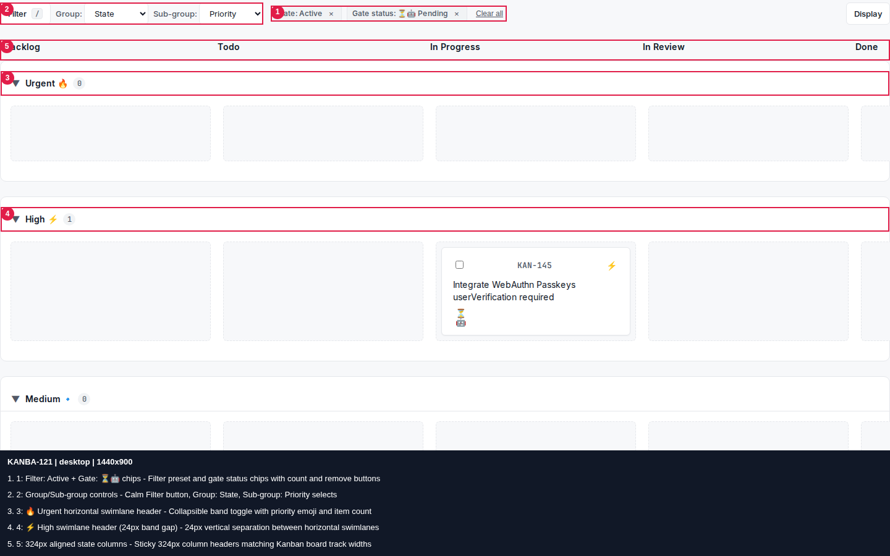
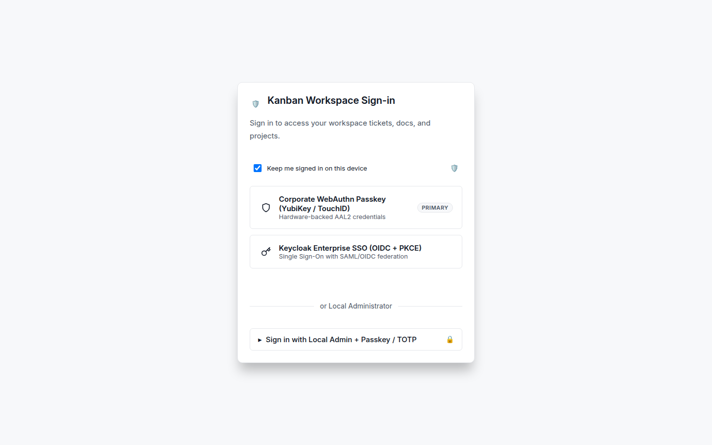
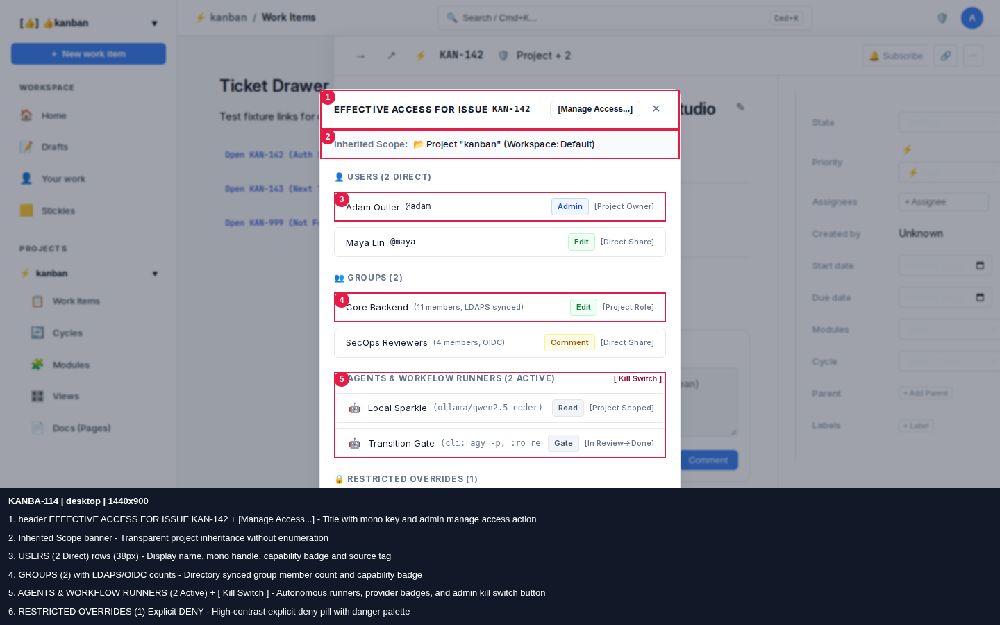
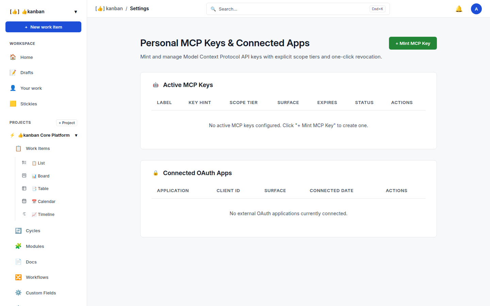
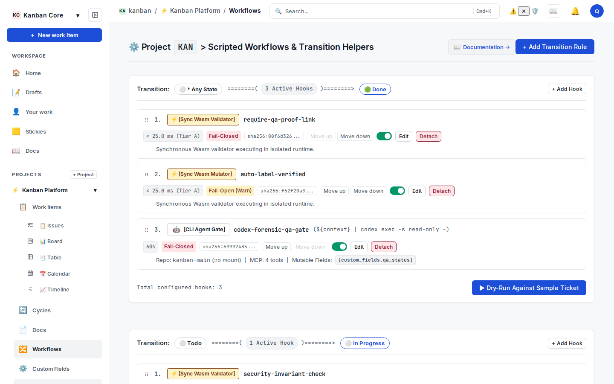
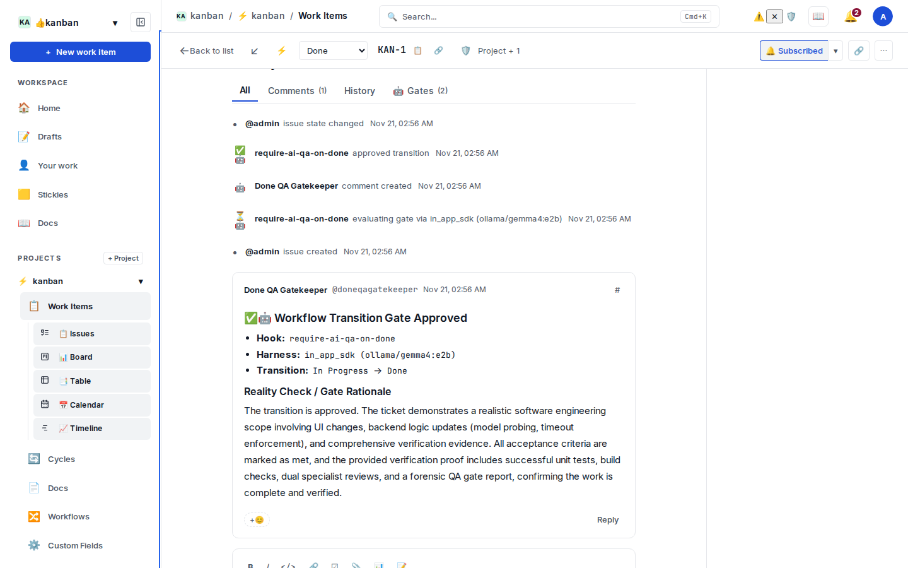
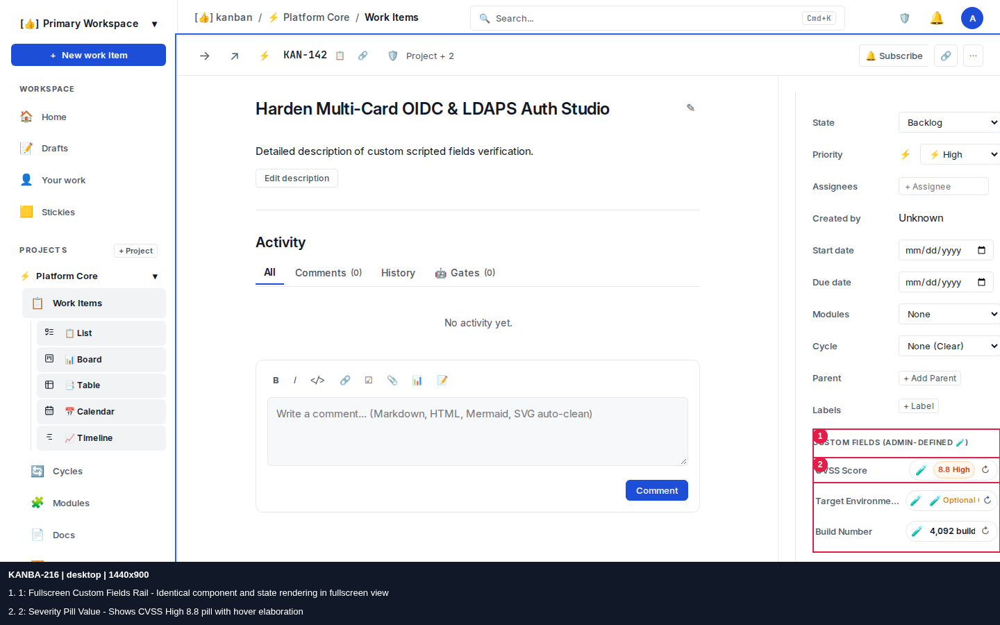
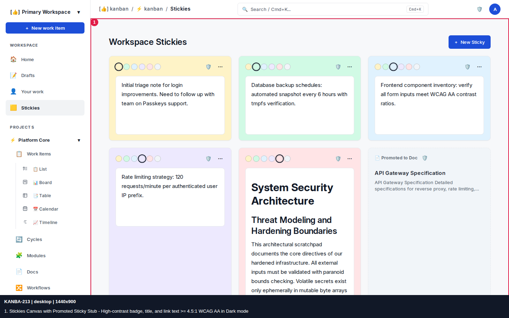
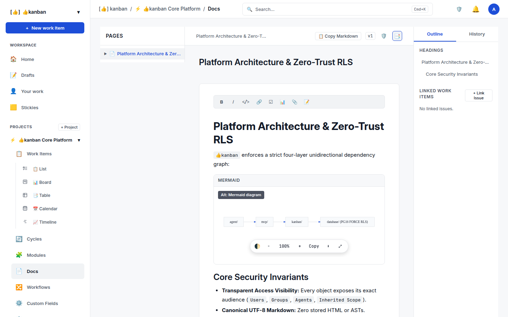
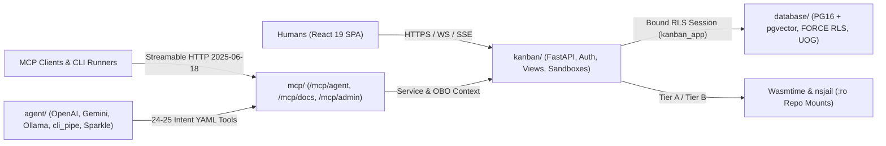

# 👍kanban

**The Apache-2.0, Zero-Trust Kanban Built for Humans and Coding Agents**

*Enterprise boards, hierarchical docs, and stickies backed by PostgreSQL `FORCE RLS`, 24 low-token MCP tools across 3 isolated surfaces, and zero SaaS AI paywalls.*

[](./LICENSE)
[](./pyproject.toml)
[](./docs/SECURITY.md)
[](https://github.com/ThumbsUp-HQ/kanban/wiki/Three-Surface-MCP-Server-Architecture)

Most issue trackers bolt AI onto a per-seat SaaS paywall and wrap 70 to 120+ REST endpoints into a context-burning MCP server. **👍kanban** (`thumbs-up-kanban`) flips the stack: **Security is Priority #0**, **Agent-First Ergonomics are Priority #1**, and **Breathable UI is Priority #2**. Run a full 5-view engineering workspace (`Board`, `List`, `Table`, `Calendar`, `Timeline`), `ltree` Docs, and Project Stickies in one `Apache-2.0` container with embedded PostgreSQL 16 + `pgvector`, Multi-Card OIDC/LDAPS/Passkeys, and native `OpenAI`, `Gemini`, `Ollama`, `Codex`, `Claude Code`, and `Antigravity` workflow gates.

[Quick Start (60s)](#quick-start-in-60-seconds) | [Full Start Guide (Wiki)](#full-start-guide-and-documentation) | [Feature Comparison](#features-comparison) | [Why Teams Switch](#why-teams-switch-to-kanban) | [Architecture](#system-architecture) | [Local Dev & CLI](#local-development-and-cli-validation)


*2D swimlane board (`State` x `Priority`) with active filter chips and a non-blocking `⏳🤖` agent transition gate on `KAN-145`.*

---

## Why You Need 👍kanban

- **Zero SaaS AI or SSO Paywalls:** Multi-Card `OIDC`, `LDAPS`, `WebAuthn` Passkeys, immutable audit logs, custom fields, and BYOK/local AI ship free in the `Apache-2.0` core.
- **No More MCP Context Collapse:** Instead of dumping 30,000 to 60,000+ schema tokens of raw REST wrappers into an LLM window, **24 intent-driven MCP tools** across **3 isolated surfaces** return compact YAML with `summary`, `standard`, and `full` LOD tiers (`>=78%` token reduction vs JSON).
- **Authorization Enforced in PostgreSQL, Not Just Middleware:** Every tenant table enforces `FORCE ROW LEVEL SECURITY` (`NOBYPASSRLS`), fails closed without bound session context, normalizes `404` responses to a 25ms timing floor, and exposes effective readers via the `🛡️` Access Inspector pill.
- **Boards, Docs, and Stickies in One Graph:** Issues, `ltree` Docs, and 6-color Project Stickies share one PostgreSQL Universal Object Graph storing canonical UTF-8 Markdown only, with 1-click ACL-preserving Sticky-to-Doc promotion (`💡📄`) and an automated 6-class Link Auditor.
- **Safe, Non-Blocking Agent Execution:** Run `agy -p`, `codex exec -s read-only -`, `gemini-cli`, or `claude-code` over read-only repository mounts via zero-shell `execve` stdin pipes, or hold workflow transitions on provisional async gates (`⏳🤖` -> `✅🤖` / `🛑🤖`) without locking human work.

---

## Quick Start in 60 Seconds

Launch the standalone all-in-one runtime with persistent PostgreSQL 16 + `pgvector` storage in one command:

```bash
docker run -d \
  --name thumbs-up-kanban \
  -p 8080:8080 \
  -v kanban_data:/var/lib/kanban/data \
  adamoutler/dash-dev:latest
```

### First-Boot Claim Flow (Zero Default Passwords)

👍kanban refuses to ship default `admin/admin` credentials and intentionally redacts the setup token (`[REDACTED:SETUP_TOKEN]`) from `docker logs` stdout.

1. **Wait for healthy startup** (embedded Unix-socket PostgreSQL 16 initializes automatically and Uvicorn drops to UID `65532` on port `8080`):
   ```bash
   docker logs -f thumbs-up-kanban
   ```
2. **Retrieve the single-use 256-bit claim token** (`kb_setup_*`, 60-minute TTL, written mode `0600`):
   ```bash
   docker exec thumbs-up-kanban cat /run/kanban/setup_token
   ```
3. **Complete `/setup` in your browser:**
   - Open `http://localhost:8080/setup` (or `http://localhost:8080/setup?token=<TOKEN>`).
   - Create the initial `SERVER_ADMIN` account (14+ character password minimum) and first workspace/project.
   - Enroll mandatory MFA (WebAuthn Passkey or TOTP authenticator) and store your 10 one-time recovery codes.

> **Deployment Accuracy Note:** `adamoutler/dash-dev:latest` runs this repository's `Dockerfile` `standalone` stage on port `8080` with persistent state (PostgreSQL `pgdata`, `0600` CSPRNG keyring, attachments, and backups) stored in `/var/lib/kanban/data`. Omitting `-v kanban_data:/var/lib/kanban/data` triggers an ephemeral storage warning in logs and the UI header. You can build the exact standalone image from source with `docker build -t adamoutler/dash-dev:latest .` (repository CI publishes `thumbs-up-kanban:latest`). Standalone is the turnkey single-container runtime today; for hardened 5-network production topology and encrypted `KBBAK1` promotion, see the [Full Start Guide on the Wiki](https://github.com/ThumbsUp-HQ/kanban/wiki/System-Topology-and-Multi-Container-Architecture).

---

## Full Start Guide and Documentation

Read the complete installation, authentication, MCP integration, and production operations manual in the **[👍kanban Project Wiki](https://github.com/ThumbsUp-HQ/kanban/wiki)**.

| Guide | What It Covers |
| :--- | :--- |
| **[Wiki Home & Onboarding](https://github.com/ThumbsUp-HQ/kanban/wiki/Home)** | Full start guide, UI tour, keyboard shortcuts, and architectural entry points |
| **[System Topology & Multi-Container Architecture](https://github.com/ThumbsUp-HQ/kanban/wiki/System-Topology-and-Multi-Container-Architecture)** | 5-network production isolation (`edge_net`, `app_net`, `data_net`, `sandbox_net`, `egress_llm_net`), Caddy TLS 1.3, and `Valkey 8` |
| **[Three-Surface MCP Server](https://github.com/ThumbsUp-HQ/kanban/wiki/Three-Surface-MCP-Server-Architecture) & [Tools Reference](https://github.com/ThumbsUp-HQ/kanban/wiki/MCP-Tools-Reference)** | `/mcp/agent`, `/mcp/docs`, `/mcp/admin`, OAuth 2.1 + PKCE `S256`, LOD YAML, and `mcp_read_taint` |
| **[Zero-Trust Security](https://github.com/ThumbsUp-HQ/kanban/wiki/Zero-Trust-Security-and-Access-Visibility) & [Multi-Card Auth Studio](https://github.com/ThumbsUp-HQ/kanban/wiki/Multi-Card-Authentication-Studio)** | PostgreSQL `FORCE RLS`, OIDC/OAuth2/LDAPS/Passkeys, AAL2 admin gates, and `🛡️` Access Inspector |
| **[Scripted Workflows & Transition Helpers](https://github.com/ThumbsUp-HQ/kanban/wiki/Scripted-Workflows-and-Transition-Helpers)** | Wasmtime validators, `nsjail` sandboxes, and `:ro` async agent transition gates |
| **[Production Promotion & Backup](https://github.com/ThumbsUp-HQ/kanban/wiki/Production-Promotion-and-Backup-Runbook) & [Migration Runbook](https://github.com/ThumbsUp-HQ/kanban/wiki/Migration-and-Cutover-Runbook)** | `kanban-ctl` AES-256-GCM `.kbbak` archives, standalone promotion, and importers |

---

## Features Comparison

Every Kanban board looks identical until you inspect who controls the auth cards, who pays the metered AI credit tax, and what happens when an autonomous agent opens 100 JSON tools.

**Legend:** `✅` Included in core | `🆓🔌` Free external add-on / separate server | `⚠️` Partial / capped / local-only / conditional | `💰` Paid per-seat tier | `💸` Extra product or metered usage credits | `❌` Not supported

| Capability | 👍kanban | Jira (Cloud) | Linear | Plane | GitHub Projects | Vibe Kanban |
| :--- | :--- | :--- | :--- | :--- | :--- | :--- |
| **License & Self-Hosting** | ✅ Apache-2.0 (Self-hosted) | ❌ Proprietary SaaS (1) | ❌ Cloud-only SaaS | ⚠️ AGPLv3 CE / Commercial | ⚠️ Proprietary (2) | ✅ Apache-2.0 (Local-first) (3) |
| **1-Command Standalone + Prod Stack** | ✅ Standalone PG16 (5-net Compose preview) (4) | ❌ Cloud-only | ❌ Cloud-only | ⚠️ Multi-container only | ❌ SaaS / GHES VM | ⚠️ Local CLI + SQLite |
| **OIDC, LDAPS & Passkey Auth** | ✅ Core (Multi-Card Studio) | 💸 Paid (Atlassian Guard) | 💰 SAML SSO Enterprise (Passkeys core) | 💰 Paid Commercial tiers | 💰 Enterprise ($21/seat) | ❌ Single-user local |
| **DB Tenant Isolation (`FORCE RLS`)** | ✅ Postgres `FORCE RLS` + 🛡️ Pill | ❌ App-layer RBAC | ❌ App-layer only | ❌ App-layer RBAC | ❌ Org/Repo ACLs | ❌ Local SQLite |
| **Immutable Audit Ledger** | ✅ Core (SHA-256 hash-chained) | 💸 Paid (Atlassian Guard) | 💰 Enterprise only | 💰 Paid Commercial tiers | 💰 Enterprise only | ❌ None |
| **MCP Server Architecture** | ✅ 3 Intent Surfaces (24 tools) | 🆓🔌 Rovo MCP (5) | ✅ Remote SaaS MCP | 🆓🔌 External (`~30` tools) | 🆓🔌 External (52 default) (6) | ✅ Built-in (`--mcp`) |
| **Token-Efficient LOD YAML & 2-Stage Delete** | ✅ Core (`>=78%` cut, blast-hash) | ❌ JSON / single-step | ❌ JSON / single-step | ❌ JSON / single-step | ❌ JSON / single-step | ❌ JSON / local |
| **AI Providers & Air-Gap Mode** | ✅ BYOK (OpenAI/Gemini) + Ollama | 💸 Metered Rovo credits | 💰 Business+ AI ($16+/seat) | 💰 Air-gap Enterprise only | 💸 Metered Copilot ($10-$39+) | ✅ Local agent CLIs |
| **Async `:ro` Repo Transition Gates** | ✅ Core (`⏳🤖` hold + snap-back) | ❌ Paid automation rules | ❌ Webhooks / Business agents | ❌ Paid workflows / webhooks | 💸 Actions / Rulesets | ⚠️ RW git worktree runner |
| **Inline Cursor Sparkle (`✨`) Completion** | ✅ Core (`<150ms` FIM + right-click) | ❌ Prompt modal only | ❌ None | ❌ None | 💸 Paid Copilot IDE | ❌ None |
| **Canonical Markdown & Paste-Jacking Guard** | ✅ Core (100% MD + hidden-DOM pruner) | ❌ ADF JSON | ⚠️ Markdown (no pruner) | ❌ HTML/JSON | ⚠️ Markdown (no pruner) | ⚠️ Local Markdown |
| **Views & Knowledge Lifecycle** | ✅ 5 Views + 2D Swimlanes + Stickies->Docs | 💸 Split (Confluence / Whiteboards) | ⚠️ List/Board/Roadmap + Docs (250 free cap) | ⚠️ 5 Views + Pages (CE, adv. paid) (7) | ⚠️ 3 Views (no Calendar/Hard WIP) | ⚠️ Board only |
| **Admin Sandboxed Scripts & Link Auditor** | ✅ Core (Wasm/nsjail + 6-class auditor) | 💸 Paid Marketplace apps | ❌ None | ❌ None | ❌ None | ❌ None |

> **Notes:** (1) Jira Data Center ended new sales on March 30, 2026 and reaches End of Life on March 28, 2029. (2) Self-hosted GitHub Enterprise Server requires Enterprise licensing ($21/user/mo). (3) Vibe Kanban sunsetted its hosted cloud organizations in 2026 and operates as a local-first single-user tool. (4) Standalone PG16 is the turnkey runtime today; `docker-compose.yml` defines the 5-network topology while its `mcp-server`/`agent-runtime` placeholder services and `script-sandbox` worker remain preview stubs. (5) Atlassian Rovo MCP calls against Teamwork Graph consume metered monthly Rovo credits ($0.01/credit overage). (6) `github-mcp-server` exposes 52 tools (~30.3k tokens) by default across 5 core toolsets, with `projects` disabled unless manually enabled. (7) Plane CE includes all 5 core views (`List`, `Board`, `Calendar`, `Gantt`, `Spreadsheet`) and basic Pages, while Published Views, custom Work Item Types, and advanced Wiki capabilities are gated behind commercial tiers.
>
> Looking for the full 50-feature matrix (including OpenAI Symphony, Businessmap, Codebeamer, shipped vs. roadmap status, and intentional non-goals)? Read [`docs/FEATURE_COMPARISON.md`](./docs/FEATURE_COMPARISON.md) or the [Wiki Feature Comparison Matrix](https://github.com/ThumbsUp-HQ/kanban/wiki/Feature-Comparison).

---

## Why Teams Switch to 👍kanban

### Priority #0: Zero-Trust Security and Transparent Access
- **PostgreSQL 16 `FORCE ROW LEVEL SECURITY`:** All tenant tables enforce `FORCE RLS` under `kanban_app` (`NOBYPASSRLS`). Zero-context queries fail closed returning `0` rows, and unreadable resources return byte-identical RFC 7807 `404` responses behind a 25ms timing floor.
- **Ubiquitous `🛡️` Effective Access Inspector:** Every Project, Issue, Sticky, Doc, Page, and View surfaces who can access it (`Users`, synced `Groups`, active `Agents`, `Inherited Scope`, and explicit `DENY` overrides) with an inline agent kill switch.
- **Multi-Card Auth Studio + AAL2 Admin Enforcement:** Enable and order simultaneous `OIDC` (PKCE `S256`), `OAuth2` (with manual claim mapping for non-OIDC providers), `LDAPS/StartTLS`, `WebAuthn` Passkeys (`rp.name = "👍kanban"`), `TOTP`, and `Local Admin` (`Argon2id` + HMAC pepper) cards with `LOCKOUT_PREVENTED` safeguards and mandatory `require_admin_aal2` on `/api/v1/admin/*`.
- **Hostile Input and Media Sanitization:** Rejects UTF-16 lone surrogates (`INVALID_UTF8_SURROGATE`), strips hidden-DOM paste-jacking elements (`display:none`, `opacity:0`, zero-width/BiDi/Plane-14 characters), sanitizes HTML/SVG with `nh3` + `DOMPurify`, renders Mermaid inside a Web Worker, proxies external images via SSRF-guarded `/api/v1/media-proxy`, and enforces `default-src 'none'; script-src 'self'; require-trusted-types-for 'script'`.
- **Tamper-Evident SHA-256 Activity Ledger:** `activity_records` and `activity_chain_heads` record edits, ACL changes, creator overrides, workflow verdicts, and link purges in an append-only hash chain.

| Multi-Card Authentication Studio | `🛡️` Effective Access Inspector |
| :---: | :---: |
|  |  |

---

### Priority #1: Agent-First Architecture and 24-Tool Isolated MCP
- **24 Intent-Driven Tools Across 3 Isolated Surfaces:** Streamable HTTP JSON-RPC 2.0 (`MCP-Protocol-Version: 2025-06-18`) separates blast radius cleanly:
  - `/mcp/agent` (**9 tools**): `search_tickets`, `read_ticket`, `create_ticket`, `update_ticket`, `begin_work`, `transition_ticket`, `complete_work`, `add_comment`, `link_objects` (schema budget `<= 2,450` tokens).
  - `/mcp/docs` (**3 consolidated tools**): `search`, `create`, `update` with surgical diff-patching and `if_match` ETag concurrency protection (schema budget `<= 1,350` tokens).
  - `/mcp/admin` (**12 tools**): governance, auth cards, workflow hooks, custom fields, link auditor, and 2-stage `destructive_lifecycle` (`request_delete` -> `execute_delete` with 5-minute token, confirmation phrase, and SHA-256 blast hash).
- **Compact LOD YAML & Read-Taint Defense:** `InlineSafeDumper` strips nulls and empty containers while `lod=summary|standard|full` lets agents request only the fields they need (`93.91%` reduction in `mcp/bench/token_benchmark.py` vs raw REST JSON). Session-bound `mcp_read_taint` blocks cross-scope prompt-injection exfiltration (`CROSS_SCOPE_TAINT_CONFIRMATION_REQUIRED`).
  ```yaml
  key: KAN-1
  issue_key: KAN-1
  sequence_number: 1
  summary: Realistic REST Issue 1 - Database indexing and cache performance tuning
  state: Todo
  priority: high
  assignees: ['@engineer1']
  ```
- **BYOK Providers, Air-Gap Guard, and `:ro` CLI Harnesses:** Native adapters support **OpenAI** (ZDR `store=False`), **Gemini** (Vertex / paid AI Studio), and local **Ollama** (CIDR-pinned SSRF protection + fail-closed `AirGapGuard`), alongside zero-shell `execve` CLI harnesses (`agy -p`, `codex exec -s read-only -`, `gemini-cli`, `claude-code`) and outbound TLS 1.3 mTLS `kanban-agent-runner` workers.
- **Sparkle (`✨`) Inline FIM & Hybrid Search:** ProseMirror caret completion targets `<150ms` p95 latency with an `18ms` `READ ONLY` `app_rls_reader` context query, outbound secret scrubbing, and a 6-row right-click accept matrix. Search (`kanban/services/search.py`) combines lexical (`tsvector` + `pg_trgm`) and hybrid (`bge-small-en-v1.5` 384-d ONNX + `pgvector` RRF + 2-hop synaptic spreading) retrieval; supply `model_int8.onnx` and `tokenizer.json` at runtime via `KANBAN_EMBED_MODEL_DIR` (weights are not bundled in the repository or container image), or fall back automatically to `FixtureEmbedder` / lexical search.
- **Provisional Async Agent Transition Gates:** Transitions stay non-blocking (`⏳🤖` -> `✅🤖` / `🛑🤖`), running Wasmtime validators (`Tier A`) or read-only agent forensic checks (`Tier B`) with automatic snap-back and rework comments on veto.

| Personal MCP Keys & OAuth Apps | Wasm & `:ro` CLI Workflow Gates | Approved `✅🤖` Transition Audit |
| :---: | :---: | :---: |
|  |  |  |

---

### Priority #2: Breathable Workspace, Stickies, and Universal Object Graph
- **5 Native Views + 2D Swimlanes:** Switch smoothly across `Board` (sub-16ms drag-and-drop with Base-62 fractional ranks), `List`, `Table` (inline editing), `Calendar`, and `Timeline` (with `BLOCKS` dependency arrows), paired with 2D `Group By x Sub-Group By` swimlanes, soft/hard WIP limits, and `Cmd/Ctrl+K` navigation.
- **17-Feature Split Drawer & Zero-Remount Fullscreen:** Inspect and edit tickets inside a `960px` peek drawer (`640px` prose + `320px` properties rail) that expands to fullscreen without remounting editor state, featuring 21-emoji `<EmojiHint>` hover elaboration, hybrid assignees + free-text `🏷️` tags, audited creator overrides (`🔄`), and blast-radius soft delete.
- **Hierarchical `ltree` Docs & Smart Sticky Promotion:** Draft fast notes on 6-color Project Stickies; when complexity grows, click `Promote to Doc` (`💡📄`) to synthesize structured Markdown and copy `resource_acl_entries` verbatim into `ltree` Docs with `PageVersion` history.
- **Universal Object Graph & 6-Class Link Auditor:** All 9 `ObjectKind`s and 13 typed `object_links` (`ON DELETE RESTRICT`) are continuously audited for missing targets, cross-workspace leakage, disallowed kind pairs, self-links, and unauthorized targets.

| Fullscreen Issue View & Custom Fields | 6-Color Project Stickies Canvas | `ltree` Docs & Rendered Mermaid |
| :---: | :---: | :---: |
|  |  |  |

---

## System Architecture

👍kanban is organized as a `uv` Python 3.12+ monorepo with `import-linter`-enforced unidirectional boundaries (`agent -> mcp -> kanban -> database`; `mcp` cannot import `database` directly) paired with a React 19 + TypeScript + Vite SPA (`kanban/web/`).



| Package | Responsibility | Key Invariants |
| :--- | :--- | :--- |
| **`database/`** | 92 SQLAlchemy 2.0 models, 76 Alembic single-head migrations / SQL up files, Universal Object Graph, SHA-256 `activity_records` | `FORCE ROW LEVEL SECURITY` (`NOBYPASSRLS`), zero-context fail closed, canonical UTF-8 Markdown only |
| **`kanban/`** | FastAPI app (`275` paths, `366` operations, `384` schemas), Multi-Card Auth, Sanitization, Wasmtime/`nsjail`, React 19 SPA (`kanban/web/`) | `require_admin_aal2` on `/api/v1/admin/*`, 25ms timing-floor `404`s, strict CSP + Trusted Types |
| **`mcp/`** | 3 isolated Streamable HTTP surfaces (`10` agent + `3` docs + `12` admin = `25` tools; 24 standard suite), OAuth 2.1 + PKCE `S256` | `InlineSafeDumper` LOD YAML, 2-stage delete blast hash, `mcp_read_taint`, forbidden from importing `database/` |
| **`agent/`** | LLM `ProviderRouter` (`openai`, `gemini`, `ollama`, `fixture`), Sparkle FIM (`<150ms` p95), `cli_pipe` & mTLS `remote_runner` | `AirGapGuard` fail-closed egress, zero-shell `execve`, `kanban-agent validate-*` offline test workbench |

---

## Local Development and CLI Validation

Run the full quality, license, and clean-database test suite locally (PostgreSQL tests use `tmpfs` template cloning + sub-millisecond `SAVEPOINT` rollback):

```bash
# 1. Install locked Python workspace dependencies
uv sync --locked

# 2. Run lint, formatting, strict mypy, import-linter, zero-dash, and migration checks
make check

# 3. Verify Apache-2.0 dependency allowlist (blocks GPL/AGPL/SSPL)
make license

# 4. Boot tmpfs test database and run Python suite (>=95% coverage gate; skips container smoke tests requiring make image-standalone)
make testdb-up
uv run pytest -m "not container" --cov=database --cov=kanban --cov=mcp --cov=agent --cov-fail-under=95

# 5. Run React/TypeScript frontend unit tests
pnpm --dir kanban/web test:unit
```

### Offline Agent CLI Validation Workbench

Validate Sparkle FIM, transition gates, sticky-to-doc promotion, and QA proof packets deterministically without external API calls using `FixtureLLMProvider`:

```bash
uv run kanban-agent validate-sparkle --provider fixture --cassette <cassette.yaml> --input-markdown <cursor_snippet.md> --project <KEY> --as-user <@handle>
uv run kanban-agent validate-transition --provider fixture --cassette <cassette.yaml> --agent-config <agent.yaml> --ticket-file <ticket.yaml> --from-state "In Review" --to-state "Done"
uv run kanban-agent validate-sticky-promo --provider fixture --cassette <cassette.yaml> --sticky-file <sticky.md>
uv run kanban-agent validate-qa-packet --provider fixture --cassette <cassette.yaml> --ticket-file <ticket.yaml> --proof-dir <docs/qa/TICKET>
```

---

## Honest Scope and Intentional Non-Goals

👍kanban stays focused on engineering delivery, agent orchestration, and canonical Markdown knowledge. It intentionally avoids becoming an arbitrary large binary DAM, a freeform infinite whiteboard, an ERP/billing suite, a DO-178C/ISO 26262 regulatory ALM platform, an omnichannel customer helpdesk, or an unreviewed host plugin runtime. See [`docs/FEATURE_COMPARISON.md`](./docs/FEATURE_COMPARISON.md) for the full routing guide and active roadmap items.

---

## Security, Contributing, and License

- **Security Disclosure:** Please report suspected vulnerabilities privately to **`security@hackedyour.info`** (do not open public GitHub issues for security bugs). Read [`docs/SECURITY.md`](./docs/SECURITY.md) for our STRIDE threat model, network boundaries, and 24-hour triage SLA.
- **Contributing:** Pull requests are welcome. Before opening a PR, verify `make check`, `make license`, and `uv run python -m scripts.check_no_dashes --all` pass cleanly (all public docs use plain ASCII hyphens instead of Unicode em-dashes or en-dashes).
- **License:** Licensed under the **[Apache License 2.0](./LICENSE)** (see [`NOTICE`](./NOTICE)). Zero `GPL`, `AGPL`, `LGPL`, or `SSPL` runtime dependencies (`Valkey 8` BSD-3 replaces Redis).
