# 👍kanban Security Architecture and STRIDE Threat Model

## Priority #0 Security Philosophy

👍kanban is engineered with an uncompromising, security-first architecture. We operate under root-level security principles:
1. Every input is hostile.
2. Every external dependency is untrusted.
3. Every component boundary must fail closed.
4. Database Row-Level Security (FORCE RLS) is the absolute authorization bedrock.
5. All sensitive operations must leave immutable forensic audit trails.

---

## 1. Trust Boundaries and System Architecture

The platform architecture partitions operations across five distinct network trust boundaries and eight concrete entry-point tiers:

```
[ External Wire / Browsers / Agents ]
                 |
                 v
        +------------------+
        |   1. edge_net    |  TLS 1.3 termination, CSRF validation, WebAuthn Relying Party
        +------------------+
                 |
                 v (Unix socket / HTTP)
        +------------------+
        |   2. app_net     |  Uvicorn (UID 65532, setpriv drop), FastAPI, RLS session binding
        +------------------+
          |              |
          | (Unix socket)| (nsjail CLI / IPC)
          v              v
+------------------+   +------------------+
|   3. data_net    |   |  4. sandbox_net  |  Tier B nsjail containers, network-isolated,
| PostgreSQL Unix  |   |                  |  MS_RDONLY repo mounts, secret whiteouts
| socket, FORCE RLS|   +------------------+
+------------------+
          |
          v (Outbound TLS via Outbound Secret Scrubber)
+------------------+
|5. egress_llm_net |  OpenAI, Gemini, Ollama API egress
+------------------+
```

### 1.1 Network Boundary Definitions
- **`edge_net` (Edge & Ingestion Boundary):** Hostile wire: TLS 1.3 termination, strict Content-Security-Policy (CSP), and secure cookies. Request ID stamping (`X-Request-ID`) on every inbound request. Rate limiting per client IP and authenticated principal. Multi-Card authentication: WebAuthn/Passkeys (`rp.name = "👍kanban"`), LDAP over TLS, TOTP, and verified OIDC claims (zero implicit account auto-merging).
- **`app_net` (Application Boundary):** Least-privilege non-root execution: dropped privileges via `setpriv --reuid=65532 --inh-caps=-all --no-new-privs`. Safe typing, zero compiler/linter warnings, and strict RFC 7807 problem documents. Explicit session binding: Every request entering FastAPI resolves `PrincipalContext` and binds session parameters to PostgreSQL before execution.
- **`data_net` (Database Boundary):** Dedicated PostgreSQL connection via local Unix domain socket (`listen_addresses = ''`, zero `host` entries in `pg_hba.conf`). Two-tier database roles: `kanban_migrator` (schema DDL only) and `kanban_app` (application queries, stripped of `SUPERUSER`, `CREATEDB`, `CREATEROLE`, and `BYPASSRLS`). 100% of public tenant tables enforce `ENABLE ROW LEVEL SECURITY` and `FORCE ROW LEVEL SECURITY`.
- **`sandbox_net` (Execution Sandbox Boundary):** Isolated sandbox runner (`TierBNsjailRunner`) executing in Linux user namespaces with `CLONE_NEWUSER`, `CLONE_NEWPID`, `CLONE_NEWNS`, and `CLONE_NEWNET`. Zero network egress inside sandboxes (`--disable_clone_newnet=false`, zero network interfaces except loopback). Workspaces mounted with `MS_RDONLY | MS_NOEXEC | MS_NOSUID | MS_NODEV`. Secret whiteout masks applied over sensitive filesystem paths (`.env`, `.git/config`, `id_rsa.pem`, `tls.key`).
- **`egress_llm_net` (AI Provider Egress Boundary):** Strictly gated outbound calls to external LLM providers. Scanned by `OutboundSecretScrubber` before dispatch, stripping API keys (`sk-...`, `ghp_...`, `AKIA...`), session HMACs, and private PEM keys. Deterministic response fixtures supported for fully offline verification.

### 1.2 System-Wide Trust Boundary Architecture

```mermaid
flowchart TD
    subgraph E1["E1: Edge Reverse Proxy (Caddy :443 / :8444)"]
        Edge443["Public Port :443 (TLS 1.3, CSP, Rate Limits)"]
        Edge8444["Dedicated Port :8444 (mTLS Runner PoP)"]
    end

    subgraph E2["E2: Primary Web & REST ASGI App (create_app)"]
        PublicAPI["Public & Auth Routes (/api/v1/auth, /oauth)"]
        TenantAPI["Tenant REST Routes (/api/v1/issues, /docs)"]
        AdminAPI["Admin Routes (/api/v1/admin/*, Depends(require_admin_aal2))"]
    end

    subgraph E3["E3: Dedicated Internal Service ASGI App (create_internal_app)"]
        InternalIntrospect["/internal/v1/mcp/introspect"]
        InternalEphemeral["/internal/v1/mcp/ephemeral-tokens/*"]
    end

    subgraph E4["E4: Realtime Multiplexers & Runner Channels"]
        WebSockets["/ws (Max 16 conns/user, Origin Check)"]
        SSEStream["/sse (Last-Event-ID, EventSource)"]
        RunnerWS["/api/v1/agent-runners/ws (mTLS Hardware PoP)"]
    end

    subgraph E5["E5: 3-Surface MCP Gateway (create_mcp_app)"]
        MCPAgent["/mcp/agent (4 Read Tools + Workflow Gates)"]
        MCPDocs["/mcp/docs (3 CLI Tools: search, create, update)"]
        MCPAdmin["/mcp/admin (12 Tools, 2-Stage Confirmation)"]
    end

    subgraph E6["E6: Sandboxes & Agent Harnesses"]
        WasmRunner["TierAWasmRunner (Wasmtime Runtime)"]
        NsjailRunner["TierBNsjailRunner (Linux User Namespaces)"]
        EgressProxy["TokenInjectingEgressProxy (Secret Scrubber)"]
        PdfSanitizer["PDF Sanitizer Subprocess (KAN-81)"]
    end

    subgraph E7["E7: Media Proxy & Importers/Exporters"]
        MediaProxy["/api/v1/media-proxy (HMAC, DNS-Pinned SSRF Defense)"]
        Attachments["/api/v1/projects/{p}/attachments (CAS Storage)"]
        AdminMigrations["/api/v1/admin/imports/* & /exports/portable"]
    end

    subgraph E8["E8: Operator & Agent CLIs"]
        KanbanCtl["kanban-ctl (Admin & DB Migrations)"]
        KanbanAgent["kanban-agent (CLI Pipe & Workflow Harness)"]
        LlmsCatalog["/llms.txt (Capability & Skills Catalog)"]
    end

    subgraph Storage["PostgreSQL 16 Universal Object Graph"]
        RLSSession["kanban_app (FORCE ROW LEVEL SECURITY, NOBYPASSRLS)"]
        AuditLedger["Immutable Activity & Audit Ledger (Crypto-Shredded)"]
    end

    Edge443 --> PublicAPI
    Edge443 --> TenantAPI
    Edge443 --> AdminAPI
    Edge443 --> WebSockets
    Edge443 --> SSEStream
    Edge443 --> MCPAgent
    Edge443 --> MCPDocs
    Edge443 --> MCPAdmin
    Edge443 --> MediaProxy
    Edge443 --> Attachments
    Edge8444 --> RunnerWS

    TenantAPI --> Storage
    AdminAPI --> Storage
    MCPAgent --> Storage
    MCPDocs --> Storage
    MCPAdmin --> Storage
    InternalIntrospect --> Storage
    InternalEphemeral --> Storage
    WebSockets --> Storage

    MCPAgent -.-> E3
    TenantAPI -.-> WasmRunner
    TenantAPI -.-> NsjailRunner
    TenantAPI -.-> EgressProxy
    Attachments -.-> PdfSanitizer
```



---

## 2. Complete Asset Inventory Matrix (A1 - A6)

Every cryptographic secret, authentication credential, tenant data structure, and audit record is strictly classified with mandatory protection controls, lifecycle bounds, and blast-radius mitigations:

| Asset ID | Asset Name & Code Location | Classification | Cryptographic & Storage Protection | Lifecycle & Destruction | Blast Radius Mitigation |
| :--- | :--- | :--- | :--- | :--- | :--- |
| **A1** | **Root Cryptographic Keyring**<br/>`kanban/security/envelope.py`<br/>`kanban/security/service_auth.py`<br/>`kanban/settings.py` | Critical System Secret | `MASTER_KEK` / `KB_MASTER_KEK_B64` loaded from env or `0600` keyring file. HKDF-SHA256 derivation for subkeys (`kanban/internal-service-auth/v1`, `media-proxy/url`). `KB_AUTH_PEPPER` for Argon2id. | Ephemeral in-process memory. Key rotation supported via key versioning (`kid`). Backup encryption keys (`KBBAK1`) separate. | Compromise of KEK allows offline decryption of wrapped DEKs; mitigated by HSM/KMS envelope wrapping, zero disk persistence of plaintext DEKs, and separate HMAC peppers. |
| **A2** | **Envelope-Encrypted Tenant Secrets**<br/>`kanban/security/envelope.py`<br/>`database/models/auth.py` | High Tenant Secret | AES-256-GCM authenticated encryption per record using unique Data Encryption Keys (DEKs) wrapped by `MASTER_KEK`. Protects OAuth client secrets, LDAP bind passwords, AI provider keys, mTLS enrollment tokens, and webhook secrets. | Re-encrypted on key rotation. Instant crypto-shredding upon tenant workspace deletion by destroying record DEKs. | Compromise of a single DEK exposes only that specific secret record; adjacent tenant records remain encrypted under independent DEKs. |
| **A3** | **User Authentication & AAL2 Credentials**<br/>`database/models/auth.py`<br/>`kanban/auth/guards.py`<br/>`kanban/auth/mfa/` | High Identity Asset | Passwords hashed with Argon2id (`m=64MiB`, `t=3`, `p=4`) plus server pepper. WebAuthn Passkeys with hardware COSE public keys and monotonic signature counters (`rp.name = "👍kanban"`, strict ASCII FQDN `rp.id`). TOTP seeds encrypted under AES-256-GCM. OAuth 2.1 authorization codes (S256 PKCE). | Sessions expire on idle timeout or explicit logout. AAL2 elevation valid for max 900 seconds (`ADMIN_AAL2_MAX_AGE_SECONDS`). Recovery codes single-use hashed. | Account takeover bounded by mandatory AAL2 for all `/api/v1/admin/*` routes; stolen password cannot execute administrative actions without second factor. |
| **A4** | **Scoped MCP API Keys & Ephemeral Tokens**<br/>`database/models/mcp_api_key.py`<br/>`kanban/security/boundary.py`<br/>`kanban/security/read_taint.py` | High Delegated Credential | Tokens hashed with SHA-256 (`token_hash`). Monotonic `Capability(IntFlag)` bitmask ceiling (0x01..0xFF), `SCOPE_CAPABILITY_MAP`, allowed project scope, tool allowlists, and optional `allowed_cidrs`. Session high-water mark `mcp_read_taint`. | Short-lived ephemeral tokens (TTL <= 15m) tied to specific execution ID; instant revocation via `revoke_ephemeral_tokens_by_execution`. | Monotonic clamp ensures leaked token cannot exceed caller authority or configured CIDR/tool boundaries; read-taint blocks cross-project exfiltration. |
| **A5** | **Universal Object Graph & Tenant Content**<br/>`database/models/` (80 ORM models)<br/>`kanban/attachments/pdf.py`<br/>`kanban/security/push_protection.py` | Confidential Tenant Asset | Canonical UTF-8 Markdown only. Strict lone-surrogate rejection (`INVALID_UTF8_SURROGATE`). Pre-persistence Shannon-entropy secret push protection (`KAN-72`). Quarantined CAS attachment storage. Subprocess active-content PDF sanitizer (`KAN-81`). Lease concurrency fencing (`KAN-69`). | Soft-delete with tombstoning followed by cryptographic purge via Invalid Object Link Auditor. Workload OIDC federation (`KAN-74`). DNS-pinned SSRF transport (`KAN-75`). | Cross-tenant bleed prevented by 100% PostgreSQL `FORCE ROW LEVEL SECURITY`. Anti-enumeration timing floors (25ms) normalize unreadable vs non-existent objects. |
| **A6** | **Authorization Graph & Forensic Audit Ledger**<br/>`database/models/audit_ledger.py`<br/>`database/session.py`<br/>`kanban/security/audit_crypto_shred.py` | Integrity & Compliance Asset | PostgreSQL Row-Level Security policies (`FORCE RLS`, `NOBYPASSRLS`). Effective Resource Access (`ERA`) cache. Append-only `audit_ledger` and `activity` streams with cryptographic event hashing and tenant-scoped crypto-shredding keys (`KAN-73`). | Immutable append-only ledger. Right-to-be-forgotten / GDPR compliance implemented via targeted DEK shredding without breaking blockchain-like hash continuity. | Unauthorized log modification prevented by immutable database triggers and append-only constraints; attribution guaranteed by cryptographic principal binding. |

---

## 3. Complete Entry Point & Trust Boundary Catalog (E1 - E8)

Every network port, IPC socket, CLI entry point, and execution harness is categorized into an authoritative tier with explicit authentication, authorization, and isolation invariants:

### E1 - Reverse Proxy Boundary
- **Code & Config:** `deploy/caddy/Caddyfile`, `deploy/standalone/Caddyfile`
- **Network Interfaces:** External TCP :443 (HTTPS / WSS / HTTP/3), External TCP :8444 (Dedicated Runner mTLS).
- **Security Invariants:**
  - TLS 1.3 mandatory with modern cipher suites.
  - Strict Content-Security-Policy (CSP) with Trusted Types (`require-trusted-types-for 'script'; trusted-types kanban-sanitizer dompurify`).
  - HSTS (`max-age=63072000; includeSubDomains`), `nosniff`, `frame-ancestors 'none'`, and `no-referrer`.
  - Strips all client-supplied internal identity headers (`X-Client-Cert-*`, `X-KB-Service-Principal`, `X-KB-Internal-*`) on port :443.
  - Drops external requests to `/internal/*` and `/api/v1/internal/*` with HTTP 404.
  - Port :8444 enforces mandatory mutual TLS client certificate verification (`client_auth { mode require }`) forwarding exclusively to runner endpoints.

### E2 - Primary Public Web & REST ASGI Application
- **Code & Config:** `kanban/app.py:create_app`, `kanban/api/v1/`, `kanban/auth/`
- **Endpoints:** 244+ OpenAPI 3.1 endpoints across `/api/v1/*`, `/oauth/*`, `/.well-known/*`.
- **Security Invariants:**
  - Explicit dependency-level authentication (`Depends(get_principal)`).
  - Every administrative route under `/api/v1/admin/*` MUST declare `Depends(require_admin_aal2)` (`assert_admin_routes_protected`).
  - RFC 7807 problem details returned for all errors, preventing stack trace or internal state leakage.
  - Rate limiting enforced on authentication, media proxy, and search endpoints.
  - ETag and `If-Match` optimistic concurrency control on all entity mutation endpoints.

### E3 - Dedicated Internal Service ASGI Application
- **Code & Config:** `kanban/app.py:create_internal_app`, `kanban/api/internal/`
- **Endpoints:** `/internal/v1/mcp/introspect`, `/internal/v1/mcp/ephemeral-tokens`, `/internal/v1/mcp/ephemeral-tokens/by-execution/{id}/revoke`.
- **Security Invariants:**
  - Completely isolated from edge routing (zero reverse-proxy exposure; dropped with 404 at Caddy).
  - Enforces `verify_internal_service_auth` on 100% of routes: validates `X-KB-Internal-Timestamp` (clock skew <= 300s) and `X-KB-Internal-Signature` (HMAC-SHA256 computed with HKDF-derived key `kanban/internal-service-auth/v1`).
  - Used strictly for inter-service communication between MCP server containers and core API.

### E4 - Realtime Multiplexers & Runner Channels
- **Code & Config:** `kanban/api/ws.py`, `kanban/api/sse.py`, `kanban/api/v1/remote_runners.py`
- **Endpoints:** `/ws`, `/api/v1/ws`, `/sse`, `/api/v1/agent-runners/ws`.
- **Security Invariants:**
  - `/ws` and `/sse`: Enforce origin validation against `settings.allowed_origins` and authenticated session resolution. Connection pool capped at 16 concurrent WebSockets per user (`WS_CLOSE_CONNECTION_LIMIT`). Frame size capped at 64 KiB (`WS_CLOSE_FRAME_TOO_LARGE`).
  - `/api/v1/agent-runners/ws`: Dedicated distributed runner channel. Authenticates peer mTLS certificate fingerprint, verifies non-revoked runner registration, and executes cryptographic challenge Proof-of-Possession (PoP) before accepting runner workloads.

### E5 - 3-Surface Model Context Protocol (MCP) Gateway
- **Code & Config:** `mcp/app.py:create_mcp_app`, `mcp/protocol/handler.py`, `mcp/surfaces/`
- **Surfaces & Endpoints:**
  - `/mcp/agent` (and scoped sub-routes `/w/{workspace}/p/{project}`): 4 primary read tools (`search_tickets`, `read_ticket`, `search_knowledge`, `read_doc`), workflow transition gates, and agent workpads. Total schema budgeted under 1,800 tokens.
  - `/mcp/docs` (and scoped sub-routes): 3 surgical tools (`search`, `create`, `update`).
  - `/mcp/admin` (and scoped sub-routes): 12 intent-based administrative tools requiring 2-stage destructive confirmation.
  - `/.well-known/oauth-protected-resource/*`: RFC 9728 discovery metadata.
- **Security Invariants:**
  - `McpAuthMiddleware`: Validates Bearer API keys and ephemeral tokens via internal introspection.
  - `CredentialBoundary`: Clamps tool availability and data access to key capability mask and allowed projects.
  - `mcp_read_taint`: Tracks high-water mark of accessed audience scopes; halts write attempts to broader audiences with `CROSS_SCOPE_TAINT_CONFIRMATION_REQUIRED`.

### E6 - Sandboxes & Agent Harnesses
- **Code & Config:** `kanban/sandbox/`, `agent/harnesses/`, `kanban/attachments/pdf.py`
- **Engines:**
  - `TierAWasmRunner` (`wasm_runner.py`): In-process Wasmtime engine executing validated WebAssembly custom field formulas and transition helpers with strict memory and instruction limits.
  - `TierBNsjailRunner` (`nsjail_runner.py`): Linux user/net namespace container sandbox with zero network access, read-only mounts, and secret whiteout masks over credentials.
  - `TokenInjectingEgressProxy` (`egress_proxy.py`): Managed HTTP outbound proxy injecting ephemeral secrets for third-party tools while scrubbing credentials from responses.
  - `cli_pipe.py`: Zero-shell `execve` stdin/stdout harness executing CLI agents (`agy -p`, `codex exec -s read-only -`) using random nonce delimiters (`<<<UNTRUSTED_TICKET_DATA_{nonce}>>>`).
  - `pdf.py`: Subprocess PDF active-content sanitizer running bounded inspection (timeout <= 3.0s) stripping dangerous PDF objects (`/JS`, `/Launch`, `/OpenAction`).

### E7 - Media Proxy, Attachments & Importers/Exporters
- **Code & Config:** `kanban/api/v1/media_proxy.py`, `kanban/api/v1/attachments.py`, `kanban/api/v1/admin/imports.py`, `kanban/api/v1/admin/exports.py`, `kanban/api/v1/reports.py`
- **Endpoints:** `/api/v1/media-proxy`, `/api/v1/projects/{project_ref}/attachments`, `/api/v1/admin/imports/*`, `/api/v1/admin/exports/portable`, `/api/v1/reports/*`.
- **Security Invariants:**
  - Media Proxy: HMAC-SHA256 signed external image URLs. DNS-pinned cookieless socket transport blocking loopback, RFC 1918, link-local, and cloud metadata (169.254.169.254). Maximum pixel decompression limit (40,000,000 pixels).
  - Attachments: Quarantined Content-Addressable Storage (CAS), SVG disinfection (billion-laughs DAG limits), PDF active-content sanitization, and sandboxed download headers (`default-src 'none'; sandbox; attachment`).
  - Importers & Exporters: Rate-limited, administrative AAL2-only, DefusedXML parsing, CSV formula-injection defense (`=`, `+`, `-`, `@`, `\t`, `\r` escaping).
  - Reports: SSTI-hardened Jinja2 sandbox blocking attribute access (`_`, `mro`, `subclasses`, `globals`, `builtins`).

### E8 - Operator & Agent CLIs
- **Code & Config:** `pyproject.toml`, `kanban/cli/ctl.py`, `agent/cli.py`, `mcp/cli/main.py`, `deploy/standalone/entrypoint.py`
- **Commands:** `kanban-ctl`, `kanban-agent`, `kanban-cli`, `/llms.txt`.
- **Security Invariants:**
  - `kanban-ctl`: Administrative CLI for migrations, diagnostics, and tenant management; drops privileges when possible and refuses to run dangerous commands without explicit flags.
  - `kanban-agent`: CLI runner supporting local offline validation (`kanban-agent validate-*`) with deterministic AI response fixtures.
  - Standalone Bootstrap: Generates single-use setup token (`/run/kanban/setup_token`) with 60-minute expiry; enforces UID 65532 capability drop and Unix socket database communication.
  - `/llms.txt`: Machine-readable capability and skills catalog served with strict read-only caching headers.

---

## 4. Comprehensive STRIDE Threat Mitigation Matrix

| STRIDE Category | Threat Vector | Affected Asset / Entry Point | Architectural Defense & Invariant | Verification Gate |
| :--- | :--- | :--- | :--- | :--- |
| **Spoofing** | Forged internal service requests to introspect or mint tokens | A1, A4 / E3 (`/internal/*`) | HMAC-SHA256 signature verification (`X-KB-Internal-Signature`, `X-KB-Internal-Timestamp` <= 300s skew) using HKDF domain subkey `kanban/internal-service-auth/v1`. Edge proxy drops `/internal/*` with 404. | `kanban/tests/security/test_internal_route_isolation.py` |
| **Spoofing** | Stolen or replayed administrative credentials | A3 / E2 (`/api/v1/admin/*`) | Multi-Card AAL2 enforcement: mandatory WebAuthn/Passkey or TOTP second factor within 900s. Passkeys bound to strict ASCII FQDN `rp.id`. Single-use recovery codes. | `kanban/tests/security/test_admin_routes_protected.py` |
| **Spoofing** | Rogue distributed runner impersonation | A2 / E4 (`/api/v1/agent-runners/ws`) | Dedicated port :8444 with TLS 1.3 client authentication (`client_auth { mode require }`), hardware-bound certificate fingerprint check, and cryptographic challenge Proof-of-Possession. | `kanban/tests/runners/test_remote_runners.py` |
| **Tampering** | Unauthorized mutation of tenant issues or docs | A5 / E2, E5 | PostgreSQL `FORCE ROW LEVEL SECURITY` on 100% of tenant tables. Zero-context fail-closed sessions. ETag and `If-Match` optimistic concurrency check. | `database/tests/test_p1_14_rls_catalog.py` |
| **Tampering** | Forged agent transition approvals or CLI injection | A5 / E6 (`cli_pipe.py`) | Zero-shell `execve` argv execution (never `/bin/sh`). True random nonce delimiter wrapping (`<<<UNTRUSTED_TICKET_DATA_{nonce}>>>`). Cryptographic `verdict_nonce` validation. | `agent/tests/cli/test_cli_policy.py` |
| **Tampering** | Committing cleartext secrets into tickets or stickies | A1, A2 / E2, E5 | Pre-persistence Shannon-entropy push protection (`KAN-72`) scanning all incoming Markdown for high-entropy tokens and API keys prior to database write. | `kanban/tests/security/test_push_protection.py` |
| **Repudiation** | Denying ticket modifications or deletion | A6 / E2, E5 | Append-only immutable `audit_ledger` and `activity` streams recording actor principal ID, event type, timestamp, and object links with cryptographic hash chaining. | `kanban/tests/security/test_audit_crypto_shred.py` |
| **Information Disclosure** | Cross-tenant data leakage via ID enumeration | A5 / E2 | Uniform RFC 7807 404 Not Found responses for both unauthorized and non-existent entities. Synthetic 25ms timing floors (`timing_floor`) neutralizing timing side-channels. | `kanban/tests/api/test_anti_enumeration.py` |
| **Information Disclosure** | Autonomous agent reading private docs and leaking to public tickets | A4, A5 / E5 (`/mcp/agent`) | MCP Read-Taint High-Water Mark (`mcp_read_taint`): accumulates audience principals during reads; blocks write attempts to broader audiences with `CROSS_SCOPE_TAINT_CONFIRMATION_REQUIRED`. | `kanban/tests/security/test_read_taint.py` |
| **Information Disclosure** | Outbound AI provider prompts leaking internal secrets | A1, A2 / E6 (`egress_llm_net`) | `OutboundSecretScrubber` scans all payloads leaving the application boundary, redacting API keys, session HMACs, and private PEM blocks. | `kanban/tests/security/test_scrubber.py` |
| **Denial of Service** | Billion-laughs XML attacks or decompression bombs | A5 / E7 (Attachments, PDF) | SVG parser enforces maximum DAG depth <= 5 and max 500 expanded nodes. PDF active-content analyzer caps file size at 25 MiB, Flate expansion ratio at 100x, and decompressed bytes at 100 MiB. | `kanban/tests/attachments/test_pdf.py` |
| **Denial of Service** | WebSocket connection exhaustion or token starvation | A4 / E4 (`/ws`) | Client connection limits (max 16 concurrent WebSockets per user), 64 KiB frame size caps, client IP rate limiting, and token budget enforcers. | `kanban/tests/realtime/test_ws_limits.py` |
| **Elevation of Privilege** | Scoped API key attempting to access unauthorized projects or tools | A4 / E5 | Monotonic `CredentialBoundary` ceiling: bitwise AND between issuer capabilities and token mask; strict project and tool allowlist filtering. | `kanban/tests/security/test_mcp_scopable_keys.py` |
| **Elevation of Privilege** | Custom scripted fields escaping container host | A1 / E6 (Sandboxes) | Tier A Wasmtime sandbox with bounded fuel/memory. Tier B nsjail sandbox with Linux user/net namespaces, read-only mounts, and secret whiteout masks. | `kanban/tests/sandbox/test_nsjail.py` |

---

## 5. Authorization Bedrock: RLS and On-Behalf-Of (OBO) Equations

### 5.1 Universal Object Graph
Every entity (`Issue`, `Doc`, `Page`, `Sticky`, `View`, `Comment`, `Attachment`) is registered in the central `objects` catalog with:
- Canonical UUID `id`
- Scope identifiers: `workspace_id`, `project_id`
- Creator: `created_by_id`
- Object kind: `object_kind`

### 5.2 Effective Resource Access (ERA) Computation
Access rights are evaluated dynamically by combining:
1. Workspace Role Bindings: `WORKSPACE_ADMIN`, `MEMBER`, `GUEST`
2. Project Role Bindings: `PROJECT_ADMIN`, `COLLABORATOR`, `VIEWER`
3. Resource ACL Entries: Explicit `ALLOW` or `DENY` 8-bit capability bitmasks (`VIEW` [0x01], `COMMENT` [0x02], `EDIT` [0x04], `TRANSITION` [0x08], `LINK` [0x10], `SHARE` [0x20], `ADMIN` [0x40], `DELETE` [0x80], `ALL` [0xFF]), governed by `SCOPE_CAPABILITY_MAP`.
4. Explicit Sharing Audience: `Audience` principals list

```
EffectiveAccess(principal, resource) =
    (HasRole(principal, resource.workspace, WORKSPACE_ADMIN) OR
     HasRole(principal, resource.project, PROJECT_ADMIN) OR
     (ExplicitACL(principal, resource) == ALLOW))
    AND NOT (ExplicitACL(principal, resource) == DENY)
```

When an autonomous agent acts on behalf of a user using an API key, the effective permission is clamped:
```
AgentEffectiveAccess = UserPermissions INTERSECT KeyScopeConstraints
```

### 5.3 Zero-Context Fail-Closed Invariant
When the database session executes under `kanban_app` without an explicitly bound workspace and principal:
```sql
SELECT count(*) FROM <table>; -- Returns 0 rows across ALL tenant tables
```
Unset session variables (`app.workspace_id = ''`) cause RLS policy evaluation to resolve to `FALSE`, preventing cross-tenant data leakage.

### 5.4 Anti-Enumeration Discipline (Spec S3.4)
To eliminate side-channel enumeration of private resources:
- All unreadable objects return uniform RFC 7807 `404 NOT_FOUND` responses.
- Responses for unreadable objects and non-existent objects are byte-identical (excluding variable headers such as `X-Request-ID` and `Date`).
- Timing floors (`timing_floor(floor_ms=25.0)`) normalize response latency to prevent timing side-channel attacks.

---

## 6. MCP Read-Taint High-Water Mark Invariant

When an AI agent or MCP client accesses sensitive resources via `/mcp/agent`:
1. Every read operation records the target object's `audience_principals` in `mcp_read_taint`.
2. The session accumulates a high-water mark of accessed scopes.
3. Subsequent write operations (`add_comment`, `create_ticket`, `update_ticket`, `transition_ticket`, `link_objects`) compare target scope against accumulated taint.
4. If writing to a broader audience than previously read data, the system blocks the action:
   - Returns error code `CROSS_SCOPE_TAINT_CONFIRMATION_REQUIRED`.
   - Emits an immutable `MCP_TAINT_BLOCKED` event to the activity ledger.
5. Taint tracking is keyed by both `Mcp-Session-Id` and client credential fingerprint (`key_fingerprint`), preventing bypass via session reconnection.

---

## 7. Distributed Runner Dedicated mTLS Port (:8444) & PoP Handshake

Remote execution daemons and test runners never share general HTTP application ingress:
- **Dedicated Port `:8444`:** Distributed runners communicate exclusively over port `:8444`. Port `:443` handles human web traffic and general REST/MCP calls, while `:8444` enforces mandatory client certificate exchange.
- **Cryptographic Proof-of-Possession (PoP):** During runner enrollment, the daemon generates a local private key and presents a hardware-bound CSR. Upon successful verification of the short-lived enrollment token (15-minute TTL), the orchestrator signs the client certificate. Every subsequent WebSocket connection requires a cryptographic Proof-of-Possession challenge, verifying the daemon possesses the matching private key before receiving build workloads.
- **Hardware-Bound Certificate Rotation:** Certificates cannot be silently renewed. If a runner certificate expires or requires rotation, the administrator revokes the runner identity in `/admin/agent-runners` (requiring AAL2 step-up verification), mints a fresh enrollment token, and re-enrolls the runner host.

---

## 8. Private-Only Internal Route Isolation (/internal/*) & HMAC Service Auth

Internal agent orchestration, runner dispatch, and distributed tool calls are isolated from external edge routing:
- **Zero Edge Routing:** All `/internal/*` and `/api/v1/internal/*` endpoints are bound strictly to internal container networks (`app_net`, `data_net`). Reverse proxies (`edge_net`) explicitly drop or block `/internal/*` request paths from external ingress with HTTP 404.
- **HMAC Request Signatures:** Inter-container calls across internal routes require valid HMAC-SHA256 signatures (`X-KB-Internal-Signature`) derived from `MASTER_KEK` via HKDF subkey `kanban/internal-service-auth/v1`, accompanied by an explicit timestamp (`X-KB-Internal-Timestamp`) rejecting clock skew greater than 300 seconds.

---

## 9. Security Verification and Audit Commands

Run the comprehensive security test suite locally to verify compliance:

```bash
# 1. Run the entire security regression and contract test suite
uv run pytest kanban/tests/security -v

# 2. Verify automated security model contract across all 4 ASGI apps
uv run pytest kanban/tests/security/test_security_model_contract.py -v

# 3. Verify PostgreSQL RLS catalog compliance
uv run pytest database/tests/test_p1_14_rls_catalog.py -v

# 4. Check architectural boundaries and import restrictions
uv run lint-imports

# 5. Run static type checking across all packages
uv run mypy --strict database kanban mcp agent

# 6. Run linter and formatting checks
uv run ruff check .
uv run ruff format --check .

# 7. Verify absence of forbidden unicode dashes (plain ASCII hyphens only)
uv run python -m scripts.check_no_dashes --all
```

---

## 10. Vulnerability Disclosure Policy

Security vulnerabilities should be reported directly to the security team:
- Email: `security@hackedyour.info`
- PGP Fingerprint: Available upon request
- Response SLA: Initial triage within 24 hours

Do not open public GitHub issues for suspected security vulnerabilities.
