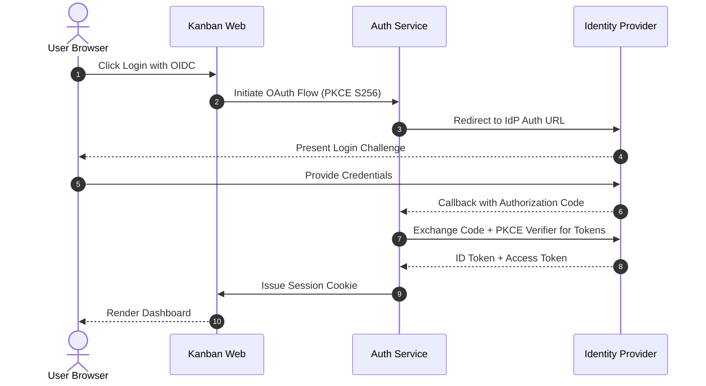

# Rough Auth Notes & Ideas

- Need to support multi-card authentication for enterprise users
- Local admin account must have break-glass access
- References: #KAN-101 and #KAN-102 for OAuth provider mappings

- Action item: implement WebAuthn Passkey registration
- Action item: configure TOTP backup generator
